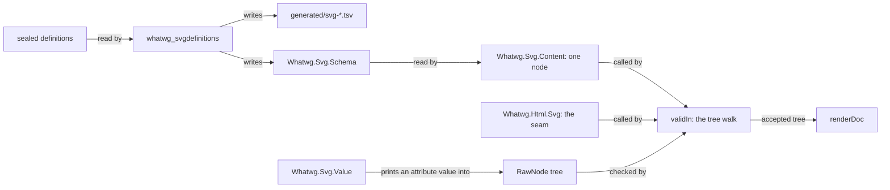

# Plan: `Whatwg.Svg`, inline SVG beside `Whatwg.Html`

Status: **S0 and S1 executed, 2026-10-11** (the ledger is §8). Slices S2 to S4 are designed here
and not built. Every ruling of §4 is a proposal until the owner rules.

This is the plan for inline SVG in the `whatwg` package. An HTML tree holds an SVG figure as
checked, first-order data. The assignment is `docs/research/2026-10-11-svg-seat-brief.md`. The
plan has the shape of `docs/HTML-PACKAGE-PLAN.md`. Its order is ruling R-S1 of `COORDINATION.md`:
design first, then land in slices. Facts were read at `html/svg` `e74dc0d`.

Three words are used in one meaning each:

- The **seam** is the set of rules by which an HTML tree holds SVG content.
- An **integration point** is an SVG element whose children are HTML content again.
- A **dangling name** is a name that a definition cites and no sealed definition declares.

## 0. What the consumer needs

lean4-effect4 builds a document as a `Whatwg.Html.RawNode` tree. `Whatwg.Html.Content.validIn`
checks the tree, and `Whatwg.Html.Print.renderDoc` writes it. Its module is
`tools/Tools/Document/Html.lean`, read at its commit `707b9a01`. Its pictures are SVG, written as
strings by `tools/Tools/View/Output.lean`. No content model checks those strings, and no reader
reads them.

| Need | What answers it | Slice |
| --- | --- | --- |
| `svg` inside a paragraph, a figure or a table cell | the seam admits `svg` where phrasing content stands | S3 |
| `svg`, `g`, `defs`, `rect`, `path`, `text`, `clipPath` | the schema, generated from the sealed definitions | S2, S3 |
| `class`, `style` and custom properties | the core attributes; CSS stays text | S3 |
| `data-key` on every mark, `data-look` on the root | `data-*` on every SVG element | S3 |
| `@keyframes` in a `style` element | the element's text, escaped when printed | S3 |
| `title`, `desc`, `role` and `aria-*` | the descriptive elements and the `aria` category | S3 |
| `d`, `viewBox`, `transform`, `points`, numbers, lengths | typed values with a printer, a checker and a reader | S4 |
| a refusal that names its node | a located refusal in the library | S3 |

The sealed definitions declare every element and attribute that `Output.lean` writes today,
apart from `xmlns` and `data-*`. This is a reading of the two sources. The battery of S3 makes
it a test.

The consumer writes its own refusal walk, `problem?`, in `tools/Tools/Document/Html.lean`. The
library gives `validIn` as a Boolean and no refusal. S3 moves that walk into the library.

## 1. Authority order

1. **The HTML Standard** at its pin (`vendor/whatwg-html-746f2ede/source`) owns the seam. It
   says where `svg` stands, where the namespace changes and how a foreign element is written.
2. **SVG 2** at `w3c/svgwg` commit `47e645ef` owns the SVG elements. It owns their categories,
   content models, attributes and value grammars.
3. **The definitions files** of that commit are the draft's machine-readable index. The chapter
   files are the same authority in prose. Where the two disagree, the projection records a row.
   No one repairs a sealed file or a projection.
4. **The CSS specifications** that SVG 2 cites own the `transform` value and the CSS number.
   None is pinned. S4 proposes the pin.
5. **Browsers and validators** give host observations under a named profile. They repair no
   statement.

The pinned draft is the Editor's Draft. Its `master/publish.xml` names the Candidate
Recommendation of 2026-06-04 as the published version. The published document has no
machine-readable definitions, so the pin is the repository commit.

## 2. The pin

`vendor/w3c-svgwg-47e645ef/` holds thirteen files of `w3c/svgwg` at commit
`47e645ef7cb61490e6975ddbcfa1997c9e972cc3` (2026-10-07). `docs/PROVENANCE.md` records the fetch
and the cross-check. `generated/vendor-manifest.tsv` holds each digest.

| File | Bytes | What the plan reads in it |
| --- | --- | --- |
| `master/definitions.xml` | 83,931 | 30 elements, 13 element categories, 8 attribute categories, 10 attributes |
| `master/definitions-filters.xml` | 20,896 | 26 filter elements |
| `master/definitions-masking.xml` | 3,090 | `mask` and `clipPath` |
| `master/definitions-compositing.xml` | 2,303 | terms only |
| `specs/animations/master/definitions.xml` | 7,488 | 5 animation elements and the category `animation` |
| `master/publish.xml` | 3,273 | the list of the five definitions files of SVG 2 |
| `master/struct.html` | 153,803 | the `data-*` rule and the ARIA role table |
| `master/paths.html` | 52,259 | the path data grammar |
| `master/shapes.html` | 37,360 | the `points` value |
| `master/coords.html` | 149,848 | the `viewBox` value; `transform` by reference to CSS |
| `master/types.html` | 140,699 | the attribute syntax notation |
| `LICENSE.md`, `README.md` | 152 and 999 | the licence pointer |

**The brief asked for `master/definitions*.xml`.** The pin holds nine more files, for three
reasons:

- `master/publish.xml` lists the definitions files of SVG 2. It names a fifth file, under
  `specs/animations/`. That file declares the category `animation`, which 20 content models cite.
- The definitions hold no value grammar. The grammars of S4 are in four chapter files.
- The `data-*` rule and the ARIA roles are in `master/struct.html` alone.

### 2.1 What the definitions hold

An XML read at pin time gave these counts. The evidence word is "tested": a PowerShell script
over the sealed bytes, not a gate. The gate of S2 recomputes each count.

| Kind | Count | Note |
| --- | --- | --- |
| `element` | 63 | 32 names hold an upper-case letter |
| `elementcategory` | 17 | each lists its member elements |
| `attributecategory` | 17 | `presentation` is declared twice, in two files |
| `attribute`, outside an element or a category | 14 | |
| `property` | 117 | the presentation attributes are a list of these names |

Each element states its content model by one of five kinds:

| Kind | Elements | Meaning in the definitions |
| --- | --- | --- |
| `anyof` | 50 | any number of the listed elements and of the listed categories' members |
| `any` | 4 | any elements or character data: `desc`, `title`, `metadata`, `foreignObject` |
| `text` | 2 | character data: `style`, `script` |
| `textoranyof` | 3 | character data and the listed elements: `text`, `tspan`, `textPath` |
| prose | 4 | a sentence: `a`, `feDiffuseLighting`, `feSpecularLighting`, `animateMotion` |

So the definitions hold what S2 and S3 need: element names, categories, content models and
attributes.

### 2.2 What the definitions get wrong or leave out

The same read found eight dangling names:

| Dangling name | Cited as | Cited by |
| --- | --- | --- |
| `altGlyphDef`, `color-profile`, `font`, `font-face` | element | `mask` |
| `document element event` | attribute category | 35 elements |
| `style` | attribute category | 21 elements |
| `externalResourcesRequired` | attribute | `clipPath`, `filter`, `feImage` |
| `transform` | attribute | `clipPath` |

Five things are in no definitions file:

- every value grammar (§5.3);
- the `data-*` attributes, which `master/struct.html` gives to every SVG element;
- the roles an element may take, also in `master/struct.html`;
- the `transform` value, which `master/coords.html` leaves to CSS Transforms;
- the CSS number, which the attribute syntax of `master/types.html` leaves to CSS.

### 2.3 Licence

`LICENSE.md` places every document of the repository under the W3C Document License. The 2023
version permits a derived work in software and in its documentation. Such a work carries a
notice: it names W3C as the copyright holder and names the source by title and address. Each
generated file of S2 carries that notice.

## 3. Target shape

```text
vendor/w3c-svgwg-47e645ef/         the sealed SVG 2 sources (S1)
WhatwgGates/SvgDefinitions.lean    the XML reader, the projection, its check (S2)
WhatwgGates/SvgDefinitionsEmit.lean  the schema modules' emitter (S2)
whatwgbin/SvgDefinitions.lean      the entry point of `whatwg_svgdefinitions` (S2)
generated/svg-*.tsv                the projection: elements, categories, attributes, dangling names (S2)
Whatwg/Svg.lean                    root of the library `WhatwgSvg`
Whatwg/Svg/
  Schema/    Definitions  Tags  Categories  Attributes  ContentModel   generated (S2)
  Schema/    Readings                                                   authored, digest-pinned (S2)
  Content/   Admission                                                  one node's judgments (S3)
  Value/     Decimal  PathData  Points  ViewBox  Transform  Length      typed values (S4)
Whatwg/Html/Svg.lean               the seam: where `svg` stands, the integration points (S3)
Whatwg/Html/Content/Valid.lean     `validIn` gains the SVG branch; the located refusal (S3)
Whatwg/Html/Print/Foreign.lean     the printer that carries the namespace (S3)
WhatwgTest/Svg/, WhatwgTest/Html/Svg*.lean   batteries
```

The diagram shows the data's route. It claims nothing: §6 lists each claim with its evidence.



**Dependency direction.** `Whatwg.Svg` imports no module of `Whatwg.Html`. The seam imports
`Whatwg.Svg`. A consumer imports `Whatwg.Html.Content.Valid` and `Whatwg.Html.Print.Render`, as
it does today.

## 4. Proposed rulings

| Id | Question | Proposed ruling |
| --- | --- | --- |
| SV-1 | authority | The order of §1. The HTML Standard owns the seam, and SVG 2 at `47e645ef` owns the elements. |
| SV-2 | schema source | The schema is generated from the five definitions files that the sealed `master/publish.xml` lists. No row is typed by hand. |
| SV-3 | dangling names | A dangling name is a row of `generated/svg-dangling.tsv`. A dangling element is admitted nowhere, and a dangling category is empty. The gate fails when the set of rows changes. |
| SV-4 | prose content models | Each of the four is an authored reading in `Whatwg/Svg/Schema/Readings.lean`, pinned to the digest of the entry it reads, as `Whatwg/Html/Schema/Readings.lean` pins its readings. |
| SV-5 | the tree | `RawNode` is unchanged. A node's namespace is an inherited attribute of its path. The checker and the printer carry it down. |
| SV-6 | layering | The library `WhatwgSvg` owns `Whatwg/Svg/` and imports nothing of `Whatwg.Html`. The tree walk stays in `Whatwg.Html`, in one mutual block. |
| SV-7 | where `svg` stands | `svg` stands where the context's base is built on flow or phrasing content. None of the fifteen exclusions the HTML schema carries names it. |
| SV-8 | integration points | The children of `foreignObject` are checked as flow content, and those of `title` as phrasing content. The HTML Standard says both. The children of `desc` are checked as flow content: this is the seat's reading. |
| SV-9 | exclusions | The exclusions of the HTML context pass through an SVG subtree. `<a><svg><foreignObject><a>` is refused. |
| SV-10 | MathML | `math` is refused with the reason "MathML is not modelled". No library is planned. |
| SV-11 | names | A tree holds each name as the serializer writes it. The checker compares names exactly, so `viewbox` is not `viewBox`. |
| SV-12 | `xmlns` | `xmlns` is admitted on an SVG element only with the SVG namespace as its value. `xmlns:xlink` is admitted only with the XLink namespace. |
| SV-13 | values before S4 | S3 admits an attribute by its name. Its value is unchecked text until S4 gives its grammar. |
| SV-14 | CSS | The `style` attribute, the `style` element's text and each presentation attribute's value are text. CSS is a foreign boundary. |
| SV-15 | roles | `role` takes any text in S3. The graphics roles belong to a specification that is not pinned. |
| SV-16 | located refusal | The library gives one refusal with a path and a reason. It is complete against `validIn`: the refusal is absent exactly when `validIn` is true. |
| SV-17 | the printer | In an SVG subtree no element is void and no text is raw. The printer returns to the HTML rules at an integration point. |
| SV-18 | numbers | A number is an exact decimal. No value of the library is a float. |
| SV-19 | reader and checker | For each value grammar, the checker is the domain of the reader. The reader accepts every spelling the grammar admits, and the printer writes one. |
| SV-20 | ceiling | `Whatwg.Svg` joins the strict prefixes at S2. A function that must traverse a `String` is an exact exception with its reason. S2 measures the residue first. |
| SV-21 | licence notice | Each generated file names its source and W3C's copyright (§2.3). |

## 5. Slices

| Slice | Work | Exit |
| --- | --- | --- |
| S0 | merge `origin/html-h7` into `html/svg` | done: ruling R-S2 of `COORDINATION.md` |
| S1 | this plan; the pin, sealed and cross-checked | `lake exe whatwg_vendorseal` passes; the rows of `docs/PROVENANCE.md` and `SPEC-MANIFEST.md` |
| S2 | the projection gate and the generated schema | the gate passes in both modes; the build and the gates of `AGENTS.md` pass; no theorem |
| S3 | the seam: the checker's SVG branch, the located refusal, the printer | the battery of §5.2 passes; the laws of §6 marked S3 are proved; every HTML battery passes unchanged |
| S4 | the value grammars | each grammar's two laws are proved; the battery replays the specification's own examples |

The seat stops after each slice with the handoff of `AGENTS.md`.

### 5.1 S2: the schema as data

The gate is `lake exe whatwg_svgdefinitions`, in the shape of `whatwg_htmlstandard`. It does five
things:

1. It refuses a sealed file whose digest is not the pinned one.
2. It reads `master/publish.xml` and takes the definitions files from it.
3. It reads each file with a total XML reader. The reader refuses a construct it does not know,
   with the byte offset.
4. It writes or checks four projections and the schema modules.
5. It fails on one byte of drift, and it names the first differing line.

The XML reader covers what the five files use: elements, attributes in either quote, comments,
character data and the five named character references. It has no `partial` function. Fuel
bounds each loop.

| Output | One row per | Columns |
| --- | --- | --- |
| `generated/svg-elements.tsv` | element | file, name, anchor, kind, categories, elements, attribute categories, geometry properties, attributes, own attributes, span digest |
| `generated/svg-categories.tsv` | element or attribute category | kind, file, name, members |
| `generated/svg-attributes.tsv` | attribute declaration | owner kind, owner, name, animatable, anchor |
| `generated/svg-dangling.tsv` | dangling name | name, cited as, cited by |

| Module | Holds |
| --- | --- |
| `Whatwg.Svg.Schema.Definitions` | the rows as data, as the standard's words |
| `Whatwg.Svg.Schema.Tags` | `Tag`, `Tag.all`, `Tag.name`, and `Tag.ofChars?` as a character decision tree |
| `Whatwg.Svg.Schema.Categories` | the element categories and each one's members |
| `Whatwg.Svg.Schema.Attributes` | `Attr`, `Attr.name`, `Attr.ofChars?`, and each tag's attribute set |
| `Whatwg.Svg.Schema.ContentModel` | each tag's kind, its admitted child tags as a resolved list, and whether it admits text |

The slice also adds the Lake library `WhatwgSvg` and the executable. It adds the library to
`Gates.DeclSnapshot.libraries`, which two battery rows pin: the seat amends both with a dated
comment, on the precedent of R-W17. The ledger claims the new modules by a leaf record, since a
passive finite alphabet closes with local receipts (`docs/AGENT-ROUTING.md`).

S2 states no theorem. The round trips of the name tables are laws of S3, which consumes them.

### 5.2 S3: the seam

**The checker.** `validIn` and `validAll` are one mutual block in
`Whatwg/Html/Content/Valid.lean`. The block gains two functions, `validSvg` and `validSvgAll`.
An element whose name is not an HTML element was refused. Now it is checked in one more case: its
name is `svg` and the context admits `svg`.

```lean
/-- A position inside an SVG subtree: the element whose content model is in force, whether an
`a` encloses the position, and the HTML exclusions inherited from outside the subtree. -/
structure SvgCtx where
  model : Whatwg.Svg.Schema.Tag
  inAnchor : Bool := false
  excl : Whatwg.Html.Schema.Exclusions := {}

def Ctx.admitsSvg (c : Ctx) : Bool            -- the HTML Standard's SVG section, first paragraph
def SvgCtx.integration (c : SvgCtx) (t : Whatwg.Svg.Schema.Tag) : Option Ctx  -- `foreignObject`, `desc`, `title`
def validSvg (c : SvgCtx) : RawNode → Bool    -- mutual with validIn, validAll, validSvgAll
```

The judgments of one node are in `Whatwg.Svg.Content.Admission` and take no tree:

```lean
def childOk (parent child : Tag) (inAnchor : Bool) : Bool   -- the content model, by its kind
def textOk (parent : Tag) : Bool                             -- `text`, `textoranyof`, `any`
def attrOk (t : Tag) (name value : List Char) : Bool         -- the name's admission; the value from S4
```

The generator of the HTML schema emits one more function, `Base.holdsPhrasing`. It is true of a
base whose reading names flow or phrasing content. `Ctx.admitsSvg` is that function at the
context's base. No hand table says where `svg` stands.

**The equations that bound the change.** Two equations say what the new branch touches:

- At a name the HTML schema knows, `validIn` equals the conjunction it equals today. The
  existing `validIn_element` keeps its statement.
- At a name that is neither an HTML element nor `svg`, `validIn` is false.

**The located refusal.** One function walks the tree and returns the first refusal:

```lean
structure Refusal where
  path : List Nat        -- child indices from the root
  reason : Reason        -- an inductive: not an element, not admitted here, an attribute, a sequence

def check (c : Ctx) (path : List Nat) : RawNode → Except Refusal Unit
def explain (c : Ctx) (n : RawNode) : Option Refusal
theorem explain_none_iff (c : Ctx) (n : RawNode) : explain c n = none ↔ validIn c n = true
```

`validIn` stays a Boolean function, because `html!` hands the kernel `Eq.refl true` and the
kernel evaluates it. So the refusal is a second walk, and `explain_none_iff` ties the two.

**The printer.** `Whatwg/Html/Print/Foreign.lean` holds a printer that takes the namespace:

```lean
inductive Mode where | html | svg
def renderIn : Mode → RawNode → List Char      -- mutual with its list and raw-text forms
theorem renderIn_html_eq {n : RawNode} (h : foreignFree n = true) : renderIn .html n = renderChars n
```

In `svg` mode every element prints a start tag, its children and an end tag. Text is escaped,
under a `style` or a `script` too. The mode returns to `html` under an integration point.
`render` and `renderDoc` become `renderIn .html`. The laws of the existing printer keep their
statements, and `renderIn_html_eq` carries them to every tree without `svg`.

**The names.** The HTML parser lower-cases a name and then restores it from three tables of the
sealed source. The battery checks two finite facts over the schema:

- each element name and each attribute name is restored: the tables send its lower-case form
  back to it;
- no SVG element name is in the list of start tags that end foreign content.

**The battery.** Each line is a reader, a control or a finite evaluation:

| Case | Kind | Expected |
| --- | --- | --- |
| `<p><svg>` | finite evaluation | admitted |
| `<svg><div>` | control | refused: `div` is not an SVG element |
| `<svg><foreignObject><div>` | finite evaluation | admitted |
| `<a><svg><foreignObject><a>` | control | refused by the inherited exclusion |
| `<svg><title><div>` | control | refused: `title` holds phrasing content |
| `<math>` | control | refused: MathML is not modelled |
| `<svg><style>a<b</style>` | finite evaluation | printed with `&lt;` |
| `<svg><rect>` with no child | finite evaluation | printed `<rect></rect>`, never void |
| `viewBox` and `xml:space` | finite evaluation | printed as written |
| the consumer's picture, built as a tree | finite evaluation | `validIn` is true, and the tree prints |
| `explain_none_iff` at a refused tree | reader | the refusal's path is the bad node's |

### 5.3 S4: the values

Each grammar is one module of `Whatwg/Svg/Value/` with the same five declarations:

```lean
structure Decimal where        -- an exact decimal: `mantissa × 10^(-places)`, in canonical form
def print : α → List Char      -- one spelling
def read : List Char → Option α  -- every spelling the grammar admits
def check (s : List Char) : Bool := (read s).isSome
theorem read_print (v : α) : read (print v) = some v
theorem check_print (v : α) : check (print v) = true
```

| Grammar | Source at the pin | Typed value |
| --- | --- | --- |
| number | the `number` production of the path data grammar | `Decimal` |
| path data, `d` | the grammar under `PathDataBNF` in `master/paths.html` | a list of commands, each with its arguments |
| `points` | `DataTypePoints` in `master/shapes.html` | a list of pairs |
| `viewBox` | `ViewBoxAttribute` in `master/coords.html` | four numbers |
| `transform` | CSS Transforms, by reference from `master/coords.html` | a list of transform functions |
| length | the attribute syntax of `master/types.html`, by reference to CSS | a number and a unit |

The module's `String` face is one function, `toString`, which is `String.ofList` of `print`.
Every law is stated over `List Char`.

**What the reader is.** The path data grammar admits many spellings of one value: `M 100-200`
and `M100,-200`. So `read` is not exact. It is exact modulo the normaliser `print ∘ read`, which
holds by `read_print`. The plan claims the retraction and no more.

**Open at S4.** Two sources are not pinned: CSS Transforms for `transform`, and the CSS number
and units for a length. S4 opens with that pin, or it restricts both grammars to what the sealed
SVG text states.

## 6. Anticipated proof graph

S2 is passive data and closes with a leaf record. S3 is an admission, so it opens a proof graph,
`SVG-PG-SEAM`, with its ten edges in the ledger. Each grammar of S4 is an exact representation
and closes with a leaf record of its two laws.

| Node | Statement | Kind | Planned evidence | Slice |
| --- | --- | --- | --- | --- |
| G1 | the projections and the schema modules equal a regeneration from the sealed bytes | drift gate | reproduced | S2 |
| N1 | `Tag.ofChars? t.name.toList = some t`, and the converse; the same for `Attr` | name round trip | proved, one `decide` per constructor | S3 |
| N2 | the parser's three tables restore every schema name | finite check | tested | S3 |
| N3 | no SVG element name ends foreign content | finite check | tested | S3 |
| C1 | `validIn` at an HTML element name unfolds as before | equation | proved | S3 |
| C2 | `validIn` at any other name but `svg` is false | equation | proved | S3 |
| C3 | `explain c n = none ↔ validIn c n = true` | located refusal | proved | S3 |
| C4 | a refusal's path names a node of the tree | located refusal | proved | S3 |
| P1 | `renderIn .html n = renderChars n` when `n` holds no `svg` | connector | proved | S3 |
| P2 | no delimiter character of a text node survives in `svg` mode | escaping | proved, from `escape_no_delim` | S3 |
| V1 | `read (print v) = some v`, for each grammar | retraction | proved | S4 |
| V2 | `check (print v) = true`, for each grammar | corollary of V1 | proved | S4 |
| V3 | `read s ≠ none` exactly when `s` matches the sealed grammar | agreement | open: stated, not planned as proved | S4 |

**What the graph does not establish.**

- No parser exists in this package (ruling HP-8). N2 and N3 are facts about names. They do not
  say that a printed tree parses back to the same tree.
- C1 and C2 bound the change to `validIn`. They do not say that the HTML checker is the
  standard's content model: that edge is the HTML package's, and it is open (debt D57).
- The content model of SVG is the definitions' index. A sentence of a chapter that narrows a
  model is not read, apart from the four of SV-4.
- V1 says that a printed value reads back. It does not say that a browser draws it as intended.
- V3 is open. Until it is proved, the reader's fidelity to the grammar rests on finite examples.
- CSS in a `style` element or attribute is never checked.

## 7. Open decisions for the owner

1. **The nine extra files of the pin** (§2). The brief named the definitions alone.
2. **SV-8, `desc`.** The HTML Standard narrows `foreignObject` and `title` and says nothing of
   `desc`. The plan reads its children as flow content.
3. **SV-20, the strict ceiling for `Whatwg.Svg`.** It costs exact exceptions at each `String`
   crossing. `Whatwg.Html` is not strict.
4. **The CSS pin of S4** (§5.3): pin CSS Transforms and CSS Values, or restrict the two grammars.
5. **The slice after S4.** lean4-effect4 moves its pin to this branch and builds its pictures as
   trees. That work is in its repository.

## 8. Ledger

| Slice | Commit | Result |
| --- | --- | --- |
| S0 | `e74dc0d` on `html/svg`, 2026-10-11 | `origin/html-h7` merged; the record is ruling R-S2 of `COORDINATION.md` and the last ledger row of `docs/HTML-PACKAGE-PLAN.md` |
| S1 | the commit that adds this file, 2026-10-11 | the pin `vendor/w3c-svgwg-47e645ef/`, thirteen files; every file matches its upstream blob hash; `lake exe whatwg_vendorseal` passes; the seal's digests equal those of `Get-FileHash`; this plan |
