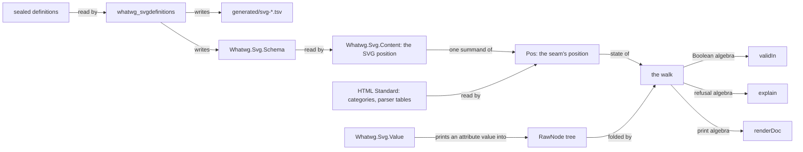

# Plan: `Whatwg.Svg`, inline SVG beside `Whatwg.Html`

Status: **S0, S1 and S2 executed, 2026-10-11** (the ledger is §8). Slices S3 and S4 are designed
here and not built. The owner adopted the seat's review on 2026-10-11. §3.1 holds its model, §4
its rulings, and §7 the owner's decisions.

This is the plan for inline SVG in the `whatwg` package. An HTML tree holds an SVG figure as
checked, first-order data. The assignment is `docs/research/2026-10-11-svg-seat-brief.md`. The
plan has the shape of `docs/HTML-PACKAGE-PLAN.md`. Its order is ruling R-S1 of `COORDINATION.md`:
design first, then land in slices. Facts were read at `html/svg` `e74dc0d`.

Three words are used in one meaning each:

- The **seam** is the set of rules by which an HTML tree holds SVG content.
- An **integration point** is an SVG element whose children are HTML content again.
- A **dangling name** is a name that a definition cites and no sealed definition declares.

## 0. What the consumer needs

lean4-effect4 builds a document as a `Whatwg.Html.RawNode` tree. `Whatwg.Html.Content.validIn`
checks the tree, and `Whatwg.Html.Print.renderDoc` writes it. Its module is
`tools/Tools/Document/Html.lean`, read at its commit `707b9a01`. Its pictures are SVG, written as
strings by `tools/Tools/View/Output.lean`. No content model checks those strings, and no reader
reads them.

| Need | What answers it | Slice |
| --- | --- | --- |
| `svg` inside a paragraph, a figure or a table cell | `svg` is a foreign tag of the HTML schema, admitted where its categories stand | S3 |
| `svg`, `g`, `defs`, `rect`, `path`, `text`, `clipPath` | the schema, generated from the sealed definitions | S2, S3 |
| `class`, `style` and custom properties | the core attributes; CSS stays text | S3 |
| `data-key` on every mark, `data-look` on the root | `data-*` on every SVG element | S3 |
| `@keyframes` in a `style` element | the element's text, escaped when printed | S3 |
| `title`, `desc`, `role` and `aria-*` | the descriptive elements and the `aria` category | S3 |
| `d`, `viewBox`, `transform`, `points`, numbers, lengths | typed values with a printer, a checker and a reader | S4 |
| a picture built from computed numbers, with no value to check at run time | the typed node `SvgNode`: an attribute holds a value of its type, and one law gives the values of every typed tree | S5 |
| a refusal that names its node | a located refusal in the library | S3 |

The sealed definitions declare every element and attribute that `Output.lean` writes today,
apart from `xmlns` and `data-*`. This is a reading of the two sources. The battery of S3 makes
it a test.

The consumer writes its own refusal walk, `problem?`, in `tools/Tools/Document/Html.lean`. The
library gives `validIn` as a Boolean and no refusal. S3 moves that walk into the library.

## 1. Authority order

1. **The HTML Standard** at its pin (`vendor/whatwg-html-746f2ede/source`) owns the seam. It
   says where `svg` stands, where the namespace changes and how a foreign element is written.
2. **SVG 2** at `w3c/svgwg` commit `47e645ef` owns the SVG elements. It owns their categories,
   content models, attributes and value grammars.
3. **The definitions files** of that commit are the draft's machine-readable index. The chapter
   files are the same authority in prose. Where the two disagree, the projection records a row.
   No one repairs a sealed file or a projection.
4. **CSS Transforms 1** owns the `transform` value, which SVG 2 cites. It is pinned at
   `w3c/csswg-drafts` commit `50337328` (SV-26, §2.4). No other CSS specification is an
   authority of this package.
5. **Browsers and validators** give host observations under a named profile. They repair no
   statement.

The pinned draft is the Editor's Draft. Its `master/publish.xml` names the Candidate
Recommendation of 2026-06-04 as the published version. The published document has no
machine-readable definitions, so the pin is the repository commit.

## 2. The pin

`vendor/w3c-svgwg-47e645ef/` holds fourteen files of `w3c/svgwg` at commit
`47e645ef7cb61490e6975ddbcfa1997c9e972cc3` (2026-10-07). `docs/PROVENANCE.md` records the fetch
and the cross-check. `generated/vendor-manifest.tsv` holds each digest.

| File | Bytes | What the plan reads in it |
| --- | --- | --- |
| `master/definitions.xml` | 83,931 | 30 elements, 13 element categories, 8 attribute categories, 10 attributes |
| `master/definitions-filters.xml` | 20,896 | 26 filter elements |
| `master/definitions-masking.xml` | 3,090 | `mask` and `clipPath` |
| `master/definitions-compositing.xml` | 2,303 | terms only |
| `specs/animations/master/definitions.xml` | 7,488 | 5 animation elements and the category `animation` |
| `master/publish.xml` | 3,273 | the list of the five definitions files of SVG 2 |
| `master/struct.html` | 153,803 | the `data-*` rule and the ARIA role table |
| `master/paths.html` | 52,259 | the path data grammar |
| `master/shapes.html` | 37,360 | the `points` value |
| `master/coords.html` | 149,848 | the `viewBox` value; `transform` by reference to CSS |
| `master/types.html` | 140,699 | the attribute syntax notation, and the kinds of a length |
| `master/geometry.html` | 17,517 | the values of the geometry properties (sealed at slice S5) |
| `LICENSE.md`, `README.md` | 152 and 999 | the licence pointer |

**The brief asked for `master/definitions*.xml`.** The pin holds ten more files, for four
reasons:

- `master/publish.xml` lists the definitions files of SVG 2. It names a fifth file, under
  `specs/animations/`. That file declares the category `animation`, which 20 content models cite.
- The definitions hold no value grammar. The grammars of S4 are in four chapter files.
- The `data-*` rule and the ARIA roles are in `master/struct.html` alone.
- The values of `x`, `y`, `width`, `height`, `cx`, `cy`, `r`, `rx` and `ry` are in
  `master/geometry.html` alone. The owner asked for that file at slice S5, and it is from the
  same commit as the rest.

### 2.1 What the definitions hold

`lake exe whatwg_svgdefinitions` prints these counts, and the projections under `generated/`
hold the rows. The evidence word is "reproduced": the gate recomputes them from the sealed
bytes at every run.

| Kind | Count | Note |
| --- | --- | --- |
| `element` | 63 | 32 names hold an upper-case letter |
| `elementcategory` | 17 | each lists its member elements |
| `attributecategory` | 17 | 16 categories: `presentation` is declared twice, in two files |
| `attribute`, outside an element or a category | 14 | three list elements that do not cite them |
| `property` | 117 | the presentation attributes are a list of these names |
| attribute names in the schema | 321 | a name may take different values on different elements |

Each element states its content model by one of five kinds:

| Kind | Elements | Meaning in the definitions |
| --- | --- | --- |
| `anyof` | 50 | any number of the listed elements and of the listed categories' members |
| `any` | 4 | any elements or character data: `desc`, `title`, `metadata`, `foreignObject` |
| `text` | 2 | character data: `style`, `script` |
| `textoranyof` | 3 | character data and the listed elements: `text`, `tspan`, `textPath` |
| prose | 4 | a sentence: `a`, `feDiffuseLighting`, `feSpecularLighting`, `animateMotion` |

So the definitions hold what S2 and S3 need: element names, categories, content models and
attributes.

### 2.2 What the definitions get wrong or leave out

The gate finds ten dangling names, and `generated/svg-dangling.tsv` lists each with its citers:

| Dangling name | Cited as | Cited by |
| --- | --- | --- |
| `altGlyphDef`, `color-profile`, `font`, `font-face` | element | `mask` |
| `document element event` | attribute category | 34 elements |
| `style` | attribute category | 20 elements |
| `externalResourcesRequired` | attribute | `clipPath`, `filter`, `feImage` |
| `transform` | attribute | `clipPath` |
| `color-profile`, `kerning` | property | the second `presentation` entry |

`transform` dangles only as a cited attribute. The first `presentation` entry lists it as a
presentation attribute, so `clipPath` has it through that category.

Five things are in no definitions file:

- every value grammar (§5.3);
- the `data-*` attributes, which `master/struct.html` gives to every SVG element;
- the roles an element may take, also in `master/struct.html`;
- the `transform` value, which `master/coords.html` leaves to CSS Transforms;
- the CSS number, which the attribute syntax of `master/types.html` leaves to CSS.

### 2.3 Licence

`LICENSE.md` places every document of the repository under the W3C Document License. The 2023
version permits a derived work in software and in its documentation. Such a work carries a
notice: it names W3C as the copyright holder and names the source by title and address. Each
generated file of S2 carries that notice.

### 2.4 The CSS pin

`vendor/w3c-csswg-drafts-50337328/` holds three files of `w3c/csswg-drafts` at commit
`50337328484f7fcdd9ab6fe9ded6011815b1707e` (2026-10-10), the head of `main` at pin time:
`css-transforms-1/Overview.bs` (73,009 bytes), `LICENSE.md` and `README.markdown`. Slice S4c
sealed it (SV-26). `docs/PROVENANCE.md` records the fetch, the cross-check and the licence.
Since slice K0 of `docs/CSS-PACKAGE-PLAN.md` (2026-10-12) the tree also holds ten more modules of the same
commit, for `Whatwg.Css`; `Whatwg.Svg` reads none of them.

The package reads one section of the source: "Syntax of the SVG transform attribute", with the
anchor `svg-syntax`. Its grammar is a list of productions, each under an id that opens with
`svg-`. Three facts of that section shape slice S4c:

- The section says that the three attributes `transform`, `patternTransform` and
  `gradientTransform` take this syntax, and not the syntax of the CSS property.
- Its `wsp` is four characters, stated in prose: U+0009, U+000A, U+000D and U+0020. The `wsp`
  of path data has a fifth, U+000C. The section's railroad diagrams are informative by its own
  statement, and the diagram of `wsp` lists another set.
- It defines no production `number`. It points at `<number-token>` of CSS Syntax 3, which is
  not sealed. SV-26 rules that a number is SVG's own production. The section's own example
  `translate(-10, 20)` carries a sign, so the production is `coordinate`, which is
  `sign? number` (SV-29).

The licence is not the one of the SVG pin: `LICENSE.md` names the W3C Software and Document
License. A derived work states what it took, so the grammar module of S4c carries that
statement.

## 3. Target shape

```text
vendor/w3c-svgwg-47e645ef/           the sealed SVG 2 sources (S1)
WhatwgGates/Xml.lean                 a total reader of the XML subset the sealed files use (S2)
WhatwgGates/SvgDefinitions.lean      the rows, the four projections, the drift check (S2)
WhatwgGates/SvgDefinitionsEmit.lean  the schema's resolution and the modules' emitter (S2, S3a)
WhatwgGates/EmitLean.lean            the Lean spelling that the HTML and SVG emitters share (S2)
whatwgbin/SvgDefinitions.lean        the entry point of `whatwg_svgdefinitions` (S2)
generated/svg-*.tsv                  the projection: elements, categories, attributes, dangling names (S2)
Whatwg/Svg.lean                      root of the library `WhatwgSvg`
Whatwg/Svg/
  Data/      Universe  Mask  NameTable                    a finite universe, a set as a mask, a name table (S3a)
  Schema/    Tags  Categories  Attributes  ContentModel   generated (S2; masks since S3a)
  Schema/    Readings                                     authored, digest-pinned (S2)
  Schema/    Universe                                     authored: the instances and the tables' laws (S3a)
  Content/   Context                                      the SVG position, its transition, one node's judgments (S3a)
  Value/     Grammar  Decimal  PathData  Points  ViewBox  Transform    (S4)
Whatwg/Html/Schema/Foreign.lean      generated: the parser's tables for foreign content (S3b)
Whatwg/Html/Node/Walk.lean           the walk and its two laws (S3b)
Whatwg/Html/Svg.lean                 the seam: `Ns`, `Pos`, the integration points (S3b)
Whatwg/Html/Content/Valid.lean       the Boolean algebra and `validIn` (S3b)
Whatwg/Html/Content/Explain.lean     the refusal algebra and `explain` (S3c)
Whatwg/Html/Print/Render.lean        the print state, the decoder, the round trip (S3d)
WhatwgTest/Svg/, WhatwgTest/Html/Svg*.lean   batteries
```

The diagram shows the data's route. It claims nothing: §6 lists each claim with its evidence.



**Dependency direction.** `Whatwg.Svg` imports no module of `Whatwg.Html`. The seam imports
`Whatwg.Svg`. A consumer imports `Whatwg.Html.Content.Valid` and `Whatwg.Html.Print.Render`, as
it does today.

### 3.1 The model

The owner adopted the review `docs/research/2026-10-11-svg-seat-review.md` on 2026-10-11
(ruling R-S6 of `COORDINATION.md`). Its points T1 to T9 are the model of this package, and its
points M1 to M8 are the rules of the meta level. The packet
`docs/research/2026-10-11-svg-theory/README.md` cites each source from its page. This section
states each point as the plan builds it. Where the review left a choice, the seat's choice is
marked **Seat**.

**T1. Validation is one top-down pass.** A `RawNode` is an unranked ordered tree. The checker
reads it once, from the root:

- a state is a position: what may stand there;
- the transition takes a position and an element's name to the position of its children;
- acceptance at a node is a local test of the position, the name, the attributes and the
  children's names.

A child's position is a function of its parent's position and its own name. So the grammar is
single-type, in the sense of Murata, Lee, Mani and Kawaguchi, and one top-down pass validates
it without backtracking. The seam of HTML and SVG is a new grammar of that kind. It is
single-type because `Pos.child` is a function, and no closure theorem gives it. The reachable
positions are finite, and the plan claims no bound on their number.

**T2. The namespace is a component of the state.** The seam's position is a sum:

```lean
inductive Pos where
  | html (c : Whatwg.Html.Content.Ctx)
  | svg (c : Whatwg.Svg.Content.Ctx) (excl : Whatwg.Html.Schema.Exclusions)
```

The HTML Standard's tree construction has its own automaton on namespaces. The seam writes it
once, from the sealed `source`:

```lean
inductive Ns where | html | svg
def Ns.step : Ns → String → Ns
theorem Pos.child_ns (p : Pos) (name : String) : (p.child name).ns = p.ns.step name
```

The checker's state is `Pos` and the printer's state holds `Ns`. Both factor through `Ns.step`,
so they cannot disagree about a node's namespace.

**Seat.** `Pos.svg` carries the HTML exclusions (SV-9). An integration point hands them back to
the HTML position below it. `Ns` has two values: `math` is refused (SV-10), so no valid tree
reaches MathML.

**T3. An SVG content model is a set of tags with a text bit.** The kinds of the definitions
spell points of that Boolean algebra:

- `anyof` is the union of the listed elements and of each listed category's members;
- `any` is every element of the schema, with the text bit;
- `text` is the text bit alone;
- `textoranyof` is `anyof` with the text bit.

The generator computes the resolution, and the library holds its value. A dangling name
resolves to the empty set (SV-3).

The SVG `a` element is transparent. Its sealed sentence reads: "Descriptive content, plus any
element or text allowed by its parent's content model, except for another a element. If the
parent is a switch element, use the content model of the nearest ancestor that isn't a switch."
So the SVG grammar is not local, and the position holds two models:

```lean
/-- What may stand at a position: the admitted elements, and whether character data may. -/
structure Content where
  tags : Mask Tag
  text : Bool

/-- A position in an SVG subtree. `model` is what the children of the position's element may
be. `outer` is the model in force at the nearest ancestor-or-self that is not a `switch`. -/
structure Ctx where
  model : Content
  outer : Content
```

**Seat.** Two components suffice. Let an `a` stand at a position. If its parent is not a
`switch`, the parent's model is `outer`. If its parent is a `switch`, the model of the nearest
ancestor that is not a `switch` is `outer` again. So `a` inherits `outer` in both cases.

**Seat.** "Except for another a element" removes `a` from the model of that `a`. It is not a
descendant exclusion: the sentence speaks of the content model, and the model of a `g` inside
the `a` lists `a`. So `<a><g><a>` is admitted and `<a><a>` is refused. The SVG position carries
no exclusion set of its own.

Two readings count. `feDiffuseLighting` and `feSpecularLighting` take exactly one light source,
and `animateMotion` takes at most one `mpath`, in any order. So a model also holds count
intervals, each over a set of tags. Its test reads only the multiset of the children's tags.

The HTML exclusions only grow along a path, and the admission of a tag is antitone in them. Both laws are
stated over `Pos`, for both namespaces.

**T4. A finite set over a generated universe is a mask over that universe.** Every finite set of the schema is a
subset of a generated enumeration. It is a `Nat` whose bit `i` is the value of index `i`:

```lean
/-- A finite universe: `all` lists every value at its index. -/
class Universe (α : Type) where
  all : List α
  index : α → Nat
  all_index : ∀ a, all[index a]? = some a

structure Mask (α : Type) where
  bits : Nat

def Mask.mem [Universe α] (m : Mask α) (a : α) : Bool := m.bits.testBit (Universe.index a)
```

Union is `|||`, intersection is `&&&`, and each law of membership is a core lemma
(`Nat.testBit_or`, `Nat.testBit_and`, `Nat.testBit_xor`). The kernel evaluates `|||`, `&&&`
and the shifts natively on literals, and `Nat.testBit` unfolds to a shift and an `&&&`. So one
definition is the specification and the fast test, and a tactic reads a mask back as one
literal. `Nat` has no complement. A difference is written with `^^^`, and the top of a universe is
`ofList all`. No law needs two masks with the same members to be equal. The index is Lean's own `ctorIdx`. The seat measured at the
toolchain `v4.33.1` that these lemmas and an instance by `cases a <;> rfl` stay under the
strict ceiling.

**T5. One walk, several algebras.** The checker, the located refusal and the printer are folds
over `RawNode` with one inherited attribute. The walk is written once. An algebra also sees the
raw children, because a sequence test reads their names:

```lean
/-- A top-down walk: a state, its transition, and what each node makes of its children. -/
structure Walk (S R : Type) where
  step : S → String → S
  element : S → String → List (String × String) → List RawNode → List R → R
  leaf : S → RawNode → R

def Walk.run (w : Walk S R) (s : S) : RawNode → R       -- mutual with `runAll`, structural
def Walk.runAll (w : Walk S R) (s : S) : List RawNode → List R
```

Two laws are proved once, by induction on `RawNode`:

- **W1, fusion.** If `h` commutes with the node maps of `A` and `B`, and their transitions are
  equal, then `h (A.run s n) = B.run s n`.
- **W2, state homomorphism.** If `f : S → S'` commutes with the transitions, and the node maps
  factor through `f`, then `A.run s n = B.run (f s) n`.

`explain_none_iff` is W1 at `Option.isNone`. The namespace agreement of T2 is the hypothesis of
W2 at `Pos.ns`.

**T6. A name table is an exact embedding.** A table is a writer `chars : α → List Char` and a
reader. The reader is built generically:

```lean
/-- A name table: each value's spelling, and a guess of the value that a spelling names. -/
structure NameTable (α : Type) where
  chars : α → List Char
  guess : List Char → Option α

/-- The value that a spelling names: the guess, kept only if it spells the input. -/
def NameTable.read (n : NameTable α) (s : List Char) : Option α
theorem NameTable.read_exact : n.read s = some a → n.chars a = s
theorem NameTable.read_chars (h : ∀ a, n.guess (n.chars a) = some a) (a : α) :
    n.read (n.chars a) = some a
```

**Seat.** The generated decision tree is the guess, and `read` checks its answer. So the
exactness holds by construction, for any guess, and it is proved once for every table. The
retraction needs one premise per table. One `decide` over the census discharges it. No proof
splits over a generated match. This is rule M1 at object level: the generated code proposes, and
a checked function decides.

Case restoration is an exact embedding modulo a normaliser. For every schema name `n`, the
parser's table sends the lower-case form of `n` back to `n`.

**T7. The printer is an exact embedding on well-formed trees.** The HTML package proves
`decode_render` and `render_injective_of_wf`. S3 keeps that strength. `wf` and the decoder take
the print state. In SVG no element is void and no text is raw. `decode_render` is proved for
trees that hold SVG.

**T8. Every value grammar of S4 is regular.** Path data, `points`, `viewBox`, the number and
the `transform` list nest no production. So S4 is one library and a transcription per grammar
(§5.3).

**T9. The schema projection is a function of sealed bytes.** The drift gate is its evidence.
A list attribute is split on commas and trimmed, because a category name holds a space. The
reader normalises an attribute value as XML 1.0 section 3.3.3 says.

### 3.2 What the theory packet corrects

The research partner read each source that the review cites. Its packet is
`docs/research/2026-10-11-svg-theory/README.md`. It contradicts or weakens the review at these
points, and the plan reads each one as the sources state it:

| Point | What the sources say | What the plan does |
| --- | --- | --- |
| T1, the name | The checker is no "top-down deterministic hedge automaton" of the cited texts. It is a single-type grammar, validated in one top-down pass. | §3.1 uses that name. |
| T1, composition | The cited closure is under intersection. A sum of states is no closure result. | The seam is built by hand, and its law T2 is proved here. |
| T1, enumeration | The states are finite, with an exponential bound once exclusions are in the state. | No proof enumerates the reachable positions. |
| T3 | Only the test at one node is the paper's count expression. The paper's schema is local, and this model is not. | The plan says "count intervals" and cites the paper for the node's test alone. |
| T4 | `Nat.testBit` is no kernel primitive, and `Nat` has no complement. | §3.1, T4, says what unfolds and what is native. |
| T5 | The cited theorem is for ranked parse trees. "Paramorphism" carries no law. | W1 and W2 are the seat's proofs, in `Whatwg/Html/Node/Walk.lean`. W1 has the premise of equal transitions. |
| T8 | No cited paper proves the retraction for free. Each proved round trip has an unambiguity premise. The retraction needs the reader to be complete on the printer's image. | `Syn.ok` is that premise (§5.3). A description is an inductive value, so it erases to its expression. |
| T8, the lexer | Verbatim's lexer recurses on an accessibility proof. | The reader recurses on the description and on fuel. |
| M4 | The kernel does unfold a definition by well-founded recursion. | The rule stands: recurse structurally. Its reason is the cost of the accessibility proof, which nobody here measured. |

The packet's two facts about the toolchain agree with what the seat measured. The index
function is `ctorIdx`, and Lean generates it for every inductive type.

## 4. Rulings

The owner ruled on 2026-10-11 (ruling R-S6 of `COORDINATION.md`). SV-8, SV-20 and SV-26 are the
owner's rulings. SV-22 to SV-25 are the review's, which the owner adopted. The rest are the
seat's proposals of S1, changed where §3.1 changes them.

| Id | Question | Ruling |
| --- | --- | --- |
| SV-1 | authority | The order of §1. The HTML Standard owns the seam, and SVG 2 at `47e645ef` owns the elements. |
| SV-2 | schema source | The schema is generated from the five definitions files that the sealed `master/publish.xml` lists. No row is typed by hand. |
| SV-3 | dangling names | A dangling name is a row of `generated/svg-dangling.tsv`. A dangling element is admitted nowhere, and a dangling category is empty. The gate fails when the set of rows changes. |
| SV-4 | prose content models | Each of the four is an authored reading in `Whatwg/Svg/Schema/Readings.lean`, pinned to the digest of the entry it reads. The reading of `a` is transparency with `switch` skipped (T3). It is not a fixed set. |
| SV-5 | the tree | `RawNode` is unchanged. A node's namespace is an inherited attribute of its path. The walk carries it down. |
| SV-6 | layering | The library `WhatwgSvg` owns `Whatwg/Svg/` and imports nothing of `Whatwg.Html`. The walk and the seam are in `Whatwg.Html`. |
| SV-7 | where `svg` stands | The HTML Standard's category lists name `SVG svg` and `MathML math` under flow, phrasing, embedded and palpable content. The HTML gate reads those items. The HTML `Tag` gains two foreign tags, which have no markup name, as `pcdata` has none. Admission of `svg` is the existing `admitsWith`, exclusions included. No hand table says where `svg` stands. |
| SV-8 | integration points | The children of `foreignObject` are checked as flow content, and those of `title` as phrasing content. The HTML Standard says both. The children of `desc` are checked as phrasing content too (owner ruling). A later ruling may widen this, and none narrows it. |
| SV-9 | exclusions | The exclusions of the HTML context pass through an SVG subtree. `<a><svg><foreignObject><a>` is refused. |
| SV-10 | MathML | `math` is refused with the reason "MathML is not modelled". No library is planned. |
| SV-11 | names | A tree holds each name as the serializer writes it. The checker compares names exactly, so `viewbox` is not `viewBox`. |
| SV-12 | `xmlns` | `xmlns` is admitted on an SVG element only with the SVG namespace as its value. `xmlns:xlink` is admitted only with the XLink namespace. The rule is the HTML Standard's, so it is in the seam. |
| SV-13 | values before S4 | S3 admits an attribute by its name. Its value is unchecked text until S4 gives its grammar. Since S4 the table of SV-32 gives a kind to ten names, and SV-30 says where a value is judged. |
| SV-14 | CSS | The `style` attribute, the `style` element's text and each presentation attribute's value are text. CSS is a foreign boundary. |
| SV-15 | roles | `role` takes any text in S3. The graphics roles belong to a specification that is not pinned. |
| SV-16 | located refusal | The library gives one refusal with a path and a reason. It is complete against `validIn`: the refusal is absent exactly when `validIn` is true. |
| SV-17 | the printer | In an SVG subtree no element is void and no text is raw. The printer returns to the HTML rules below an integration point. |
| SV-18 | numbers | A number is an exact decimal. No value of the library is a float. |
| SV-19 | reader and checker | For each value grammar, the checker is the domain of the reader. The reader accepts every spelling the grammar admits, and the printer writes one. |
| SV-20 | ceiling | `Whatwg.Svg` is a strict prefix from its first module (owner ruling). A function that must traverse a `String` is an exact exception with its reason. None exists: a lookup reads a `List Char`, and the seam converts. |
| SV-21 | licence notice | Each generated file names its source and W3C's copyright (§2.3). |
| SV-22 | finite sets | Every finite set of the schema is a mask over its universe (T4). |
| SV-23 | traversals | The checker, the refusal and the printer are algebras of one walk (T5). |
| SV-24 | name tables | A name table is an exact embedding built generically (T6). |
| SV-25 | value grammars | A value grammar is a regular expression as data. One invertible description reads and prints it (T8). |
| SV-26 | the CSS pin | `w3c/csswg-drafts` is pinned at one commit, and only the CSS Transforms 1 source is sealed. A number is SVG's own `number` production. No CSS Values file is pinned. A length takes only what the sealed SVG text states (owner ruling). Amended 2026-10-12 by ruling CS-1 of `docs/CSS-PACKAGE-PLAN.md`, on the owner's word: ten more modules of the same commit are sealed for `Whatwg.Css`. What `Whatwg.Svg` takes from CSS does not change by that. |
| SV-27 | unknown names | An element whose name is in neither schema is refused at every position. This holds under `metadata` too, whose model is `any`: the checker knows no rule for the subtree. |
| SV-28 | the arc's rotation | The three leading arguments of `elliptical_arc_argument` are the production `number`, which has no sign. So the rotation of an arc is unsigned, like its radii, and `a25,25 -30 0,1 50,-25` is refused. The grammar of SVG 1.1 gave the rotation a sign; the sealed grammar does not, and no one repairs it (seat, S4b). |
| SV-29 | the number and the white space of `transform` | A number of the `transform` grammar is the production `coordinate` of path data, `sign? number`: SV-26 makes it SVG's own, and the sealed section's example carries a sign. Its white space is the four characters the section states, without U+000C (seat, S4c). |
| SV-30 | where a value is judged | `validIn` reads no SVG value. The judgment of values is `valuesOk`, a second algebra of the walk, with its own located refusal. The kernel cannot open a long `String` at a bearable cost (§5.3, as built), and every proof of `validIn` is an evaluation by the kernel. A typed value's text is admitted by a theorem, and `html!` runs a literal's grammar when it builds the tree (seat, S4b). Since S5 the route is the typed tree of SV-34: `html!` reads the literal into a typed value, and the judgment of every typed tree is one law. |
| SV-31 | the length | A length is a number of SVG's own production with one of the ten kinds that the unit table of `SVGLength` names in the sealed `master/types.html`: no unit, a percentage, and `em`, `ex`, `px`, `cm`, `mm`, `in`, `pt` and `pc`. A unit is read in either case, as the sealed annotation on property values says, and white space is read at both ends. Another unit of CSS, a `calc()` expression, a CSS comment and a CSS escape are refused. SVG admits them by reference to CSS Values and CSS Syntax, which are not sealed (SV-26). So the check of a length refuses some values that SVG admits, and it admits none that SVG refuses by its grammar (seat, S4d). |
| SV-32 | which attribute has which kind | One table gives the kind of a value from the element and the attribute. A name that has one grammar wherever it stands has its kind on any element: `d`, `points`, `viewBox` and the three transform attributes. `x1`, `y1`, `x2` and `y2` are lengths on `line` alone: the sealed table of `line` states their value, and their definition on `linearGradient` is in a chapter that is not sealed. At S4d the geometry properties had no kind, because `geometry.html` was not sealed; SV-35 gives them theirs (seat, S4d). |
| SV-33 | the completeness of the reader | The chapter's rule is that a production consumes as much as it can. `Greedy` states it as a relation: the meaning of a description as a parsing expression, with an ordered choice and a greedy repetition. V3b is `Greedy g s o ↔ g.read s = o`, so the reader is the rule's decision procedure and `check` decides the rule's language. The language of the bare expression is larger, and V3a is the link to it. The two agree for a description that passes `Syn.deterministic`, which is `Syn.ok` over the sets the reader reads: node V3c. A description that reads `comma_wsp?` between two numbers fails that test by design (seat, S4d, on the coordinator's notes: G2 of the second and section 4 of the third). |
| SV-34 | the typed node | An SVG subtree has a typed tree beside `RawNode`: `SvgNode`. Its element is a tag of the schema. Its attribute is an attribute of the schema with a value of `AttrValue t a`, which is the carrier of its kind where the table gives one and text otherwise; or a custom data attribute; or one of the two namespace declarations, whose values are fixed. `toRaw` writes the raw tree, and the raw tree of every typed tree passes `valuesOk` by one law that evaluates nothing (V7). So a value is right by its type, and `validIn` still judges the structure on the raw tree, where it reads names alone. The type of a value and the table are in `Whatwg.Svg`. The node is in the seam, because it holds the raw HTML content below an integration point and its law is about the seam's judgment. `RawNode` is unchanged. `html!` builds an SVG subtree as a typed tree: it reads a literal value once, at elaboration, and a spliced value has its carrier's type (seat, S5, on G4 of the coordinator's third note). |
| SV-35 | the geometry properties | The sealed `master/geometry.html` gives nine names a value on the elements it names. `cx` and `cy` on `circle` and `ellipse`, and `x` and `y` on `svg`, `rect`, `image` and `foreignObject`, are lengths. `r` on `circle` is a length that is not negative. `rx` and `ry` on `ellipse` and `rect`, and `width` and `height` on `svg`, `rect`, `image` and `foreignObject`, are `auto` or a length that is not negative. The chapter says that a negative value there is invalid and is treated as the initial value, with no error state. The check refuses it, as it refuses any value that is not of its grammar: a caller that wants the fallback reads the refusal. On any other element those names have no kind, and `x`, `y`, `dx` and `dy` of `text` are lists that `master/text.html` states, which is not sealed (seat, S5). |
| SV-36 | where the structure of a typed tree is judged | A typed tree holds each element as a tag and each attribute as a key, so its structure is judged by those: `SvgNode.okAt`, with `SvgAttr.allOk` one pass over the keys of an attribute list. The law `SvgNode.validAt_toRaw` says that the checker's verdict on the raw tree is `okAt`'s on the typed tree, at every position. `html!` proves an SVG subtree by it, and `Child.ofSvg` places a typed tree in the typed HTML tree. `okAt` reads text at three places only: the key of a custom data attribute, a raw subtree, and an element at an HTML position that is not `svg`, which the checker reads as an HTML name there. The test is a Boolean and no index of the tree's type: a tree with free values has it by one evaluation, and a tree with a free list of children by the test's equations. |
| SV-37 | a transcribed grammar against its chapter | The sealed `master/paths.html` states the grammar of path data as one EBNF block. The gate `lake exe whatwg_svggrammar` reads that block from the sealed bytes, turns `svg_path` and each production below it into a regular expression, and decides by derivatives that it has the language of the erased expression of the library's description. It is unverified code: its PASS is that procedure's verdict and no theorem, and it carries controls that must differ. It compares bare expressions. The reader's rule is V3b. No other sealed chapter states a grammar in that notation, so `points`, `viewBox`, `transform` and the length have no such gate. |
| SV-38 | a size from an integer | A size has no negative value (SV-35). `Magnitude.ofInt?` and `AutoExtent.ofInt?` answer `none` for a negative integer, and the library clamps nothing: a writer that wants zero writes `.ofNat v.toNat` and says so. A numeral is a size, `.attr .width 30`, as it is a length. |
| SV-39 | a superseded node is withdrawn | Node V5, the check of a typed value's text under two written names, served a caller who built a raw tree by hand. Since S5 a caller builds a typed tree, and `SvgAttr.valueOk_toPair` states the same fact at a typed attribute with no premise on names. V5 and its two helper equations are removed at S7, with the reason dated in ruling R-S21. |
| SV-40 | the XML serialization | DOM Parsing and Serialization owns it: the pinned HTML Standard names "XML serialization" and gives it to that document. `Whatwg/Html/Print/Xml.lean` writes it for a tree of this package, read as the DOM that the tree construction makes of it: an element below `svg` in the SVG namespace, any other in the HTML namespace, no element with a prefix, and the eleven names of "adjust foreign attributes" in their namespaces. The writer is the algorithm at such a DOM, by an argument that the module states step by step, and not by a transcription of the algorithm over a DOM. `Xml.ok` is the tree for which "require well-formed" throws nothing. The productions `Char` and `Name` are transcribed from XML 1.0, which was not sealed at slice S8 and is since slice S9 (SV-42). |
| SV-41 | the place of a text | The sealed `master/text.html` gives `x`, `y`, `dx` and `dy` of `text` and `tspan` one length or more, and `rotate` one number or more, each a list in the notation of CSS value definitions. Each is read as `<points>` is: an item, then further items each after `comma_wsp?`. `textLength` is a length, and its prose makes a negative one an error, so its kind is `extent`. The kinds stand on `text` and `tspan` alone: `textLength` of `textPath` has no table of its own in the chapter. |
| SV-42 | the productions of XML 1.0 | XML 1.0 (Fifth Edition) owns `Char`, `NameStartChar`, `NameChar` and `Name`, which the XML serialization cites. The document is sealed, and `Whatwg/Html/Print/Xml/Productions.lean` holds the four as Boolean functions, with no import. A character production is a set of code points, so its comparison can be total: the gate `lake exe whatwg_xmlproductions` reads the three from the sealed rows and compares each with its function at every code point from U+0000 to U+10FFFF. `Name` is one sequence and one repetition: the gate asks that its sealed body is `NameStartChar (NameChar)*`, and compares `isName` with that reading at short texts. The gate's verdict is no theorem. No other production of XML 1.0 is an authority here. |
| SV-43 | the geometry layer and its numbers | `Whatwg/Svg/Geometry/` computes with the typed values of `Whatwg/Svg/Value/`. It is under the ordinary axiom ceiling (ruling R-S25): it uses the arithmetic of Lean's core library and does not prove it again, on the owner's word. `Decimal` has an exact sum, difference and product (`Arith`), which are associative, commutative and distributive as equations of values, and respect `Same`; an order that reads the number and not the spelling (`Order`); and two rounded quotients, each to a stated number of places with a half going up. A sum keeps the places of its operands, so `0.5 + 0.5` is the value `1.0`; `trim` drops the zeros. `Convert` lets an integer or a `Decimal` stand where a `Length` or a list of one is expected. |
| SV-44 | what a path means for its point | The chapter Paths keeps two points while it reads commands: the current point and the initial point of the current subpath (`paths.html`, `PathDataGeneralInformation`, `TermInitialPoint`, `PathDataClosePathCommand`). `Cursor` is the pair, `Command.advance` one command, and `Path.cursor` a path, with its first `m` absolute. `Pen` builds a path call by call, and its current point is this meaning at the path it builds, and no field of its own (`Pen.cursor_path`). A review tested the meaning on seventeen texts against the chapter. No control point, radius or flag is read: the shape a path draws is not here. |
| SV-45 | curves are d3-shape's | The forms of a curve through a list of points are those of d3-shape, read from its source: `linear`, the steps, the bumps, `cardinal` with its tension, `catmullRom` as the cardinal of tension zero, and `basis`. Each draws the outline that the d3 curve of its name draws. The splines divide, so they take a number of places and round their control points; a point of the data is never rounded, so every form ends at its last point exactly (`Curve.run_through`), and an area is closed (`Shape.cursor_area`). On the way back an area exchanges `stepBefore` and `stepAfter`, as d3 does. `Shape.bumpX` and `bumpY` take a reach. Not here: a Catmull-Rom spline with a positive `alpha`, the monotone and the natural curve, and the closed variants. |
| SV-46 | what a transform does to a point | CSS Transforms 1 gives the matrix of each function and the order of a list (`Overview.bs`, `two-d-transform-functions`, `transformation-matrix-computation`): the matrices multiply from left to right, so the last function of a list meets the point first. `Transform.image?` and `TransformList.image?` are that, and `none` for a rotation or a skew, whose matrices hold a sine. `Matrix.apply_mul`, `TransformList.image?_append` and the laws of `PanZoom`, the view that is moved and scaled, are equations of values. |
| SV-47 | constructors, paint and the text of a picture | `Svg.rect`, `Svg.path`, `Svg.text` and ten more take the geometry of an element by position, typed, and a list of further attributes; each unfolds to `SvgNode.element`. `Svg.Frame` is the outer `svg`, with the law that its view box has the aspect ratio of its viewport. `Rgb` and `Paint` are typed arguments for `fill` and `stroke`, and the attribute stays a `String`: no sealed text states the grammar of a colour (SV-26). `SvgNode.render` and `renderXml?` are the two texts of a picture; the unchecked XML text is named `renderXmlUnchecked`. |
| SV-48 | a flat list of calls as a forest | `SvgNode.nest` makes a balanced forest of a list of marks, starts and ends, and `okAllAt_nest` says that it passes when each mark does and the wrapper keeps a passing list passing. `Svg.okAllAt_clipped` is the wrapper of a clipped group. `SvgAttr.allOk_of_sublist` says that an attribute list which passes still passes with attributes left out. A writer proves its marks and its wrapper and has every list of calls. |
| SV-49 | the name of a custom data attribute | The HTML Standard asks that the name is a valid attribute local name with no ASCII upper-case letter. The checker and the typed test read the second half alone until slice S10, so a key with a space or a quotation mark passed the structure test and was written as broken markup, or as a second attribute. `Content.dataNameChar` is the rule now: no ASCII white space, NUL, `/`, `=`, `>`, and none of `"`, `'` and `<`, which the syntax of a name in markup has not. The XML serialization asks more of a name, and `Print.Xml.ok` still judges that. |
| SV-50 | geometry computes in `Rat` | A typed value is a spelling: a `Decimal` has no quotient, `1.0` and `1` are two values, and `a + 0 = a` holds up to `Same` and not as an equation. Geometry needs the numbers, and it divides. So from slice S11 `Whatwg/Svg/Geometry/` computes in `Rat`, the rational numbers of Lean's core library: every operation is exact, an equation of two computations is an equation of values, and core's `grind` proves the algebra. `Decimal.toRat` is the number of a spelling. It is the meaning of the arithmetic and the order of SV-43: it takes `+`, `-` and `*` to those of `Rat`, two values are `Same` exactly when their numbers are equal, and `≤` is the order of the numbers (`Rational/Laws`). A number is rounded in one place, where it is written: `Decimal.ofRat` to the nearest decimal of a stated number of places, a half going up, and `ofRatDown` and `ofRatUp` for a box that must hold what it held. A number with no more places than are kept is written exactly, as an equation of values (`ofRat_div_pow`), so a program that counts in thousandths loses nothing at three places. This closes debt D109. |
| SV-51 | a cubic segment and its blossom | `Cubic` is one cubic Bézier segment, its four points. A straight segment and a quadratic are cubics exactly (`line`, `ofQuad`); an elliptical arc is not, and has no segment. The meaning function is `pointAt`. It and every part of a segment come from one function, the blossom: de Casteljau's three rounds of steps, each with a parameter of its own. `between_pointAt` is the law of subdivision, for every rational parameter: the point at `s` of the part from `a` to `b` is the point of the whole at `a + s (b - a)`. `upTo`, `after`, the junction of a split, the part of a part and the segment backwards are cases of it. A map of the plane that keeps steps takes a segment to the segment of the mapped points (`map_pointAt`); a move and a scaling are such maps. `velocity` is the derivative as a polynomial, with the chain rule for a part (`between_velocity`); that it is the derivative of analysis is a statement about real numbers and is not made. |
| SV-52 | a box, and the box that holds a segment | A box is convex (`Box.contains_lerp`), and a point of a segment is three rounds of steps between its four points. So the box of the four points holds the segment (`Cubic.contains_pointAt`), and the box of a part lies in the box of the whole (`Cubic.includes_between`): a bound that needs no root, and is as tight as is wanted by splitting. `Box.viewBox` rounds outwards. The least box of a segment takes the roots of the derivative and is not here. |
| SV-53 | segments into a path | `Pen.cubic` writes a segment with the shortest command that draws it: `H`, `V` or `L` for a segment that draws a straight line (`Cubic.isStraight`), and `C` for any other. A straight segment of no length as written writes nothing, and a segment that does not start where the pen is, as written, starts a subpath. The laws are stated against the cursor of SV-44: the pen is at the end of the segment as written, and a chain is one subpath. `Path.ofLoops` leaves a straight last segment back to the start to the closepath. `Whatwg/Html/Node/SvgDraw.lean` has the elements from exact geometry: `Svg.cubics`, `loops`, `curve`, `box`, `dot`, `segment` and `label`. |
| SV-54 | a curve is a list of segments, in d3's three ways | This amends SV-45. A curve through points is a list of `Cubic`, exact: the sixths and thirds of a spline are numbers and are not rounded, and a form holds no number of places. d3 has three curves for each form, and so has `Curve`: `cubics` from the first point to the last, `cubicsOpen` with the two ends as guides only, and `cubicsClosed` back to the first point. A spline is one rule for four points in a row (`cardinalSegment`, `basisSegment`, applied by `windows`), and the three ways differ only in what stands beyond the ends of the list (`reflected`, `doubled`, `wrapped`); a program with ends of its own applies `windows` to its own list. `bumpX` and `bumpY` take a reach. The laws: every form is a chain from the first point to the last; a cardinal spline passes through every point; a closed form ends where it starts; a curve through moved or scaled points is the curve, moved or scaled. Gone with S10's forms: `Curve.through`, `Curve.pair` as commands, `Pen.through`, and `Shape.bumpX` and `bumpY`, which are `Shape.link (.bumpX r)` and `(.bumpY r)`. `Shape.line` takes points of `Rat` and a number of places. |
| SV-55 | outlines | `Cubic.rect`, `roundRect`, `ring`, `ellipse` and `circle` are closed chains, clockwise as a screen shows them. A quarter turn is one cubic, `Cubic.corner`, within three parts in ten thousand of a circle at the default `kappa`. Each outline stays in its box, and the outline of a moved box is the outline, moved (`Outline/Laws`). |
| SV-56 | a root to a number of places | The square root of a rational number is seldom rational. `sqrtDown q n` is the greatest number of `n` places whose square is no more than `q`, by `Nat.sqrt` of core on a scaled integer, and core's two bounds are its two bounds. `Vec.norm`, `dist`, `unit` and `normal`, and `Cubic.normalAt` and `offsetAt`, are stated through it. A distance and a normal are the same for a moved figure (`Root/Laws`). |
| SV-57 | an affine map, exact | `Affine` is the six numbers of `matrix(…)` in `Rat` (`Whatwg/Svg/Geometry/Affine/Map.lean`). The identity moves no point as an equation, the product is associative, and a map whose determinant is not zero has an inverse (`inverse_apply`). A rotation is exact where its sine and cosine are rational: by quarter turns, and by `turn u`, the rotation whose half angle has the tangent `u`, which keeps every length (`normSq_turn`). An affine map keeps steps, so a segment under a map is the segment of the mapped points (`Cubic.transform_pointAt`). `Transform.affine?` and `TransformList.affine?` read a `transform` attribute in the order of CSS Transforms 1, and read `rotate` by a multiple of ninety degrees, which SV-46's reading in `Decimal` refuses. Where that reading has an image of a point, this one has the same, as numbers (`TransformList.toVec_image?`): this closes debt D108. `Affine.fit` is the map of a view box onto a viewport that the chapter Coordinate Systems computes for `preserveAspectRatio` (`coords.html`, the equivalent transform of an SVG viewport), with `none`, `meet` and `slice` and the three places along each axis; `fit_none_corner` says that `none` takes corner to corner. |
| SV-58 | Mathlib in a package of its own | The owner asked for a way to use Mathlib that does not touch the libraries, which must stay code that compiles to C and runs. `analysis/` is a Lake package of its own, `whatwg_analysis`, with its own lakefile, manifest and build tree. It requires Mathlib at `v4.33.1`, which pins Batteries and Aesop at the revisions this repository pins. Three rules keep the two apart (`analysis/README.md`): the library never names that package or Mathlib; that package holds statements and no programs; and the seam is a cast, from the `Rat` the geometry computes in to the real numbers. It compiles the library modules that its theorems import from the library's own sources (`srcDir = ".."`), so it writes nothing into the library's build tree. Its first theorems each close a line that a header of the geometry says it cannot claim: the velocity of a cubic is its derivative (`hasDerivAt_pointAt_x`), the computed root is within one unit of its last place below the real square root (`sqrtDown_le_sqrt`, `sqrt_lt_sqrtDown_succ`), and `Affine.turn u` is the rotation by `2 arctan u` (`apply_turn`). A fourth module closes two lines more: the box of a segment holds it at every real parameter from `0` to `1`, and four control values moved by `δ` at most move the curve by `δ` at most (`box_holds_x`, `bezier_near`), which bounds what the rounding of a written path can do. The package is outside the trust gates: no gate builds it, and no claim of the library depends on it. |
| SV-59 | d3's own tests as guards | The owner's word: run d3's tests, converted, and do not copy every detail of its code. `WhatwgTest/Svg/D3Shape.lean` is the curve tests of d3-shape at commit `a82254af`, under its ISC notice: one `#guard` for one assertion, with d3's call above it. Of the 237 assertions of `test/curve/`, 130 have a form in the kit and are converted. In 82 the kit's text is d3's. In 46 the outline is the same and the commands differ, each for a named reason: d3 writes a dot for one point and the kit writes nothing; d3 starts a closed spline at its second point; d3 writes a `C` where the four points are on one line and the kit an `L`; a step passes through its middle point. In 2, marked `DIFFERS`, the outline differs: the area of an open spline through three points is a line of no area in d3 and nothing in the kit. In all 130, every number that both write is the same at six places. The 107 that are left out have no form in the kit yet: the monotone, natural and bundle curves, a Catmull-Rom spline with a positive `alpha`, and a tension given as a string. A difference of this kind is recorded and is not a defect: the kit's design is its own, and d3 is the reference for behaviour. |
| SV-60 | a layer with no rational number | In core the definition `Rat.add` reaches `Classical.choice`, so a consumer that keeps its proofs to `propext` and `Quot.sound` can neither call the geometry nor cite a law of it. `Whatwg/Svg/Scene/` holds what such a consumer proves about a picture and needs no number for, under the strict ceiling (`WhatwgGates/TrustConfig.lean`). `Moves δ α` is a thing that moves by an amount, lawful by its two fields; a list, an optional value and a pair move with their parts. `Commutes f` says that `f` of a moved thing is `f` of the thing, moved, and three laws follow for every such `f`: a stored result stands for the computation at a moved input (`Commutes.stored`), a computation may be done at an origin and moved back (`from_origin`), and the law crosses a seam between two kinds of amount (`transport`). A consumer gives an instance for its own type and converts no data. `IVec` and `ICubic` are a point and a cubic segment of whole units. |
| SV-61 | the join by key | `join key old new` gives the three selections of d3: the new things that enter, the kept ones as pairs, the old ones that exit, for a key with a lawful equality test. Every new thing enters or updates and not both (`length_enter_add_update`), every old thing exits or a new one has its key (`join_old`), and with distinct keys a pair updates exactly when the two have one key (`mem_update_iff`). The definition and its first two laws are lean4-effect4's. |
| SV-62 | motion as data | A step is one picture and its tracks. `Easing` has the two forms that CSS writes exactly: `stops`, the `linear()` of CSS Easing Functions 2 with evenly spaced stops, and `cubic y1 y2`, which is `cubic-bezier(1/3, y1, 2/3, y2)`. With those abscissae the curve's `x` is the progress itself (`Easing.segment_pointAt` of `Whatwg/Svg/Geometry/Easing.lean`), so the eased progress is a polynomial and no equation is solved. A `Transition` is a delay, a duration and an easing, read as a CSS animation that fills both ways. A `Track` is a key, a `Change` (a shift, a size, a part revealed, an opacity, each from a start to an end) and a transition. Everything counts in whole thousandths, with one division that rounds down, so the layer is strict; `cubicAt_eq_floor`, `stopsAt_eq_floor` and `mix_eq_floor` say what each number is the floor of. The end law: a track whose transition is over stands at the end of its change (`Track.at_done`), and a motion held in its step is at rest at the step's end (`Motion.within_atRest`). `Motion.arrive` and `depart` are the tracks of a join, one for each thing of the new picture (`length_arrive`). |
| SV-63 | the seam of whole units | `Vec.ofGrid s` reads whole counts of `1 / s` as an exact point, and `toGrid` and `nearGrid` round back. A point of the grid comes back as itself, and rounding commutes with a move by a whole count (`toGrid_add_ofGrid`). So a law of the form "the figure of a moved input is the figure, moved" holds after the rounding, for every move by whole units: `Commutes.grid` states it for any computation on segments. `Vec.snap` ends a stage of a computation on the grid, within one unit of the exact stage. What does not cross: two stages that each round are not the rounding of the two exact stages. |
| SV-64 | smooth joints, and near curves | `Cubic.Smooth` is a chain in which each segment starts with the velocity the one before arrives with. Every cardinal spline of `Curve`, and every open or closed basis spline, is smooth (`smooth_windows`); a basis spline also keeps its bend across a joint. `Cubic.pointAt_near`: a box that holds the four differences of the control points holds the difference of two segments at every parameter from 0 to 1. So a written segment is within half a unit of the last place of the exact one along each axis (`written_near`, `line_near`), which states in the library the bound that debt D113 asked for at rational parameters. `chord_error` is how far a segment stands off its chord. |
| SV-65 | motion as CSS | `Whatwg/Html/Node/SvgMotion.lean` writes a motion as a `style` element of `@keyframes` rules and a `style` attribute on each thing: `translate` for a shift, `scale` for a size, `opacity`, and `stroke-dashoffset` under `pathLength` for a reveal. A filled outline has no dash, so `Svg.revealed` draws it through a mask whose line is revealed. `Motion.attrsAt` writes the poses of one moment with no animation. No grammar of CSS is sealed here, so the text is judged by no gate (debt D119). It was read by one browser: in Chrome 152 the five animations of a trial and the eleven of `workshop/MotionProbe.lean` parsed with their easings, delays and fills, and at every sampled moment each value was the kit's reading up to its rounding down, with one exception recorded as debt D120. |
| SV-66 | a stroke of varying width | SVG strokes a path with one width. `Stroke.stroke` is a line as a closed filled outline whose half-width on each side is a function of the length run: samples of the centre line with a direction and a running length, a side of points along the normals, and a smooth path through each side (`Curve.through`, the cardinal spline with each end twice, with the laws of the other curves). `Stroke.organic` is a half-width that wanders by value noise (`Noise`) inside a proved band and fades at the ends. Every stroke is closed, and the stroke of a moved line is the stroke, moved, also when its side points end a stage on a grid and the move is by a whole count (`stroke_move`, `stroke_move_grid`, `commutes_onGrid`). `Stroke.collar`, `Stroke.arrowhead` and `Cubic.revealed` stand at its ends. The definitions are lean4-effect4's, moved out of the port of slice S11, which is now half as long. |
| SV-67 | a transition reads its easing at the exact share | The first reading of a transition rounded its progress to a thousandth and then read the easing. A probe showed a size of 0.416 in the kit against 0.419 in a browser. `Easing.of e num den` reads an easing at the share `num / den` with one division, and `Transition.at` reads `tr.ease.of (t - tr.delay) tr.duration`. `Easing.of_thousand` joins it to the reading in per mille. `cubicOf_eq_floor` and `stopsOf_eq_floor` say what it is the floor of, and `Transition.at_cubic` says that between its delay and its end a transition with a cubic easing reads the floor of a thousand times the polynomial at the share of the duration that has passed, which is the number a browser computes. This closes debt D120. |
| SV-68 | a change of shape, and an entrance for each thing | An edge between two things that move differently changes its shape, or it leaves its things. `Change.morph start stop` is a change between two lists of segments of whole units, segment by segment (`ICubic.mix`); two lists of different lengths jump at the middle, as in CSS. The same transition on a thing and on a line joined to it keeps them joined, since a value on its way is its end and a shift on its way to nothing (`mix_shift`), and a shape that is only moved changes as a move does (`ICubic.mix_move`). `Change.morphOf` makes the change from two exact outlines. The writer writes it as the property `d` with every segment a `C`. `Motion.arriveWith` takes each new thing's change and transition from the thing: a row appears, a box grows, a line draws itself. `Motion.delayed` starts each track later by its key, for things that enter level by level. This closes debt D121. |
| SV-69 | intervals in a row | `stack start weights` is the intervals that start at `start`, each as long as its weight and starting where the one before ends; `ports centre weights` is their middles about a centre. An interval is as long as its weight, with weights that are not negative no two overlap (`stack_apart`), and a moved row is the row, moved. The branches of a node leave it at its ports, side by side in the order of the children. The same rule is the bars of a stack and the children of a node in an icicle. |
| SV-70 | where the nodes of a tree stand | `Whatwg/Svg/Scene/Tree.lean`, strict. The leaves stand in a row in their order, and a node stands over its leaves: its span is its first and its last leaf, and its depth. Twice the middle of a span is a whole number, so the layer needs no fraction. A node's span lies inside its tree's columns (`spans_within`); two subtrees of one node do not interleave (`spansAll_apart`), so an edge of one does not cross an edge of the other; a subtree is drawn the same wherever it stands (`spans_shift`); and the nodes of the picture are the nodes of the tree, each once, in order (`spans_values`). It is the plainest placement that is true to the tree, and not the narrowest. |
| SV-71 | lean4-effect4's motion on the kit | `WhatwgTest/Html/SvgMotion.lean` is the port of the easings, transitions and choreography of the consumer's `Look.lean` and of the step of its `Motion.lean`, read at `707b9a01`. Each of the seven easings is a kit `Easing`, compared with the consumer's formula at every moment from 0 to 1000. `linear`, `in_`, `settle` and `spring` are equal, by theorems (`kit_in`, `kit_settle`, `kit_spring`). `out` and `outBack` differ by one per mille at most, since the consumer rounds them up where a cubic rounds down. `inOut` is two cubics and no form of `Easing`, so it is 21 stops of its formula and is up to five per mille off between stops. The kit writes the same `linear(…)` text as the consumer's `Ease.css`. A step is `Motion.arriveWith` then `Motion.delayed`, `Motion.depart` and `Motion.within`, with the consumer's levels and slots. The consumer's end law is proved in its own form, `sample c old new 1000 = new.map Thing.still`, and every one of the port's twenty theorems is within `propext` and `Quot.sound`. This closes debt D122. What the port found awkward is debt D124. |
| SV-72 | what holds at every moment of a step | `Whatwg/Svg/Scene/Between.lean`, strict; module M1 of the craft note. A motion means a change, and each moment between two pictures is a picture that a reader reads. `mix_gap`: a gap along one axis that both pictures have is a gap of every moment between them, with the rounding, for an eased progress from 0 to 1000. `mix_mem`: a value inside a range in both pictures is inside it at every moment. `Easing.bounded` is a test that an easing stays in range, and `Easing.bounded_at` and `Transition.bounded_at` say that an easing that passes it reads from 0 to 1000 at every moment of a transition; `at_le_over` bounds one that does not. `Kept R` is a relation of two places that every moment keeps: left of by a gap, above by a gap, a fixed step from, and the conjunction of two kept relations. `Kept.moment`: two things under one transition whose easing passes the test have each kept relation at every moment. `grow_clear`: two boxes a gap apart, each grown about its middle a little past its size, share no unit where the gap has the room. Five controls show that each premise is needed. Three rules of craft follow, each with its reason: stagger the things that enter and never the things that are kept; an easing that passes its end is for a size and never for a place; a kept thing travels straight. `workshop/BetweenProbe.lean` shows the three. |
| SV-73 | widths that conserve | `Whatwg/Svg/Scene/Branch.lean`, strict, in `Nat`; module M4 of the craft note. A width means a share of the work. `rootDown k n` is the greatest `r` with `r ^ k ≤ n`, with its two bounds, in about `log n / k` steps. A `Share` is two counts; a share of a share multiplies both, with no rounding (`split_exact`), so a width is rounded once at any depth. `Share.width k trunk s` is the width of a line with the share `s` where the `k`-th powers of widths add: 1 for a flow, 2 for Leonardo's rule, 3 for Murray's law. `width_conserves`: at a fork the `k`-th powers of the branches' widths sum to no more than the trunk's exact quantity, and those of the widths plus one to more. `width_mono`: a greater share is never drawn narrower. `wobbleRoom_apart`: within the room that `Branch.wobbleRoom` gives, a narrower line with its wobble is narrower than a wider one with its own at every point. A guard has the number that the craft note found: a trunk and a branch of a fork of two at `k = 2` have a room of 171 per mille, and lean4-effect4's default look has 350. The exponent, the weights and the least width are the owner's to rule, and each is a parameter. |
| SV-74 | order in time | `Whatwg/Svg/Scene/Score.lean`, strict; module M3 of the craft note. Order in time says order in the program: a thing does not appear before what it comes from. `Motion.finish` is the moment the last track ends. `Motion.Respects before m` says that a track of a key ends before a track of each key that `before` puts after it starts, and `delayed_respects` that a motion delayed by a rank times a gap respects every order that the rank follows. `Motion.andThen` starts one motion when another has finished. `Motion.fit` scales every delay and duration by one factor so that the motion ends by a budget, and keeps the order (`fit_respects`, `fit_finish`). `Motion.reduced` is the same step for a reader who asked for less motion: the same keys and times, a size or a reveal as an opacity, and a shift or a change of shape standing at its end from the first moment; a track that settles still settles (`reduced_settles`). `Easing.settledBy slack` is the first stop from which an easing stays within `slack` of its end. Not here: a step retargeted at its middle, and `settledBy` at a transition of another duration. |
| SV-75 | what a host says of a face | `Whatwg/Svg/Scene/Metrics.lean`, strict; module M6 of the craft note. Lean has no font. A host says what it knows of a face once, as numbers: for each range of code points the least and the greatest advance of a character, and four heights, in thousandths of the picture's unit. The width of a text is then two bounds (`Metrics.width`), and a layout gives a text its greatest width as its room. `Metrics.Draws` is what a host may draw of a run, one advance for each code point within its bounds, and `width_draws` and `fits_draws` say that whatever a host draws so is between the two bounds: a text that fits its room in Lean fits it on the screen. `Metrics.mono` is a face of one advance and needs no host (`mono_width`). `Metrics.any` is several fallback families as one face, whose bounds hold each family's and are each attained by one of them (`advance_any`, `advance_any_attained`, `fits_any`). `tabular` is computed from the ranges and is no flag that a host sets, and where it holds two runs of digits of one count have one width (`tabular_aligns`). `FitsRow` is a sum and no difference that truncates. `Metrics.codes` reads a string's bytes as UTF-8 itself and has no law, since core's functions on the characters of a string reach `Classical.choice` at this toolchain. The module measures nothing: the numbers are the caller's, and no law says that a host draws within them |
| SV-76 | a label in a room | `Whatwg/Svg/Scene/Label.lean`, strict; module M7. A label is a list of pieces that are never broken, each with its width, how much it matters (`keep`) and whether a line may end after it; the fitting reads no character. `Label.fit room rows mark label` shows the first of four forms that the room holds: whole, on the fewest lines, three at most, with the narrowest widest line; cut, the pieces that matter most with one mark for each run left out; a sign; nothing. Each line of the result is within the room at its greatest width (`fit_fits`), a cut text reads as its label (`fit_subsequence`, with `Label.Reads` as the meaning), a text with no mark is the whole label (`fitWith_unmarked`), and with more room the result shows every piece that it showed with less (`fit_mono`). `Label.fitAll` fits the labels of one picture: a cut is shown only where its text reads as that label and as no other label of the picture (`fitAmong_alone`), so two labels that differ are never shown as one text (`fitAll_distinct`), and where the only cut that fits reads as two labels each is a sign. The test does not read the room, which is what lets `fitAll_mono` hold beside it. Not claimed: that a cut is shown wherever one would fit, since only the cuts of the levels of `keep` are tried; more than three lines |
| SV-77 | the motion of a join as one value | `Whatwg/Svg/Scene/Plan.lean`, strict; it answers debt D124. `Plan α` says what a kept thing does, how a new thing enters and how an old one leaves, each as a list of changes with their transitions: the empty list is a thing that does nothing, and a thing may change several properties at once. `Motion.ofJoin key j p` is the tracks of a join under a plan, the staying ones and the leaving ones (`Motion.staying`, `Motion.leaving`). `Plan.moving place move` is the `kept` of a thing whose place alone can change, and gives no track where the place is the same (`Plan.moving_nil`). `Plan.and` puts two plans together, a plan for places with a plan for shapes or for opacity (`mem_ofJoin_and`), and `Plan.still` does nothing. The laws of a step take one hypothesis on the plan: with a plan that settles and is proper (`Plan.Settles`, `Plan.Proper`), every pose that the step sets on a thing of the new list is at rest at the step's end and after (`Motion.ofJoin_end`, `Motion.staying_after`), and `Join.drawn` says which things a reader draws at a moment: the leaving things until the end, then the new list (`Join.drawn_end`). A key has no track of both kinds (`mem_staying_key`, `mem_leaving_key`), and a thing with no track has no pose (`Motion.still_of_no_track`). Not claimed: that a thing that leaves ends as nothing; that a thing has one change at most of a property |
| SV-78 | a quantity as a length | `Whatwg/Svg/Scene/Scale.lean`, strict; module M8. A scale takes a quantity to a length in whole units: `linear`, `root` (on `Share.width`), `log2` and `steps`, the last as one base level and a list of pairs of a threshold and a level, so that two lists cannot differ in length. A rising scale never reverses an order (`Scale.at_mono`), a falling one never keeps it (`at_anti`), and where the room is no less than the range a linear scale is strict (`linear_strict`). A linear scale from zero shows a ratio to within a unit for each fold: `n * s.at a ≤ s.at (n * a) < n * s.at a + n` (`linear_ratio`). What the rounding hides is data: `Scale.ties` is the pairs of values that one length shows, `Scale.groups` the same by length for a legend, and `at_lt_or_tie` says that two values in order are shown in order or are a tie that the list names. `Encoding` is which channel shows which quantity, with one row for a channel (`Encoding.Single`, which is `Distinct` of the channel). Not claimed: units, since every quantity is a whole number; strictness or a ratio for `root` and `log2`, whose floor ties every value within an octave |
| SV-79 | a graph for motion, a leaf for the scene | Motion has a reading, laws of composition and a writer to CSS: a denotation, a composition and a generated-code relation, each of which needs a proof graph. The graph is `SVG-PG-MOTION`, with the document `docs/SVG-MOTION-DAG.md`, the receipts log `docs/receipts/SVG-PG-MOTION.md` and the ledger entry `WhatwgTest/Ledger/SvgMotion.lean`. Its fence is `Scene/Motion`, `Motion/Laws`, `Between`, `Score`, `Plan` and `Geometry/Easing`. No edge is closed, and the open items are named: a moment is a whole thousandth of a step; no function of the kit puts the poses on a thing; no law relates the written sheet to the reading; one host was observed, by hand. The passive data of the layer `Whatwg.Svg.Scene` is the leaf `SVG-LF-SCENE`, standalone: a thing that moves, the join, a tree, a share, a row, a scale, a face's metrics and a label. `SVG-LF-GRAMMAR` keeps the grammars and the exact geometry |
| SV-80 | one way to give a join its tracks | `Motion.arrive`, `Motion.arriveWith` and `Motion.depart` of slices S12 and S13 are retired with their thirteen laws: each was a case of `Motion.ofJoin` of a plan, and a kept thing there could only shift and had a track where it did not move. The port `WhatwgTest/Html/SvgMotion.lean` is on `Plan`: one plan with `plan_settles` and `plan_proper`, the entrance delay inside the plan's `enter`, and lean4-effect4's end law `sample_end` in five lines from `Motion.ofJoin_end`; every comparison of its easings stands. `workshop/BetweenProbe.lean` is on `Plan` too, with the same three least gaps. `Motion.within_after` states the end law at every moment from the step's end on, and `Motion.within_atRest` is its case at the end |
| SV-81 | a row whose lengths change | `Whatwg/Svg/Scene/Row.lean`, strict. A rank of boxes and gaps, or a bar of shares, is a row of lengths. `Row.between e s s' ws ws'` mixes the edges and not the lengths: each edge goes the straight way at one eased progress, and a length is what lies between two edges. The row then tiles at every eased progress, in range or not (`tiles_between`). Its length is the mixed length, so two rows of one start and one length keep that length (`between_conserves`). A length that both rows have is that length exactly, in range or not (`part_fixed`, `between_mem`), so a gap stays a gap while the boxes on its two sides change, on an easing that passes its end too. With an eased progress in range each length is between its two lengths. Mixing each length by itself loses a unit of the row's length to the roundings, and a control shows it. No tween of lengths can state these: they are facts of whole numbers with one rounding for each edge |
| SV-82 | a motion at every time, in exact numbers | `Whatwg/Svg/Geometry/Moment.lean`, under the ordinary ceiling; it answers the open item "a moment is a whole thousandth of a step" of `SVG-PG-MOTION`. `Easing.exact`, `Transition.exact` and `mixExact` are the readings in rational numbers at a rational time. The whole-number readings are their floors, with no premise: an easing at a share (`Easing.of_eq_floor`), a transition at a whole moment (`Transition.at_eq_floor`) and a mix (`mix_eq_floor_exact`). An easing that passes `Easing.bounded` reads from 0 to 1 at every exact progress (`Easing.exact_mem`), and a transition with one at every rational time (`Transition.exact_mem`). **The law** is `Transition.exact_gap`: two values that take one transition with an easing in range keep, at every rational time, each gap that both pictures have. `KeptExact` is `Kept` of `Between.lean` over the points of the kit, with `KeptExact.moment`; beside "left of", "above" and "the fixed step from" it holds a gap along any direction (`KeptExact.along`), which whole numbers lose off the two axes. `Transition.mix_near` says how far the whole-number reading is from the exact one: more than `x - 1 - max (v - u) 0 / 1000` and no more than `x + max (u - v) 0 / 1000`, each side nearly attained in a guard. Not claimed: a real time or a limit; what a browser computes in floating point; an exact form of the spans that grow past their size |
| SV-83 | where two lines cross | `Whatwg/Svg/Scene/Cross.lean`, strict; the strict part of module M9. `IVec.turn a b c` is twice the signed area of a triangle, and `crosses a b c d` reads the signs of four turns: with points of whole units the test has no tolerance. It is strict: segments that share an end, a segment that ends on another and segments on one line do not cross (`crosses_touch`, `crosses_shared`), so no gap is cut where lines join. A move changes no turn and no crossing (`IVec.turn_move`, `crosses_move`, `crossings_move`). **The layered law** (`crosses_layered`): two straight links between two ranks cross exactly when their ends stand in opposite orders at the two ranks. **No crossing appears on the way** (`crosses_on_way`): where a step keeps the strict order of the upper ends of two links and of their lower ends, the links cross at every eased progress in range exactly when they cross before it. `crossings above lines` lists the crossings of the lines of a picture, the pairs of pieces of two lines that cross and no other (`mem_crossings`, `crossings_sound`, `crossings_complete`), with the line that `above` puts over (`crossings_above`); and the crossings of a layered picture are the inversions of its order (`crossings_links_length`). Not claimed: that `crosses` is true exactly where a point is inside both segments, a law of exact numbers; links that are curves; the marks that are too near, which wait for a box of whole units |
| SV-84 | a step in stages | `Whatwg/Svg/Scene/Stage.lean`, strict. lean4-effect4's choreography as one function with its laws. `Transition.inWindow` places a transition in a window of the step, its own delay and duration in per mille of the window, and `Motion.slotted` gives each track the window of its key's rank. `Motion.staged key j p enterFrom levels rank` is a step in stages: the kept things and the things that leave come first and end by `enterFrom` (`Motion.endBy`, which fits a first stage that is too long and leaves a shorter one as it is), and then the new things enter level by level, each level in a slot of its own. It has the tracks of `Motion.ofJoin` with other timings (`staged_untimed`). **No new thing appears before the kept things are at rest** (`staged_kept_first`, with no premise), **and none before the level above it is done** (`staged_levels`). The step is over by its end, and its last moment is the new picture (`staged_finish`, `staged_end`). `Transition.atMost` carries the cap that lean4-effect4 puts on a duration. Found on the way: with lean4-effect4's defaults its kept things move for 450 of a thousand and its first new thing starts at 300, so the kept things are still moving when a new thing appears; the staged step has the same new things and a first stage that ends at 300. Not claimed: an order inside one level |
| SV-85 | what a thing looks like at a moment | `Whatwg/Svg/Scene/Frame.lean`, strict; it answers the last item of debt D124. A thing has five properties (`Property`): its place, its size, how much of its line is drawn, its opacity and its shape. A `Frame` is a value for each, and `Frame.rest` the still picture. `Pose.onto` puts a pose on a frame: it sets its own property, and a later pose of one property replaces an earlier one, as the later of two animations of one property does in CSS. `Motion.frame m key t` is the reader: the poses of a thing put on the still picture in the order of the tracks. Where no thing has two tracks of one property (`Motion.Single`) the frame shows the pose of each of its tracks and does not depend on their order (`frame_has`, `frame_shift`, `Same.of_mem`); a thing with no track is the still picture (`frame_of_no_track`); and a motion held in its step shows every thing at rest from the step's end on (`within_frame_atRest`). `Motion.Same` is two motions that give every thing one frame at every moment: it is kept by `++` on the left with no premise, and on the right only where both rows are `Single`, and the module refutes the law without that premise by an example. `Change.from` and `Frame.toRest` start a change where a thing is seen and bring a seen thing to rest: slice S16 builds an interrupted step on them. Not claimed: a thing's own shape, which a frame does not know |
| SV-86 | a sheet with exact times, opened at a moment | `Whatwg/Html/Node/SvgMotion.lean`. A time of the sheet is written exactly, to a thousandth of a millisecond: a duration rounded to a whole millisecond gave a browser another share of the duration than `Transition.at` reads, and the paused pictures below showed it as one part in a thousand of a line. `Motion.attrs` and `Motion.style?` take the moment at which the step is `opened`, and whether it is `paused`: each delay is that much less, and a delay of less than nothing starts an animation partway through. So a page that is loaded again in the middle of a step goes on from there, and a paused one is the browser's own still picture of the moment, with no script. `Frame.css` writes a frame as declarations, one for each property that is not at rest |
| SV-87 | a step that is interrupted | `Whatwg/Svg/Scene/Resume.lean`, strict. A live view answers one request at a time, and a request can arrive while the step before is moving. The picture of every moment is data (`Motion.frame`), so the new step can start where each thing is seen. `Change.from` of `Frame.lean` starts a change there; `Frame.resume` gives a kept thing the plan's changes from where it is seen and brings to rest what the plan does not change; `Frame.leaveFrom` lets a thing go on leaving from where it is and holds what the plan does not change (`Frame.hold`), its shape too; `Plan.resume p seen settle shape` is the plan of the new step. **Nothing jumps** (`Motion.nothing_jumps`, `Motion.nothing_moves`): at the first moment of the resumed step each kept thing shows every pose that it showed at the moment of the interruption, and stands where it stood. A thing that was leaving goes on from where it is (`resume_leaving_shows`, `resume_leaving_held`), and one that was leaving and is wanted again comes back from there. The resumed step ends on the next picture (`Plan.resume_settles`, `Plan.resume_proper`, `Motion.resume_end`), and a thing seen at rest resumes as the plan says (`Plan.resume_of_rest`), so a step that is not interrupted is the plan's step. `Plan.sprout` lets a new thing enter from the place of the thing it comes from (`sprout_origin`). `Plan.Single` says that no answer of a plan changes one property twice, and `Motion.single_ofJoin` that its step then has one track for each property of each thing: debt D127 is paid. Found on the way: a proper easing is not enough for the first moment, since a transition with no delay and no duration is over at the moment 0; the laws ask that each transition reads nothing there (`Transition.at_zero`). Not claimed: the speed of a thing, which starts the new change from standing; the shape of a kept thing whose plan gives no change of shape and whose own shape is not given |
| SV-88 | what an edit does to a tree's placement | `Whatwg/Svg/Scene/Tree/Edit.lean`, strict. A live view answers one edit at a time, and an edit replaces the subtree at one address. `Tree.replace new a t` is the edited tree, `Tree.subtree? a t` the subtree at an address and `Tree.column start a t` the column where it starts. The edited tree and the old subtree have together as many leaves as the tree and the new subtree (`leaves_replace`). **The law** is `spans_replace`: every node of the edited picture is a node of the new subtree, or a node of the old picture with the same value whose span is `Span.Edited`, in one of three groups that the old span tells: before the edit, as it was; on the way to the address, its last column moved by the change of the count (`Span.Stretched`); after the edit, moved whole by that change (`Span.Shifted`). `spans_replace_old` is the same law from the old picture, so no kept node is lost. A group that shifts is rigid: two nodes after the edit keep the step between them at every eased progress, in range or not (`Shifted.moment`), so the edges among them need no change of shape. The columns of a subtree stay before those of its later siblings at every eased progress in range, between any two pictures (`spansAll_apart_between`). Whole numbers have no difference, so a change of a count is said with two sums. Not claimed: which of two nodes of one value is meant; an edit that moves a subtree to another address |
| SV-89 | a sequence in the room of a word | `Whatwg/Svg/Scene/Strip.lean`, strict; module M12 of the craft note, in hand when guidance 4 arrived. A run of a program is a sequence of steps, and a fiber is in one state at each. `Strip.runs` is the runs of a sequence, each state with the count of steps that it lasts; `Strip.boxes column states` places them as boxes in a lane, on `Row.spans`; `Strip.lanes` gives each key its lane, where a step with no state has no box; `Strip.line` is a sequence of quantities as points, one column for each, at the height that a `Scale` gives; `Strip.marks` is the columns of the least value, the greatest and the last. Every step is in exactly one box, of its state (`runs_expand`, `boxes_cover`, `boxes_one`); the boxes tile from nothing to the count of steps (`boxes_tile`, `boxes_start`, `boxes_end`); a run is as long as it can be (`runs_apart`). **The law of a picture that grows** (`boxes_snoc`, `boxes_snoc_keeps`, `lane_snoc_keeps`): with one more step, one box enters at the right or the last box gets one column wider, and no earlier box changes. Absent is no state: the boxes on the two sides of a hole do not cover it (`lane_hole`, `lane_absent`). On a rising scale a greater value is never drawn lower (`line_mono`), and `marks` takes the first column of the least value and of the greatest (`marks_least`, `marks_greatest`). Not claimed: a height or a box of two axes; two lanes read against each other; a negative column |
| SV-90 | what the kept things of a step keep | `Whatwg/Svg/Scene/Together.lean`, strict; the law that guidance 4 names for the first check of a look's read. `Frame.stand f place` is where a thing stands at a frame. `Motion.MovesFrom m k a tr` says that the place of the thing `k` is changed by the one shift from `a` by the transition `tr`, or by nothing where `a` is nothing, so one statement covers a thing that moves and one that stands still. `Plan.MovesBy p place move` is the check itself: the kept things of the plan change their place by `Plan.moving place move` and by no second change (`Plan.movesBy_moving`, `Plan.MovesBy.and`). **The law** (`Motion.together`): two things whose places take one transition with an easing that passes `Easing.bounded` have, where they stand at every moment, each kept relation (`Kept`) that their places have in both pictures. For a step it asks three things only, distinct keys in the new list, `Plan.MovesBy` and the easing's test: `ofJoin_together`, `ofJoin_within_together`, `staged_together` and `staged_within_together`, with the gap along each axis by name (`ofJoin_within_leftOf`, `staged_leftOf`, and the two for `above`). It does not ask that the step is `Single`, nor anything of the things that enter or leave. Controls: the probe's three timings read 16, -141 and -2 through `Motion.frame`, and 16, -138 and -2 on the staged step; a plan with a second shift, and a new list with one key twice, each lose a relation that both pictures have. Not claimed: a kept thing against a new or a leaving one as a law of the step; a rational time |
| SV-91 | the definitions reach Lean alone | Asked by the Effect4 coordinator's guidance 4: a program that imports the kit's definitions linked Aesop and part of Batteries, because `Whatwg/Svg/Data/Mask.lean` and the value grammars imported the rule banks and proved the totality of each description by search. Since slice S16 no module of definitions imports `Whatwg.Auto.RuleSets`. The seventeen proofs of totality in `Whatwg/Svg/Value/` are terms that follow their descriptions, with no search and the same axioms. The rules of the bank `Whatwg.Mask` and its theorem are in `Whatwg/Svg/Data/Mask/Laws.lean`; the 42 rules of `Whatwg.Syn` and its theorem `Length.tail_total` are in `Whatwg/Svg/Value/Bank.lean`. No name and no statement changed. `workshop/Closure.lean` prints what the consumer's roots reach: 166 modules of Aesop and Batteries before, none after, and without its own `import Lean` the closure is `Init` and 93 modules of this repository. The root `AGENTS.md` says the rule: a module of definitions that a consumer imports asks for no search |
| SV-92 | the ports as templates | The Effect4 coordinator writes lean4-effect4's port from this repository's ports, so each shows a caller on the kit's newest forms. `WhatwgTest/Html/SvgMotion.lean`: the port's own reader is gone and `sample` reads `Motion.frame`; the end law is that the last sample is the new list with every frame at rest; `kept_place` says where a kept thing stands at a moment; `motion` stays lean4-effect4's choreography number for number, and `stagedMotion` beside it is the same step on `Motion.staged` with `Transition.atMost` for the caps, with guards for where the two agree (track for track at an `enterFrom` of 270, and in every new thing at the defaults) and where they differ (debt D131). `WhatwgTest/Html/SvgStroke.lean`: the settings follow lean4-effect4's look at `c7504d69`, with no noise by default and the look `organic` as `Organic.noisy`, and `Organic.refusal?` is the second check of a look's read, with `fork_apart` for what a look that passes is promised |
| SV-93 | a step is one value | `Step α κ` holds the key, the picture before, the picture after, the plan, and how the step is timed (`stages`, a field, so that the last picture, one track for a property and the kept relations each have one statement for both timings). `Step.motion` is always held inside its step. `Step.interrupt` is the step that begins while another is moving, from where each thing is seen, and has no stages. A step holds functions, as a plan does; what a stream or a player carries is still `s.motion` with `s.drawn`. |
| SV-94 | the writer of CSS on data | A declaration is a name, a value as text and whether it is important; a rule is a qualified rule, an at-rule with a block, or a statement at-rule, each as the sealed CSS Syntax 3 says parsing gives them (`Whatwg/Html/Node/Css.lean`). The writer gives data first and text from it. A thing's own declarations merge with its motion's into one `style`. One record, `Play`, says how a step is played: its length, the stem of its names, the grid, the moment it is opened at, paused or not, a custom property that scrubs it, and when a reader sees its end at once. A running thing carries `data-motion` with the stem, and the sheet ends with the rule of reduced motion over that mark. One `@keyframes` rule stands for each change under each easing, with the easing in the rule. Names are `stem-n`. A reveal has one dash of two thousand. |
| SV-95 | a step as nodes | `Step.nodes s play draw` is the sheet of the step and each thing drawn with its motion; `Step.still s t play draw` is a moment with no animation. `draw` puts the motion on the tag it chooses: a line that is revealed takes it on the path, a thing with a `transform` attribute on a group around it. |
| SV-96 | a spring is a recurrence in rational numbers | Read at evenly spaced moments, a spring's offset obeys `x (i + 2) = p x (i + 1) - q x i`; a third number says what is left after one piece of an offset let go at rest. No exponential is computed. Stops are rounded to the nearest per mille, since that is what gives lean4-effect4's two tables stop for stop. An interrupted spring is the one that ran plus a fresh one from rest for the move of the target (`Spring.run_moved`), so nothing jumps in place or in speed. A resumed easing stays in range only for a calm thing (`Spring.Calm`); `Plan.springResume` asks the caller which to keep. In exact places, things on one critical spring keep every gap of their pictures through any number of interruptions (`Spring.critical_followed_gap`); the kit's frames do not have that law yet (debt D134). |
| SV-97 | a writer of pictures types no keyword as text and no identifier | Thirteen closed sets of keywords are types, each with its text and a reader (`SvgKeyword.lean`); `fillRule`, `fontStyle` and `pointerEvents` take them, in place of a flag or a text. Sizes and colours take literals (`SvgLit.lean`). A definition that is referred to (a gradient, a mask, a clip path, a marker, a filter, a group for `use`) is made by a program of `Svg.Defs`, which counts under a stem and gives back a typed reference: identifiers of one build are distinct, and two stems share none. `Svg.link` is an `a` around marks; `Svg.titled` is a picture read by its title. `SvgKit.lean` is one import. The keyword sets and the meaning of those definitions are from memory until their chapters are sealed (debt D136). |
| SV-98 | what a whole tree owes, beside what each position owes | `Child.check?`, `check` and `accept`, and their list forms, admit a raw node with its proof where the checker accepts it, or give the refusal that `Content.explain` gives. `Refusal.describe` writes a refusal with the names along its path. `Svg.figure` is an HTML `figure` around a picture and its caption. `Document.problems` judges a whole tree: identifiers well formed and distinct, each reference naming one, one `main` that shows, no heading level skipped. Each rule names its basis: a requirement of the sealed HTML text, a convention that no sealed text states (fragment links, ARIA, SVG references), or advice. A skipped heading level is a requirement. `ClosedAll.append` says that closed parts with no identifier in common are closed together, which is what two pictures under two stems give. |
| SV-99 | the layers of a graph with no cycle | `Whatwg/Svg/Scene/Layers.lean`, strict. A caller's links are read through three functions (`Layers.Reading`: source, target, least distance), and no data is converted. `Layers.heights r links start order` places each thing of an order as early as the links into it allow. Along an order that serves the links every link is met (`heights_meets`), the places are the least that meet them (`heights_least`, which asks nothing of the order), and two such orders give one picture (`heights_unique`). `serves` decides whether an order serves, exactly (`serves_iff`). `table` and `read` are the runnable form. The module makes no order: a caller takes one from its own structure or computes one and lets `serves` judge it. Not claimed: anything of a graph with a cycle; places across a layer. |
| SV-100 | the room a thing takes, in whole units | `Whatwg/Svg/Scene/Extent.lean`, strict. `IBox` has its first edge in and its second out, so two boxes that share an edge share no point. `Inside` is an order and `hull` its least upper bound; `hullAll` is the room of a list and none for the empty list; `Disjoint` is "share no point" by theorem (`Disjoint.not_holds`, `disjoint_iff`); a move changes none of it. `Boxed α` is a thing that takes room: a type gives the box of each of its things and shows that the box of a moved thing is the box, moved. The class is not named `Extent`, since `Whatwg.Svg.Value.Extent` exists. Not claimed: that the box of an `ICubic` holds the curve, which is a law of exact numbers. |
| SV-101 | parts of a picture put together | `Whatwg/Svg/Scene/Layout.lean`, strict. A `Layout α` is a room and the things placed in it from the origin; whatever holds a part moves it into place. `beside`, `above` and `over` are each a monoid with the empty layout; `row`, `column`, `inset`, `centred` and `stack` are made of them. The room of a composite is the hull of the rooms of its parts where they stand. `Fits` (each thing inside the room) is kept by every operation, and `Clear` (no two things share room) by every operation but `over`; things of two parts are the gap apart (`beside_gap`, `above_gap`). Rooms and gaps are `Nat` by the owner's ruling, so a negative size cannot be written. Not claimed: places for links; a narrowest layout; a baseline. |
| SV-102 | an ordered content model composes | `Whatwg/Html/Content/Automaton.lean` reads the model of an element as an automaton: the state after a run of tags, and two runs in a row (`Seq.after_append`, `accepts_append`). `Whatwg/Html/Node/Run.lean`: a `Run ctx t a b` is children of an element of tag `t`, valid where they stand, that take its model from the state `a` to the state `b`. Runs compose as paths; `Run.loop` checks a group that leads back to its state once, for a list of any length; `Run.content` takes children whose tags are not known, by one closed test; `Element.ofRun` closes a run into an element, and every element of such a tag is a closed run (`ofRun_toRun`). A state is a closed term, so a builder written for every position owes nothing where it is used. `Whatwg/Html/Content/Monotone.lean`: admission whatever the attributes (`Ctx.admitsWith_of_admits`), and validity at a wider base. Not claimed: `audio` and `video`, which read their children over the base of their position; that a loop is found when two states have one language and two terms (`Run.cast`). |
| SV-103 | the structure of a tree as facts that can be named | `Whatwg/Html/Content/Structure.lean`, the HTML half of the consumer's ask W14. A `Test` reads one element (its name, a token of `class`, an attribute, its place among its parent's elements), a `Where` is a place in a tree (here, under a place, inside a place), and `places w tree` is the paths where it holds, in one pass, with `mem_places_iff` that the pass is the reading of one place at every element. `Vocabulary` is the class of types of facts, each naming its place; the sum of two is one, so a consumer's facts stand beside the package's `Fact`. `unused facts trees` is the facts that no tree shows: a rule that draws nothing. Not here: a selector from a `Where` and the theorem that it selects those elements, which is the CSS side's and waits for Selectors to be sealed. |
| SV-104 | the family of an easing | `Whatwg/Svg/Scene/Ease.lean`, strict, and `Whatwg/Svg/Geometry/Ease.lean`. One easing gives three: itself, `Easing.out` (played from the end, upside down) and `Easing.inOut` (the first half in, the second half out). The out form of the out form is the easing (`out_out`); the in-and-out form is its own out form (`inOut_out`); each keeps `Proper` and `bounded`. `Easing.Rises` is a test that an easing never goes back, kept by both, and it gives the law that no tween library states: under such an easing a value on its way up is never lower at a later moment (`Transition.mix_mono`, at every exact progress). A cubic easing with both heights in range passes. Not claimed: the out form at a progress between two stops of a sampled easing; a converse of `Rises`. |
| SV-105 | a curve that does not overshoot | `Whatwg/Svg/Geometry/Monotone.lean` and `Monotone/Laws.lean`. `Curve.monotoneX` and `Curve.monotoneY` are d3-shape's two monotone curves in exact numbers, verified by d3's own 42 assertions. They read every point, so they are functions beside `Curve` and no form of it. For every list of points: the pieces pass through the points and chain; the abscissa of a piece is linear in its parameter (`monotoneX_x`); no piece leaves the box of its two points (`monotoneX_within`); the curve stays in the range of its data (`monotoneX_range`); a piece whose end is no lower never falls (`monotoneX_rises`). The proof is Steffen's bound on the slopes. Not claimed: smoothness at a joint; the laws at every real parameter. |
| SV-106 | motions in time | `Whatwg/Svg/Scene/Timeline.lean`, strict. `Motion.later n m` starts a motion `n` later, and shows at the moment `t + n` what the motion shows at `t` (`poses_later`, `frame_later`). A later start is an instance of `Moves`, so the laws of a stored result hold of time as they do of place. The finish of two motions together is the later finish, of a later motion the finish and the wait, of one after another the sum (`finish_append`, `finish_later`, `finish_andThen`). `andThen` is a monoid with the empty motion. `Motion.inOrder` is a row of motions each after the one before. `Plan.later` delays a plan, and the motion of a join under it is the motion, later (`ofJoin_later`). Not here: a run of steps as one value. |
| SV-107 | what a site writes by hand, written once | `Whatwg/Html/Content/Site/Link.lean`: a relative link from one page to another that the reader of ruling SV-98's site check reads back as that page (`resolve_linkTo`), for target names that pass `plain`. `Whatwg/Html/Node/Nav.lean`: a list of sections, a trail and a pager from one type of item, admitted wherever `Nav.takesLinks` holds; `Nav/Laws.lean` says where the current page is marked and that links written from a sound site's pages have no fault. `Whatwg/Html/Node/Outline.lean`: a contents list from an outline of any depth, closed against a page with the outline's identifiers. `Whatwg/Html/Node/Table.lean`: a table with the width of its rows in the type, as a run of head and body. Each erases to the consumer's node by theorem. Not claimed: an outline read from a tree; a fragment that needs an escape; a table's caption and row headers. |
| SV-108 | a change of a picture as a value | `Whatwg/Svg/Scene/Patch.lean`, `Patch/Laws.lean`, `Patch/Order.lean`, strict. A `Patch` is operations on keyed things (`put`, `move`, `drop`) and the new order of keys. `diff key old new` is the patch between two pictures and `Patch.apply` applies one; `apply_diff` is their round trip, for a new picture with distinct keys. A thing that only moved is a `move` (`diff_moved`), so a renderer shifts it and writes nothing else. Patches compose (`++`, a monoid). `Store σ κ α` is the class of stores by key, with a lookup as its plain instance; each law is proved of lookups and holds of every store (`Patch.get?_applyTo`). `MovedBy` is the class of things that can tell by how much one is another moved. `Step.patch` (`Step/Patch.lean`) is the patch of a step. `Join/Whole.lean` adds the identity of the join and its law under a map that keeps keys. Not claimed: agreement with d3's join on a key that stands twice, where the two differ by design. |
| SV-109 | the fold of a tree | `Whatwg/Svg/Scene/Tree/Fold.lean`, strict. `Tree.map`, `Tree.fold`, with fusion (`fold_fusion`), the product of two folds (`fold_both`) and induction over a fold (`fold_keeps`); `Tree.scan` stores a fold's value at every node; the leaves, the values and the links of a tree are folds, and each commutes with `map`. `spans_map`: a placement reads no value. The header names the three ways `Tree.spans` differs from d3's `cluster`. Not here: a law of a fold of an edited tree. |

## 5. Slices

| Slice | Work | Exit |
| --- | --- | --- |
| S0 | merge `origin/html-h7` into `html/svg` | done: ruling R-S2 of `COORDINATION.md` |
| S1 | this plan; the pin, sealed and cross-checked | done: ruling R-S3 |
| S2 | the projection gate and the generated schema | done: ruling R-S4 |
| S3a | the universe, the mask and the name table; the schema as masks; the SVG position | the laws U1, B1, N1 and K1 of §6 are proved; the gate passes in both modes |
| S3b | the walk and its two laws; the foreign tags and the parser's tables; `Pos`; the Boolean algebra | W1, W2, T2, X1, X2, N2, N3, C1 and C2 are proved; every HTML battery passes unchanged |
| S3c | the refusal algebra | C3 and C4 are proved; a refused tree's path is the bad node's |
| S3d | the print state, the decoder, the round trip | P1, P2 and P3 are proved for trees that hold SVG |
| S3e | the `admits` tactic and `html!` | the tactic renders the refusal of `explain`; `html!` builds an SVG figure |
| S4a | the grammar library and its generic laws | V1 and V3a are proved over the description |
| S4b | the number, path data, `points` and `viewBox` | done: ruling R-S16. Each grammar's premise holds; the battery replays the chapter's own examples |
| S4c | `transform`, after the CSS pin | done: rulings R-S15 and R-S16. The pin is sealed; the grammar's premise holds |
| S4d | the length; one table of kinds; the located refusal of a value; the reader's rule as a relation, and its bridge to the expression's language | done: ruling R-S17. V3b, V3c and V6 are proved; the table of kinds is keyed by element and attribute |
| S5 | typed values in the tree (G4 of the coordinator's third note; debt D92): a typed node beside `RawNode` whose SVG attribute holds a value of its kind; `toRaw` prints each value; one connector theorem gives `valuesOk` of every typed tree; `html!` emits typed nodes; the text route for typed attributes goes; the geometry properties get their kinds (debt D93) | done: rulings R-S18 and R-S19. An `html!` literal with a long `d` carries a proof of its values, and no kernel evaluation opens a value's text |

| S6 | the structure of a typed tree by its tags and keys, with the law that this is the checker's verdict; `html!` proves by it; a typed tree in the typed HTML tree; the locality of a refusal (debt D94); the gate of the path grammar against its chapter (debt D95) | done: ruling R-S20. V6b and V8 are proved; the kernel checks a picture of 300 elements in 0.16 s, where it took 8.06 s |
| S7 | a review of the package by three seats, and what a port of the consumer's picture writer asked for: sizes and numbers from integers, a path of several subpaths, the laws of a group and of a forest in the library, and the fold as a battery; two import edges cut; V5 withdrawn | done: ruling R-S21. `picture_okIn` of `WhatwgTest/Html/SvgPicture.lean` holds for every list of device calls at every HTML position that admits `svg` |
| S8 | two pins on the owner's word, DOM Parsing and Serialization and the text chapter; the XML serialization of a tree; the lists of a text's place; the grammar module split into definitions and laws | done: rulings R-S22 and R-S23. `Print.Xml.render` writes the consumer's picture as a file, and the gates' reader reads it back |
| S9 | XML 1.0 sealed on the owner's word; the four productions that the XML serialization cites, in a module of their own; a gate that compares them with the sealed document | done: ruling R-S24. The transcription of slice S8 is the sealed text, and the gate finds no difference at any code point |
| S10 | a kit for writing pictures, on the owner's word and a survey of d3: exact arithmetic and order, a pen, d3-shape's curves, a transform on a point, element constructors, paint, a frame, a flat list of calls as a forest; the geometry layer under the ordinary ceiling; the name of a data attribute | done: ruling R-S25. lean4-effect4's real writer runs on the kit (`WhatwgTest/Html/SvgKit.lean`), with the structure of every picture proved |
| S11 | exact geometry, on the owner's word for what lean4-effect4 needs: the geometry computes in `Rat` and rounds once, where it writes; a cubic segment with its laws, a box that holds it, an affine map with its inverse, outlines, a root to a number of places; d3's curves as segments, from end to end, open and closed; segments into a path; Mathlib in a package of its own, with four modules of theorems over the real numbers; d3-shape's own curve tests as guards | done: ruling R-S26. lean4-effect4's stroke code runs on it (`WhatwgTest/Html/SvgStroke.lean`) |
| S12 | the seams between a consumer's data and the kit's, and motion as data: a layer with no rational number under the strict ceiling, the join by key, easings and tracks that CSS writes exactly, the seam of whole units, smooth joints, the bound of the one rounding, a stroke of varying width, and a probe with lean4-effect4's own frame | done: ruling R-S27 |
| S13 | what the two probes of S12 asked for: a transition read at the exact share of its duration, a change of shape so that an edge stays joined to its nodes, an entrance for each new thing and a start for each level, intervals in a row for the branches of a node, the placement of a tree in whole numbers, and the port of lean4-effect4's motion onto the kit; a seat's design note of the modules that follow, and its first three: what holds at every moment of a step, widths that conserve, and order in time | done: ruling R-S28 |
| S14 | a plan for a join in place of three loose functions, with lean4-effect4's motion ported onto it; a row whose lengths change, which tiles and keeps its length and its gaps at every moment; honest scales with their ties; a face as numbers and a label fitted to a room; and a proof graph of its own for motion, with the passive data of the scene as a leaf | done: ruling R-S29 |
| S15 | the laws of a step at every rational time, in exact numbers; the reader that says what a thing looks like at a moment; a step in stages, with lean4-effect4's choreography as a value; the crossings of lines, with the law that a step which keeps the order creates none; a sheet with exact times that can be opened at a moment | done: ruling R-S30 |
| S16 | what lean4-effect4's port asks for first, by the Effect4 coordinator's guidance 4: the definitions that a consumer imports reach Lean alone; the ports on the kit's reader and staged step; the law of a whole step that the check of a look buys. And three modules in hand when the guidance came: a step that is interrupted and resumes where things are seen, what an edit does to a tree's placement, and lanes of states over a run | done: ruling R-S31 |
| S17 | a polish pass on the owner's word (CSS usage, deep modules, animation math, ergonomics for a writer of pictures), and lean4-effect4's asks W1, W2, W4, W7 and W10: a step as one value; the CSS writer on data; springs as exact recurrences; literals, keywords and definitions with identifiers that are not typed; checked admission of a raw node, a refusal in words, a figure, and a check of a whole tree | SV-93 to SV-98 |

Each part lands as commits by explicit paths, with its narrow build, `lake build`, the axiom
receipt and the gates it reaches. A part runs the default trust self-test when it changes a
path that ruling R-T1 names.

### 5.1 S2: the schema as data

The gate is `lake exe whatwg_svgdefinitions`, in the shape of `whatwg_htmlstandard`. It does five
things:

1. It refuses a sealed file whose digest is not the pinned one.
2. It reads `master/publish.xml` and takes the definitions files from it.
3. It reads each file with a total XML reader. The reader refuses a construct it does not know,
   with the byte offset.
4. It writes or checks four projections and the schema modules.
5. It fails on one byte of drift, and it names the first differing line.

The XML reader covers what the five files use: elements, attributes in either quote, comments,
character data and the five named character references. It has no `partial` function. Fuel
bounds each loop.

| Output | One row per | Columns |
| --- | --- | --- |
| `generated/svg-elements.tsv` | element | file, name, anchor, kind, categories, elements, attribute categories, geometry properties, attributes, own attributes, span digest |
| `generated/svg-categories.tsv` | element or attribute category | kind, file, name, members |
| `generated/svg-attributes.tsv` | attribute declaration | owner kind, owner, name, animatable, anchor |
| `generated/svg-dangling.tsv` | dangling name | name, cited as, cited by |

| Module | Holds |
| --- | --- |
| `Whatwg.Svg.Schema.Tags` | `Tag`, `Tag.all`, `Tag.name`, `Tag.chars`, and `Tag.guess` as a character decision tree |
| `Whatwg.Svg.Schema.Categories` | `Category` and each one's members, as a mask |
| `Whatwg.Svg.Schema.Attributes` | `Attr` with its names and its guess, `AttrCategory` with its members, and each tag's attributes as a mask |
| `Whatwg.Svg.Schema.ContentModel` | `Tag.model`: the categories and elements as stated, the resolved set and the text bit, and what a read sentence adds |

As built, S2 differs from its design in three ways:

- No module repeats the raw rows in Lean. The four projections are the raw rows, and nothing in
  Lean reads them a second time.
- An attribute reaches an element in two directions. An element cites an attribute, or an
  attribute outside every element lists the element. Three attributes list elements that do not
  cite them, so a tag's own attributes are the union.
- The ledger carries `Whatwg.Svg` as an unrouted prefix (debt D78), not as a leaf record. A leaf
  record holds receipts, and S2 states no law. The graph of S3 fences these modules.

S2 emitted each set as a list. S3a emits it as a mask (SV-22), and the projections keep every
byte.

### 5.2 S3: the seam

**S3a. The data of `Whatwg.Svg`.** Three modules of `Whatwg/Svg/Data/` hold the declarations
of T4 and T6 with their laws. They name no schema. The debt H-C2 of §6.1 moves them to a home
that the HTML schema can import.

The generator emits masks, a writer `chars` and a guess per name table. One authored module,
`Whatwg/Svg/Schema/Universe.lean`, holds the four `Universe` instances, the two name tables and
their retractions. `Whatwg/Svg/Content/Context.lean` holds the position of T3:

```lean
def Ctx.outside : Ctx                              -- where an outermost `svg` stands
def Ctx.child (c : Ctx) (t : Tag) : Ctx            -- the model of `t`; `outer` kept under `switch`
def Ctx.admits (c : Ctx) (t : Tag) : Bool := c.model.tags.mem t
def boundsOk (t : Tag) (children : List Tag) : Bool   -- each interval of `t` holds its count
def attrOk (t : Tag) (name : List Char) : Bool        -- the tag's attributes, or `data-*`
```

`Ctx.child` reads three generated facts of `t`: its own content, whether it inherits, and what
it removes. One generated set, `handsOn`, names the elements under which `outer` is kept. At
this pin it holds `switch` alone. The gate refuses two readings that name different sets.

**S3b. The walk and the seam.** `Whatwg/Html/Node/Walk.lean` holds `Walk`, `run`, `runAll`, W1
and W2. It imports `Whatwg.Html.Node.Raw` alone.

The HTML gate reads two more things from the sealed `source`:

- the foreign items of the four category lists, which become the tags `svg` and `math`;
- the parser's tables for foreign content, which become `Whatwg/Html/Schema/Foreign.lean`. They
  are the start tags that end foreign content, the SVG names that the parser restores, and the
  SVG integration points.

The seam, `Whatwg/Html/Svg.lean`, holds `Ns`, `Ns.step`, `Pos`, `Pos.child`, `Pos.ns` and the
law `Pos.child_ns`. `Pos.child` is total:

| Position | Name | Position of the children |
| --- | --- | --- |
| `html c` | an HTML element `t` | `html (c.child t)` |
| `html c` | `svg` | `svg (Ctx.outside.child .svg) c.excl` |
| `html c` | any other | `html` at the base `nothing`: nothing is admitted |
| `svg c x` | `foreignObject` | `html` at flow content, with the exclusions `x` |
| `svg c x` | `desc`, `title` | `html` at phrasing content, with the exclusions `x` |
| `svg c x` | another SVG element `t` | `svg (c.child t) x` |
| `svg c x` | any other | `svg` at the empty model |

The Boolean algebra is `check : Walk Pos Bool` in `Whatwg/Html/Content/Valid.lean`. Its test at
an HTML element is the conjunction that `validIn` holds today. Its test at an SVG element is
the admission of the tag, the attributes and the bounds. A child's tag in a sequence is its HTML tag, or
its foreign tag: `<figure><svg/><figcaption/><svg/></figure>` is refused by the sequence of
`figure`.

`validIn c n` becomes `check.run (.html c) n`. The seat measures
`WhatwgTest/Html/DecideBenchmark.lean` and `WhatwgTest/Html/MarkupBenchmark.lean` before and
after. If either build slows by more than a tenth, `validIn` stays a mutual function with the
SVG cases, and one connector, `validIn_eq_run`, ties the two. Either way two equations bound
the change:

- At a name the HTML schema knows, `validIn` equals the conjunction it equals today. The
  existing `validIn_element` keeps its statement.
- At a name that is neither an HTML element nor `svg`, `validIn` is false.

**S3c. The located refusal.** `Whatwg/Html/Content/Explain.lean` holds the second algebra:

```lean
inductive Reason where            -- no element of the position's namespace; not modelled; not
  | …                             -- admitted here; an attribute; a repeated attribute; the
                                  -- sequence; a count; character data; a comment
structure Refusal where
  path : List Nat                 -- child indices from the root
  reason : Reason

def explainWalk : Walk Pos (Option Refusal)
def explain (c : Ctx) (n : RawNode) : Option Refusal := explainWalk.run (.html c) n
theorem explain_none_iff (c : Ctx) (n : RawNode) : explain c n = none ↔ validIn c n = true
```

One lemma per namespace says that a node's reason is absent exactly when its Boolean test
holds. `explain_none_iff` is then W1. It needs no second induction. The three prose functions
of today retire: `attrProblem?`, `valueProblem?` and the consumer's own `problem?` (M2).

**S3d. The printer.** The print state is the namespace and one bit:

```lean
structure PrintState where
  ns : Ns
  raw : Bool                       -- the parent is an HTML raw-text element

def printWalk : Walk PrintState (List Char)
def renderIn (s : PrintState) (n : RawNode) : List Char := printWalk.run s n
def renderChars (n : RawNode) : List Char := renderIn ⟨.html, false⟩ n
```

In the SVG namespace every element prints a start tag, its children and an end tag. Text is
escaped, under a `style` or a `script` too. `wf` and the decoder take the state. `decode_render`
and the two injectivity laws are proved again, for every tree that `wf` accepts at the root
state. The existing battery `WhatwgTest/Html/Print.lean` passes unchanged.

**S3e. The meta level.** The `admits` tactic renders the refusal of `explain`, so its message
is complete by C3. It reads a mask as one literal and writes no second reader of a context (M3).
`html!` keeps each SVG name exactly, and takes a string literal for a name that is no identifier
(`xml:space`). It declares no token that the trust gate refuses.

**The battery.** Each line is a reader, a control or a finite evaluation:

| Case | Kind | Expected |
| --- | --- | --- |
| `<p><svg>` | finite evaluation | admitted |
| `<svg><div>` | control | refused: `div` is not an SVG element |
| `<svg><foreignObject><div>` | finite evaluation | admitted |
| `<a><svg><foreignObject><a>` | control | refused by the inherited exclusion |
| `<svg><title><div>` | control | refused: `title` holds phrasing content |
| `<svg><a><a>` | control | refused: `a` removes `a` |
| `<svg><a><g><a>` | finite evaluation | admitted: the removal is not a descendant exclusion |
| `<svg><switch><a><rect>` | finite evaluation | admitted: `a` inherits the model of `svg` through `switch` |
| `<feDiffuseLighting>` with two light sources | control | refused by the count |
| `<figure><svg/><figcaption/><svg/>` | control | refused by the sequence of `figure` |
| `<math>` | control | refused: MathML is not modelled |
| `<svg><metadata><x>` | control | refused: `x` is in no schema |
| `<svg><style>a<b</style>` | finite evaluation | printed with `&lt;` |
| `<svg><rect>` with no child | finite evaluation | printed `<rect></rect>`, never void |
| `viewBox` and `xml:space` | finite evaluation | printed as written |
| the consumer's picture, built as a tree | finite evaluation | `validIn` is true, and the tree prints |
| `explain_none_iff` at a refused tree | reader | the refusal's path is the bad node's |
| `decode_render` at a tree with SVG | reader | the decoder returns the tree |

### 5.3 S4: the values

**S4a. The library.** One module, `Whatwg/Svg/Value/Grammar.lean`, holds three layers:

```lean
/-- A set of ASCII characters, as a mask over the code point. -/
structure CharSet where
  bits : Nat

/-- A regular expression over character sets: what a description erases to. -/
inductive Regex where
  | empty | eps | set (s : CharSet) | seq (a b : Regex) | alt (a b : Regex) | star (a : Regex)

inductive Regex.Matches : Regex → List Char → Prop        -- the language
def Regex.accepts : Regex → List Char → Bool              -- by derivatives
theorem Regex.accepts_iff : r.accepts s = true ↔ r.Matches s

/-- A typed description of a regular grammar. It reads a value and prints one. -/
inductive Syn : Type → Type 1
def Syn.erase : Syn α → Regex
def Syn.print : Syn α → α → Option (List Char)            -- one spelling, or none outside the image
def Syn.read : Syn α → List Char → Option (α × List Char) -- the longest match; no backtracking
def Syn.ok : Syn α → Bool                                 -- one character decides each choice
```

Two laws are proved once, over the description:

- **V1, the retraction.** If `g.ok` holds and `g.print v = some s`, then `g.read` on `s`,
  followed by a text that cannot continue the match, returns `v` and that text.
- **V3a, the soundness of the reader against the expression.** If `g.read s = some (v, rest)`, then `s` is `pre ++
  rest`, and `g.erase` matches `pre`.

`g.ok` is the premise of V1. It is a decidable test of the description: at each sequence, each
choice and each repetition, the next character decides. One `decide` discharges it per grammar.

**Seat.** The size of this layer is a risk. V1 over `Syn` may not be proved within S4a. The seat
then lands the regular expression, its matcher and V3a, and proves V1 per grammar in S4b. The
claims of §6 then say so.

**As built (S4a).** The risk did not come about: V1 is proved over `Syn`. The library is
`Whatwg/Svg/Value/Grammar.lean`, and its leaf record in the ledger is `SVG-LF-GRAMMAR`. It
differs from the design above in four ways:

- A description has seven forms: `eps`, `one`, `seq`, `alt`, `many`, `map` and `skip`. `map`
  carries the proof that its reading undoes its writing. `skip` reads a part in every spelling
  and prints its canonical one, which is how a reader takes more spellings than a printer
  writes.
- The printer is total. `Syn.valid g v` says that the value is one the description can print,
  and it is the second premise of V1.
- `Syn.ok` is computed from five facts of a description: whether a print or a read may be
  empty, what a print and a read may open with, and what may continue the reader past a print.
- No matcher decides `Regex.Matches`. The language is a relation, and the reader is the only
  decision procedure. `Syn.print_matches` is added: a printed value is a text of the language.

**S4b and S4c. The grammars.** Each grammar is one small module: the typed value, the
description, the proof of `ok`, and three corollaries.

```lean
def print : α → List Char
def read : List Char → Option α
def check (s : List Char) : Bool := (read s).isSome
theorem read_print (v : α) : read (print v) = some v
theorem check_print (v : α) : check (print v) = true
```

| Grammar | Source at the pin | Typed value |
| --- | --- | --- |
| number | the `number` production of the path data grammar | `Decimal` |
| path data, `d` | the grammar under `PathDataBNF` in `master/paths.html` | a list of commands, each with its arguments |
| `points` | `DataTypePoints` in `master/shapes.html` | a list of pairs |
| `viewBox` | `ViewBoxAttribute` in `master/coords.html` | four numbers |
| `transform` | CSS Transforms 1, pinned at S4c (SV-26) | a list of transform functions |
| length | what the sealed SVG text states (SV-26) | a number and a unit |

**The number** is an exact decimal: an integer mantissa and a power of ten. Its normal form has
no trailing zero in the mantissa. The invariant is a predicate, and one function normalises. A
conversion from a rational with rounding is a widening, not an embedding. The consumer's layout
numbers cross it, so the module states its bound.

**What the reader is.** The path data grammar admits many spellings of one value: `M 100-200`
and `M100,-200`. So `read` is not exact. It is exact modulo the normaliser `print ∘ read`, which
holds by `read_print`. The plan claims the retraction and V3a, and no more.

The module's `String` face is one function per grammar, in the seam. Every law is stated over
`List Char`.

**As built (S4b and S4c).** Ruling R-S16 of `COORDINATION.md` is the record. The design above
changed in six ways:

- **A grammar is one value.** `Grammar α` holds a description and its two premises: `ok`, by one
  evaluation, and `Syn.Total`, which says that every value prints. `Grammar.read_print`,
  `check_print`, `print_injective` and `matches_of_check` are proved once, so a grammar module
  states no law of its own. The bank `Whatwg.Syn` holds one totality rule for each form of a
  description, and a search closes the totality of each grammar.
- **The modules.** `Value/Number.lean` holds the number and the separators: `Magnitude` is the
  production `number`, `Decimal` is `coordinate`, and `Point` is `coordinate_pair`.
  `Value/Path.lean`, `Points.lean`, `ViewBox.lean` and `Transform.lean` hold one grammar each.
  `Value/Attribute.lean` says which grammar judges which attribute. `Value/Cohort.lean` holds
  the law of the canonical number.
- **The number has two layers.** A value is a spelling: `150` and `15e1` are two values. The
  reader keeps the digits it is given, and the printer writes no power of ten that the spelling
  does not show, so each costs the length of its text. `Decimal.Same` says that two values
  denote one number. `Decimal.reduce` gives the canonical value of that number, with no zero at
  the end of the mantissa, at the cost of the mantissa's digits. `Decimal.tidy` is the canonical
  value written plain where that is no longer. The first build of this slice expanded a positive
  exponent; the coordinator's second note (`docs/research/2026-10-11-svg-seat-guidance-2.md`,
  G1) showed that its cost was the exponent's size, and this form replaced it.
- **A value is judged beside the checker (SV-30).** The seat measured the kernel on this
  toolchain. `String.toList` on a literal of 433 characters takes 14 seconds, and on one of
  1,855 characters it fails with "deep recursion". The grammar's reader takes under a second
  and about three seconds on the same texts as lists of characters. So `validIn` reads no SVG
  value. `Whatwg/Html/Content/Values.lean` holds the judgment `valuesOk`, its refusal
  `explainValues`, and `valueText`, the `String` face of every grammar. `check_valueText` says
  that the text of a typed value passes its grammar's check: it is a theorem and opens no text.
  `html!` runs the grammar on a literal value and refuses a bad one at its token.
- **The length is not here.** No slice of §5 names it, and it needs the units that the sealed
  SVG text states. It is debt D89. Slice S4d pays it.
- **V3b stays open, and it is narrower than the plan said.** Each grammar passes `ok` and still
  has a text of its expression that the reader refuses: `12` is two numbers to the expression
  and one to the reader. The sealed path grammar asks for that reading: a production consumes
  as much as it can. So the reader is the grammar's rule, and no theorem yet states the rule as
  a relation. The second note's G2 asks for `ok → (check ↔ Matches)`. The batteries refute it
  for this `ok`. Slice S4d states the rule as a relation and proves the reader against it. It
  also proves the note's claim under the premise that the note's own caution names.

**As built (S4d).** Ruling R-S17 of `COORDINATION.md` is the record. The owner asked for the
length and for a tighter implementation, and said that the coordinator's notes are the owner's.
So the slice also does the two open points of the second note, G2 and G3, as the third note
(`docs/research/2026-10-11-svg-seat-guidance-3.md`) restates them, and its G5. The third
note's G4, a typed value in the tree, is slice S5.

- **The length (SV-31).** `Value/Length.lean` holds `LengthUnit`, the ten kinds of the sealed
  unit table, and `Length`, a `Decimal` with its kind. After a number, `e` opens an exponent or
  the unit `em` or `ex`. The reader of a choice starts again where the choice began, so it reads
  both, but `ok` is a test of one character. The description is therefore left-factored at that
  `e`, and at the `p` of `px`, `pt` and `pc`.
- **One table of kinds (SV-32, G5).** `Value/Attribute.lean` holds `ValueKind`, its typed
  value `carrier`, its grammar, and `kindOf`, which gives the kind of an attribute's value on
  an element. `valueOk` and `explainValue` read it. One law, `valueOk_print`, replaces the six
  laws of S4b, and one law by name replaces the six of the seam: the text of a typed value is
  admitted wherever the table gives its kind. The note's table is keyed by the attribute
  alone. This one is keyed by the element too, because the sealed text states the length of
  `x1` for `line` and not for `linearGradient`.
- **The located refusal of a value (G3, node V6).** `Value/Refusal.lean` holds `Syn.run`, the
  reader with its reach: the length of the shortest text the reading stood on. A part that the
  reader tries and gives up keeps its reach. So the offset of a refusal is the furthest
  character a reading got to, and it is found in the one reading. `Syn.explain` is absent
  exactly when `check` holds. The seam's refusal carries the offset (`AttrFault.valueAt`), and
  `html!` writes it in its message.
- **The reader's rule as a relation (G2 restated, node V3b, SV-33).** `Value/Greedy.lean` holds
  `Greedy`, the outcome of reading a text with a description as a parsing expression: an
  ordered choice, and a repetition that goes on while its part succeeds and consumes a
  character. An outcome is a refusal or a value with the text left, because a choice takes its
  second alternative only when the first fails. `Greedy g s o ↔ g.read s = o`: the reader is
  the rule's decision procedure, and `check` decides the rule's language.
- **The bridge to the expression's language (node V3c).** `Value/Deterministic.lean` holds
  `Syn.deterministic`, which is `ok` over the sets the reader reads, and proves that the reader
  of a deterministic description reads every text of its expression's language. The number,
  the coordinate and the length are deterministic. Path data, `points`, `viewBox` and
  `transform` are not: each reads `comma_wsp?` between two numbers, by design.
- **A part is an `abbrev`.** The search that proves a grammar total reads through a reducible
  part. So a part of a description states no totality lemma of its own, and the modules lose
  the lemmas that only fed the search.

### 5.4 S5: a value is right by its type

**As built (S5).** Rulings R-S18 and R-S19 of `COORDINATION.md` are the record. The slice does
G4 of the coordinator's third note in the order the note gives, and pays debts D92 and D93.

- **The type of a value.** `Whatwg/Svg/Value/Attribute.lean` gives `AttrValue t a`: the carrier
  of the kind of `a` on `t`, and `String` where the table gives none. `kindOf` is reducible, so
  the type of `d` on `path` is `PathData` on sight.
- **The typed node (SV-34).** `Whatwg/Html/Node/Svg.lean` holds `SvgAttr t` and `SvgNode`. An
  attribute is `attr a value` with `value : AttrValue t a`, a custom data attribute, or one of
  the two namespace declarations. A node is an element with a tag of the schema, character
  data, an entity, a comment, or a raw subtree for the HTML content below an integration point.
  `SvgNode.toRaw` writes the raw tree. `SvgNode.valuesOk_toRaw` is the connector (node V7):
  the raw tree of every typed tree passes `valuesOk`. Its proof is `check_print` at each
  attribute and the judgment's unfolding at each node. A program that computes its numbers has
  the law for nothing.
- **The structure stays the checker's.** `validIn` of `toRaw` judges a typed tree. It reads
  names, so the kernel evaluates it without opening a value. The battery
  `WhatwgTest/Html/SvgNode.lean` builds the consumer's picture from variables, proves its
  values for every number, and checks the structure of one closed instance by one evaluation.
- **The reader (node P4).** `Whatwg/Html/Node/SvgRead.lean` holds `SvgNode.ofRaw?`, which reads
  a raw tree as a typed one with each attribute's grammar. `SvgNode.ofRaw?_toRaw` is its
  retraction on the trees the reader produces (`SvgNode.placed`), by V1 at each value. A raw
  tree that reads has values of their grammars. The reader keeps a value and not its spelling:
  `M 10 20` reads and prints as `M10,20`.
- **`html!` emits a typed tree.** An SVG subtree in markup is `SvgNode.toRaw` of a typed term.
  The elaborator reads each literal value with its grammar and emits the value's term, so the
  kernel sees constructors and numbers where the markup held a literal. A bad literal is
  refused at its token with the offset, and a spliced value has its carrier's type. The run of
  a literal with no proof is gone.
- **The geometry properties (SV-35).** `master/geometry.html` joined the pin on the owner's
  word. `Value/Extent.lean` holds `Extent`, a length that is not negative, and `AutoExtent`,
  `auto` or one. The table gives the nine names their kinds on the elements the chapter names.
- **Numerals.** `10 : Decimal`, `320 : Magnitude` and `10 : Length` are instances, and
  `-10 : Decimal` is the opposite number.

### 5.5 S6: the structure by tags and keys

**As built (S6).** Ruling R-S20 of `COORDINATION.md` is the record. The slice answers the
owner's word after the push of S5: speed, the open items, and the gaps of the design.

- **What was slow.** A string is a byte array with a proof, and the kernel takes some
  milliseconds to decode one name. The checker decodes each name several times, so the kernel
  took 8.06 s to check the structure of an `html!` picture of 300 `rect` elements with eight
  attributes each. A typed tree already holds each name as a constructor.
- **The key of an attribute (SV-36).** `Whatwg/Html/Node/SvgKeys.lean` holds `SvgAttr.Key`: an
  attribute of the schema, the key of a custom data attribute, or one of the two namespace
  declarations. The name is injective in the key. `SvgAttr.allOk` is one pass over an attribute
  list: each attribute is one the element takes, and its key was not met before, where the
  keys met are a mask, a list of data keys and two bits. `SvgAttr.svgAttrsOk_toPairs` says that
  the checker's test of the written pairs is this pass, and `SvgAttr.allOk_iff` what the pass
  decides.
- **The structure of a typed tree (node V8).** `Whatwg/Html/Node/SvgValid.lean` holds
  `SvgNode.okAt`, the test of a typed tree at a position by its tags and its keys, and
  `SvgNode.validAt_toRaw`: the checker's verdict on the raw tree of a typed tree is `okAt`'s
  verdict, at every position. An element at an HTML position that is not `svg` is handed to
  the checker's own test of one node, because the checker reads its name as an HTML name
  there; so the law is an equation and not an implication.
- **`html!` proves by the law.** The obligation of an SVG subtree is `SvgNode.okIn ctx e = true`
  with `SvgNode.validIn_of_okIn`. The kernel checks the picture of 300 elements in 0.16 s, and
  one of 100 in 0.05 s where it took 2.44 s. `WhatwgTest/Html/SvgBenchmark.lean` pins a bound.
- **Structure for every input.** `okAt` forces no value, so a picture built from variables has
  its structure for every number and text by one small evaluation, and a picture with a free
  list of marks by the test's equations. `WhatwgTest/Html/SvgValid.lean` proves it for the
  shapes that lean4-effect4's picture writer emits. With V7 such a tree has both judgments and
  no text is read. A closed test is `decide +kernel`. A test with free values is
  `conv => lhs; whnf`, since the elaborator's unifier does not fold a shift by a large index.
- **In the typed HTML tree.** `Child.ofSvg` makes a `Child ctx` of a typed tree that passes
  `okIn ctx`. The typed HTML tree `Element` still has no SVG element of its own.
- **Locality of a refusal (node V6b, debt D94).** `Value/Refusal.lean` gains `Syn.run_local`: a
  run depends only on the text it stood on. `Syn.explain_local` follows: a refusal at an offset
  that holds a character is shared by every text that agrees through that character.
- **The path grammar against its chapter (SV-37, debt D95).** `WhatwgGates/SvgGrammar.lean` is
  the gate `lake exe whatwg_svggrammar`. It finds the sealed production `svg_path` and the
  erased expression of `Path.syn` to have one language, and the same for 24 productions below
  it, with seven controls that differ as they must. The default run takes rows found equal
  as letters of the rows above them and takes under a second. `--whole` adds the reference,
  `svg_path` over characters alone, in about eight seconds, and CI runs that. The gate reads
  one block of one chapter: `points`, `viewBox` and the transform list are debt D97.
- **The proof style of the HTML package (debt D82).** 117 calls in eight files of
  `Whatwg/Html` name their lemmas or are direct terms now. No statement changed.

### 5.6 S7: what a review and a port asked for

The owner asked for a review of the package at a larger scale, with an eye to fast development
and to the consumer's integration. Three seats read it: one ported lean4-effect4's picture
writer to the typed node with the note to Effect4 as its only guide, one read the seam, and one
read `Whatwg.Svg`. This slice is what they found that was cheap and worth having. The rest is
in ruling R-S21 as options, with the evidence.

- **A size and a number from an integer (SV-38).** A width is the difference of two corners,
  an `Int`. `Magnitude.ofInt?` and `AutoExtent.ofInt?` refuse a negative one. `Extent` and
  `AutoExtent` take a numeral. `Decimal.trim` is the value of the same number with no zero at
  the end of its fraction, so a count in thousandths prints as `10`, `13.288` and `15000`;
  `same_trim` says it denotes the number, and `trim_exponent_nonpos` that it takes no exponent
  from a whole number.
- **A path of several subpaths.** `Path.ofSubpaths` takes a list of subpaths. The first moveto
  is in the constructor and each later one is a command, and a writer no longer matches on
  its own command list to tell them apart.
- **The laws of a group and of a forest.** `Pos.inSvg x` is where the marks of a picture
  stand, under any HTML exclusions. `Pos.belowElement_plain` says that below an element that
  neither inherits nor hands on, the position reads the element alone, and
  `Pos.belowElement_g` that a `g` keeps the position of an outermost `svg`'s children.
  `SvgNode.okAt_g` and `okAt_inSvg_g` are the equations of a group. `okAllAt_eq_all` says
  that the test of a forest is `List.all`, with `okAllAt_reverse`, `okAllAt_map` and
  `okAllAt_flatMap`. `okIn_svg` no longer states the count of `svg`, which has none.
- **The fold as a battery.** `WhatwgTest/Html/SvgPicture.lean` is a writer for seven device
  calls, the fold with its stack of open cuts, and `picture_okIn`.
- **Imports.** `Whatwg/Html/Svg.lean` imported the value grammars and used none, so an edit
  to a grammar rebuilt the checker, the combinators and the printer. The printer imported the
  erasure, and through it the tactic `admits` and the generated combinators. Both edges are
  cut. The denotation layer of a decimal, which no carrier reads, moves from
  `Value/Number.lean` to `Value/Cohort.lean`. The grammar gate is imported by the test root
  and not by the gates' umbrella, which fourteen census batteries import.
- **A typed picture in a typed document.** `WhatwgTest/Html/SvgValid.lean` puts
  `Child.ofSvg` in a generated combinator, in a combinator with an ordered model and in
  `html!`, and prints the result.
- **Withdrawn (SV-39).** V5 and its two helper equations.
- **Proofs and prose.** `Pos.child_ns` and `Pos.excl_le_child` take their cases from
  `Pos.child` by `fun_cases`. Docstrings that named a declaration that does not exist, or a
  count that had changed, are corrected.
### 5.7 S8: a picture as a file, and the place of a text

The owner answered the two questions of slice S7: seal both pins, land the writer of XML, and
split the laws of the grammar module from its definitions. A scout searched for Lean code to
borrow first. What it found decided three things. Lean's own XML library left the toolchain at
v4.29, so no reader comes with the compiler. The design to copy is this package's own HTML
printer: an escaper at `List Char`, a lemma that no delimiter survives, and a decoder for the
escaper's alphabet. And the convention for a split is this repository's own,
`Whatwg/Streams/Readable/Laws.lean`: the laws beside what they are about, in one namespace.

- **The XML serialization (SV-40, debt D104 paid).** `Whatwg/Html/Print/Xml.lean`. `Xml.render`
  writes a tree as the algorithm of the sealed DOM Parsing and Serialization writes the DOM
  that the tree makes. The namespace of an element is declared where the default namespace
  in scope differs: on the root, on an HTML element below an integration point, and on an
  `svg` inside it. An attribute of the XLink namespace declares `xlink` where it is not in
  scope. An element with no child is `<name/>`, and an HTML one has its end tag or ` />`. A
  text has `&`, `<` and `>` replaced, and a value `&`, `"`, `<`, a tab, a line feed and a
  carriage return. `Xml.ok` is the tree that "require well-formed" accepts. Proved: no `<` is
  in a written text and no `<` or `"` in a written value, and each escaper's output decodes
  to its input, so each is an embedding.
- **The place of a text (SV-41, debt D96 paid).** `Whatwg/Svg/Value/Lists.lean`: `LengthList`
  and `NumberList`, each a grammar, and in the table of kinds `x`, `y`, `dx`, `dy`, `rotate`
  and `textLength` on `text` and `tspan`.
- **Definitions and laws (debt D98 paid).** `Whatwg/Svg/Value/Grammar.lean` keeps `CharSet`,
  `Syn`, the printer, the reader, `ok`, the derived forms, `Total` with its bank, `Regex`,
  `Syn.erase` and `Grammar`. `Whatwg/Svg/Value/Grammar/Laws.lean` holds the retraction, the
  check law and the soundness of the reader, with their forms at a grammar. No carrier imports
  the laws, so an edit to a law rebuilds no carrier; an edit to a definition still does.

### 5.8 S9: the productions of XML, sealed

The owner answered the question that slice S8 left: seal XML 1.0. The algorithm of the XML
serialization cites two productions of it under "require well-formed": `Name` for a local
name, and `Char` for a value, a text and a comment. Slice S8 wrote them from memory of the
fifth edition.

- **The pin.** `vendor/w3c-xml-20081126/REC-xml-20081126.html`, the Recommendation of 26
  November 2008. The dated address and the address that DOM Parsing and Serialization cites
  serve the same bytes.
- **The module (SV-42).** `Whatwg/Html/Print/Xml/Productions.lean` holds `isChar`,
  `isNameStartChar`, `isNameChar` and `isName`, moved from `Print/Xml.lean` with no change. The
  sealed text shows each to be its production, alternative by alternative.
- **The gate (debt D105 paid).** `lake exe whatwg_xmlproductions` reads the three character
  productions from the sealed rows and compares each with its function at every code point.
  It reads `Name` as `NameStartChar (NameChar)*` and compares `isName` with that reading at
  short texts. Four controls show that a changed production is noticed. It runs in under a
  second.

What stays open is as slice S8 left it: the algorithm over a DOM is not transcribed (D106),
and no reader of XML is in the library (D107).

### 5.9 S10: a kit for writing pictures

The owner asked for what makes the library quick to use, from a survey of d3 and of the open
gaps, and then set three rules for it. Algorithms are d3's, read from its source. Arithmetic
is the core library's and is not proved again. A test is the consumer's real code on the new
API, or a review, and no file of sample evaluations.

- **Numbers (SV-43).** `+`, `-`, `*` and an order on `Decimal`, decimal literals, casts, and two
  rounded quotients. The geometry layer is `Whatwg/Svg/Geometry/`, under the ordinary ceiling.
- **Paths (SV-44, SV-45).** `Cursor` is the meaning that every builder is stated against. `Pen`
  draws a path call by call; `Curve` and `Shape` are d3-shape's forms, splines included.
- **Transforms (SV-46).** A function and a list on a point, in the specification's order, with
  `PanZoom`.
- **Trees (SV-47, SV-48).** A constructor for each common element, paint helpers, the frame of
  a picture, the forest of a flat list of calls with its theorem, and the text of a picture in
  one call.
- **A bug (SV-49).** The name of a custom data attribute is judged as the HTML Standard asks.

How it was checked. One seat ported lean4-effect4's `tools/Tools/View/Output.lean` and its edge
forms onto the kit, and its proofs passed on their first run; the port is
`WhatwgTest/Html/SvgKit.lean`. One seat reviewed every new module against the sealed chapters
and by experiment, and found the bug of SV-49, the exchange of steps in an area, and the
numbers that keep a zero after a sum. Both lists were worked through before the commit.

What is next, in the owner's order of preference: boxes and bounds; a normal form of a path as
absolute segments, with a path under a transform and a cubic's point and split; the closed
curves; then fractions from core `Rat`, for a linear scale, ticks and the monotone and natural
curves. Trigonometry would come from Mathlib in a package of its own.

### 5.10 S11: exact geometry

The owner's word after S10: "work on the lean4 effect4 usability stuff". lean4-effect4 keeps
its edges and its outlines as lists of cubic segments in whole thousandths, and computes them
with integer division: a step of a split, a sixth of a chord, a root by Newton's steps. Its
laws, such as that the stroke of a moved line is the stroke, moved, are proved on that
arithmetic by hand. S10's kit could write such a list, and could not compute one.

The slice changes what the geometry computes in (SV-50). `Rat` is in core, it divides, and an
equation of two computations is an equation of values, which `grind` proves: the law of
subdivision of a cubic is two lines, and the hull theorem a dozen. Nothing is proved on the
representation of a number again.

- **Numbers (SV-50).** `Vec`, `Decimal.toRat`, and the three roundings that write a number.
- **Segments (SV-51, SV-52).** `Cubic` with the point at a parameter, the part between two
  parameters, a move, a scaling, the velocity; `Box` with the theorem that the box of the four
  points holds the segment.
- **Curves and outlines (SV-54, SV-55).** d3's forms as lists of segments, from end to end,
  open and closed; a box with round corners, a frame, an ellipse.
- **Roots (SV-56).** A square root to a number of places, a distance, a normal.
- **Maps (SV-57).** An affine map with its inverse, exact rotations, a segment under a map, a
  `transform` attribute as a map, and the map of a view box onto a viewport.
- **Writing (SV-53).** Segments into a `Path` with the shortest commands, and elements from
  exact geometry.

How it was checked. One seat ported lean4-effect4's stroke code, `Organic.lean` and the edges
of `Graph.lean`, onto the kit: `WhatwgTest/Html/SvgStroke.lean`, with 63 lines of definitions
for the consumer's 114, and nine of its lemmas now the kit's. One seat reviewed every module, ran
d3's ten curve files beside the kit on 1,176 cases, and compared `Affine.fit` with a
transcription of the sealed algorithm in 1,539 cases; of its nine findings eight were repaired
and one, a step whose coordinate turns back, is documented. One seat converted d3's own curve
tests (SV-59). Four seats proved laws, each in one file.

What is next. Three surveys and a set of trials are in
`docs/research/2026-10-12-pictures-seams-and-mathlib.md`: the consumer's own view code, and
Mathlib for curves and for layout. The owner's order is the seams first, where a consumer's
data meets the kit's, and motion as data. The note says what each seam is, what was tried, and
which modules follow.

### 5.11 S12: the seams, and motion as data

The owner's word: "we definitely want the motion as data stuff", and "look at seams where data
boundaries are because that often becomes the hard part for a consumer". The owner agreed to
two things first: a consumer module that computes curves takes the ordinary three axioms, and
its expected output may change where a stage rounds once.

- **A layer with no rational number (SV-60, SV-61).** `Whatwg/Svg/Scene/`, strict: things
  that move, a stored result, the join by key.
- **Motion as data (SV-62, SV-65).** Easings, transitions, tracks, the tracks of a join, and
  the same tracks as CSS.
- **The seam of whole units (SV-63).** Rounding commutes with a move by a whole count.
- **Smooth and near (SV-64).** No corner at a joint, and what one rounding does to a curve.
- **A stroke of varying width (SV-66).** With noise in a proved band.

How it was checked. One seat proved the 58 laws of the strict layer, each within `propext` and
`Quot.sound`; the trust gate holds the whole layer to that. One seat moved the stroke out of
the port into the kit, and every guard of the port passed unchanged, with the old and the new
compared on 896 strokes beside it. `workshop/MotionProbe.lean` draws one step of
lean4-effect4's own frame of the program `pFork`, read from its rendered picture: four rows
become seven, a fiber grows, and the fork between two fibers draws itself as an organic stroke
behind a mask. A browser animated it from the kit's CSS, and five still pictures from the kit's
own reading stand beside it (`docs/research/2026-10-12-motion-probe/pfork.html`).

What the probe found, for the next slice. The reading of a transition rounds its progress to a
thousandth before the easing, so it can differ from the browser by the slope of the easing over
one thousandth (debt D120). An edge between two things that move differently changes its shape,
which no `Change` says (debt D121). A seat is writing the list of the modules that follow, from
the crafts of animation, typography, Tufte's graphics, organic form and scientific practice.

### 5.12 S13: what the probes asked for

The owner's word during slice S12: "create actual animations using data like mine to probe",
and "put a seat on this and land the suggestions as we go". The two probes of S12 each found a
thing the kit lacked, and this slice is those things.

- **An exact share (SV-67).** A transition reads its easing at the share of its duration that
  has passed, with one rounding, and reads what a browser computes.
- **A change of shape, and an entrance for each thing (SV-68).** An edge stays joined to two
  things that move differently. A new row appears, a new box grows, a new line draws itself,
  level by level.
- **Intervals in a row (SV-69).** The branches of a node leave it side by side.
- **A tree (SV-70).** Each node over the middle of its leaves, in whole numbers, with the law
  that two subtrees do not interleave.
- **The port (SV-71).** lean4-effect4's easings, transitions and end law on the kit.
- **The first three modules of the craft note (SV-72, SV-73, SV-74).** What holds at every
  moment of a step; widths that conserve; order in time. Each is strict, in whole numbers.

How it was checked. One seat repaired and extended the laws of the strict layer for the new
definitions, 81 theorems in all, and ported lean4-effect4's motion (SV-71). The seat wrote the
definitions, the exact laws, `Stack` and `Tree`, and ran every build. Three probes, each a
page that a browser animated from the kit's CSS beside still pictures from the kit's own
reading (`docs/research/2026-10-12-motion-probe/`): `pfork.html` again, where the size that
had differed now agrees; `tree.html`, the tree of `pFork` before and after the body of its
fork, on `Tree.spans`, with ports, a change of shape for three kept edges and an entrance
level by level; and `between.html`, one box leaving a rank of four, timed three ways. In the
last the least gap between two neighbours over the step is 16, the gap of both pictures, with
one timing and an easing in range; it is -141 with the farther box started first, and -2 with
an easing that passes its end. The browser showed the same three. Two more seats proved
the three modules of the craft note, each law checked to be within `propext` and `Quot.sound`.

`docs/research/2026-10-12-pictures-craft-modules.md` is a seat's design note, asked for by
the owner: what the crafts of animation, typography, Tufte's graphics, organic form and
scientific practice know that a picture of a program needs, and sixteen modules in order, each
with the meaning it must not show falsely, its laws, its seam and a probe. Its first three are
what holds at every moment of a step, the order of things in time, and the change of shape of
an edge. The note is a design: no line of it was checked by Lean, and its sources are
recalled, not read.

### 5.13 S14: a plan for a join, and a graph for motion

The owner's word after slice S13: keep the velocity and the design of the codebase, stay
"apprised of our closure graph", draw on prior art for abstractions, and "do not underrate the
power of our math based strict capabilities to access previously impossible animation
semantics".

- **A plan (SV-77, SV-80).** The motion of a join is one value: what a kept thing does, how a
  new thing enters, how an old one leaves. Each law of a step takes one hypothesis on it. The
  three functions it replaces are gone, and lean4-effect4's motion is ported onto it.
- **A row whose lengths change (SV-81).** The edges move, and a length is what lies between
  two of them. The row tiles, keeps its length and keeps each gap exactly, at every moment and
  on an easing that passes its end. A tween of lengths cannot say this: the roundings of the
  lengths do not add up.
- **Honest scales (SV-78).** A quantity as a length in whole units, with the pairs of values
  that the rounding shows as one, as data for a legend.
- **A face as numbers, a label in a room (SV-75, SV-76).** The width of a text as two bounds
  that hold for every host the numbers describe. A label shown whole, cut, as a sign or not at
  all, where a cut reads as its own label and as no other label of the picture.
- **The closure graph (SV-79).** Motion is the proof graph `SVG-PG-MOTION`, with ten edges and
  each open item named. The passive data of the scene is the leaf `SVG-LF-SCENE`.

How it was checked. Two seats wrote the four modules of the craft note and the plan, and one of
them then made the plan's answers lists, retired the three functions, and moved the port and
`workshop/BetweenProbe.lean` onto the plan. The seat wrote `Row`, the graph and the leaf, and
ran every build. Each module's constants were walked for their axioms in a copy: `Plan` 67,
`Scale` 253, `Row` 72, `Metrics` 178, `Label` 383, `Join/Laws` 31, `Motion` 295 and
`Motion/Laws` 77, with none over `propext` and `Quot.sound`. Two probes
(`docs/research/2026-10-12-motion-probe/`). `branch.html`: at the exponent two and
lean4-effect4's default wobble of 350 per mille a branch is in places wider than its trunk,
7.55 pixels against 7.04; the room that `Branch.wobbleRoom` gives a fork of two is 171, and at
150 the trunk is the wider at every point. `row.html`: a rank of four boxes where one gets
wider and its neighbour narrower. With each box at its own time the gap runs from -42 to 17;
with each length mixed by itself the rank is 663 at some moments; with the edges mixed the gap
is 16 and the rank 664 at every moment, also on an easing that passes its end. Chrome 152
measured -41.8 to 16 in the first way and exactly 16 and 664 in the last two.

Found by the seats and kept as written. `tabular` as a flag of a face would make its law
false, so it is computed. A row holds a face by a sum, since a difference of whole numbers
truncates. Showing each label by itself and then demoting the ones that collide would show
less in a wider room, so the test of a cut does not read the room. A scale of steps as two
lists could differ in length.
### 5.14 S15: every time, the reader, stages and crossings

Built while slice S14 was landing, on the owner's word of section 5.13. During it the Effect4
coordinator's fourth guidance arrived (`docs/research/2026-10-12-svg-seat-guidance-4.md`): the
kit owns the mechanism of motion, lean4-effect4's pin moves next to the commit of S14, and
after S14 the seat builds what lean4-effect4's ports ask for first.

- **Every time (SV-82).** The laws of a gap, a bound and a kept relation hold at every rational
  time, in exact numbers, and the whole-number reading is the floor of the exact one.
- **The reader (SV-85).** `Motion.frame` says what a thing looks like at a moment. It is the
  function that the port wrote for itself, and its composition is that of CSS.
- **Stages (SV-84).** lean4-effect4's choreography as one function: no new thing before the
  kept things are at rest, and no level before the one above it is done.
- **Crossings (SV-83).** In whole numbers the test of a crossing has no tolerance. The
  crossings of a layered picture are the inversions of its order, and a step that keeps the
  order creates no crossing at any moment.
- **The sheet (SV-86).** Exact times, and a step opened at a moment, running or paused.

How it was checked. Four seats proved `Moment`, `Frame`, `Stage` and `Cross`, each in a file of
its own outside the tree, and the seat moved each in and ran every build. Each strict module's
constants were walked for their axioms in a copy: `Frame` 228, `Stage` 78 and `Cross` 177, with
none over `propext` and `Quot.sound`; `Moment` is under the ordinary ceiling. Probes
(`docs/research/2026-10-12-motion-probe/`). `cross.html`: with the orders of the ends kept, the
one crossing is there at each of a hundred and one moments; with two lower ends changing
places it is lost once, by the moment 290; and two links that change places have no crossing
before, none after, and one from the moment 260 to the moment 290. `label.html`, for slice S14's
labels: in a room of twelve cells two names fitted each by itself both read `…mapEffect`, and
fitted together each is a sign. `tree.html` runs on `Motion.staged`, and shows five moments
twice: as the kit reads them, and as the browser computes them from the same tracks opened at
the moment and paused, with no script. Chrome 152 drew the two rows alike to 0.05 of a unit,
and each number that the kit read was the browser's, rounded down: a size of 0.768857 read as
768, and a line drawn to 952.145 of a thousand read as 952. Before the times of the sheet were
exact the browser drew that line to 953.06. Asked for the least gap of `between.html` at 998
times that are no whole moments, it gave 16.0000 where `Transition.exact_gap` says that no
rational time has less.
### 5.15 S16: what the port asks for first

The Effect4 coordinator's fourth guidance (`docs/research/2026-10-12-svg-seat-guidance-4.md`)
gives the order: after S14 the seat builds what lean4-effect4's ports ask for first, and a
module of the craft note follows when lean4-effect4's view needs one.

- **Lean alone (SV-91).** A program that imports the kit's definitions links no proof search.
- **The ports as templates (SV-92).** lean4-effect4's port is written from this repository's,
  so each shows a caller on the kit: the motion port on `Motion.frame` and `Motion.staged`,
  the stroke port on the consumer's current look with the check of its noise.
- **The law that a look's check buys (SV-90).** Kept things with one timing and an easing in
  range keep, where they stand at every moment of a step, each relation of both pictures.

Three modules were in hand when the guidance came, and land here:

- **A step that is interrupted (SV-87).** It resumes from where each thing is seen, and nothing
  jumps.
- **An edit of a tree (SV-88).** Every kept node is as it was, stretched, or shifted, and the
  shifted ones move as one.
- **Lanes of states (SV-89).** A run that goes on by one step changes no earlier box.

How it was checked. One seat rewrote the seventeen proofs of totality and moved the banks; one
moved the motion port; three proved `Together`, `Resume` with `Tree/Edit`, and `Strip`, each in a
file outside the tree; and one then moved thirty-odd laws to the modules that own them
(`Plan.lean` imports `Frame.lean` now, and holds `Plan.Single`, `Plan.MovesBy` and the poses of
a step), so that the port cites the kit and carries none of its lemmas. Each strict module's
constants were walked for their axioms in a copy: `Plan` 97, `Frame` 249, `Stage` 72, `Resume`
122, `Together` 32, `Tree/Edit` 193, `Strip` 282, `Join/Laws` 40 and `Motion/Laws` 85, with none
over `propext` and `Quot.sound`. `workshop/Closure.lean` printed the consumer's closure before
and after: 166 modules of Aesop and Batteries, then none. Probes
(`docs/research/2026-10-12-motion-probe/`). `resume.html`: one box is leaving a rank and two
others are closing the room when, at the moment 400, a second box is asked to leave. The boxes
stand at 201 and 433 and the leaving one is at 488 of a thousand of its opacity. A second step
from the still picture starts them at 160 and 392 and at full opacity: a jump of 41 pixels.
The resumed step starts them at 201 and 433 and at 488, and ends on the third picture. Chrome
152 drew the four pictures from tracks opened at the moment and paused, with no script, and
measured the same to a tenth of a pixel. `tree.html`: its step is now one `Tree.replace`, and
the page reads the groups from the spans: the root and `withFiber` stretched, `awaitFiber`
shifted, the rest the new subtree.

Found on the way. With lean4-effect4's defaults its kept things are still moving when its first
new thing appears (debt D131). A proper easing is not enough for the first moment of a step:
a transition with no delay and no duration is over at the moment 0. `omega` on a goal that is
no arithmetic, closed from a false hypothesis, reaches `Classical.choice`; `exfalso` first does
not.
## 6. Anticipated proof graph

S2 is passive data and states no law. S3 is an admission, so it opens a proof graph,
`SVG-PG-SEAM`, with its ten edges in the ledger, and that graph fences the schema modules. Each
grammar of S4 is an exact representation and closes with a leaf record of its laws.

Two consumers read these nodes. **D** is lean4-effect4's document builder,
`tools/Tools/Document/Html.lean`. **P** is its picture writer, `tools/Tools/View/Output.lean`.

| Node | Statement | Kind | Planned evidence | Slice | Consumer |
| --- | --- | --- | --- | --- | --- |
| G1 | the projections and the schema modules equal a regeneration from the sealed bytes | drift gate | reproduced | S2 | P |
| U1 | a Boolean predicate that holds on `Universe.all` holds at every value | reflection, once per class | proved | S3a | D, P |
| B1 | `mem` sends union, intersection, difference and `ofList` to the Boolean operations | homomorphism | proved | S3a | P |
| N1 | `read s = some a → chars a = s`, and `read (chars a) = some a`, for every name table | exact embedding | proved: generic, with one `decide` per table | S3a | P |
| K1 | the resolved set of each model is the join of its stated categories and elements | finite check | proved by `decide` | S3a | P |
| N2 | the parser's tables restore every schema name from its lower-case form | exact embedding modulo a normaliser | proved by `decide` | S3b | P |
| N3 | no SVG element name is a start tag that ends foreign content | finite check | proved by `decide` | S3b | P |
| W1 | fusion of two algebras of the walk | law of the walk | proved | S3b | D |
| W2 | a state homomorphism carries one algebra's run to another's | law of the walk | proved | S3b | D |
| T2 | `(p.child name).ns = p.ns.step name` | homomorphism of automata | proved | S3b | D, P |
| X1 | the HTML exclusions only grow along `Pos.child` | monotonicity, both namespaces | proved | S3b | D |
| X2 | the admission of a tag at a position is antitone in its exclusions | antitonicity, both namespaces | proved | S3b | D |
| C1 | `validIn` at an HTML element name unfolds as before | equation | proved | S3b | D |
| C2 | `validIn` at a name that is no HTML element and not `svg` is false | equation | proved | S3b | D |
| C3 | `explain c n = none ↔ validIn c n = true` | located refusal | proved, as W1 | S3c | D |
| C4 | a refusal's path names a node of the tree | located refusal | proved | S3c | D |
| P1 | the decoder inverts the printer on every well-formed tree, SVG included | exact embedding | proved | S3d | D, P |
| P2 | no delimiter character of a text node survives in the SVG namespace | escaping | proved, from `escape_no_delim` | S3d | P |
| P3 | the printer is injective on well-formed trees, SVG included | corollary of P1 | proved | S3d | D, P |
| V1 | `read (print v) = some v`, for each grammar | retraction | proved: generic, with one `decide` per grammar | S4a, S4b | P |
| V2 | `check (print v) = true`, for each grammar | corollary of V1 | proved | S4b | P |
| V3a | a string that `read` accepts is in the language of the description's expression | soundness of the reader | proved, generic | S4a | P |
| V3b | `Greedy g s o ↔ g.read s = o`: the reader decides the rule that a production consumes as much as it can, stated as a relation | completeness of the reader against the chapter's rule | proved, generic | S4d | P |
| V3c | for a deterministic description, `check s = true ↔ Matches s`: the rule's language is the expression's | bridge to the expression's language | proved, generic, with one evaluation of `deterministic` per grammar. The number, the coordinate and the length are deterministic. Path data, `points`, `viewBox` and `transform` are not, and each battery holds a text of the bare expression that the reader refuses | S4d | P |
| V4 | `explainValues n = none ↔ valuesOk n = true` | located refusal of a value | proved, as W1 | S4b | D, P |
| V5 | the text of a typed value passes its attribute's check | corollary of V2 and of `String.toList_ofList` | withdrawn at S7 (SV-39): `SvgAttr.valueOk_toPair` states it at a typed attribute | S4b | P |
| V6 | `explainValue t a s = none ↔ valueOk t a s = true`, and the offset is a position of the text, no earlier than where the reader stopped | located refusal of one value | proved, generic, by the reader that carries its reach | S4d | D, P |
| V6b | a text refused at offset `n`, with a character there, shares the refusal at `n` with every text that agrees with it on its first `n + 1` characters | locality of the refusal | proved, generic: a run depends only on the text it stood on (`Syn.run_local`) | S6 | D, P |
| V7 | `valuesOk node.toRaw = true` for every typed tree `node` | connector from the typed tree to the value judgment | proved: V2 at each attribute and the judgment's unfolding at each node; it evaluates no text | S5 | D, P |
| V8 | `validAt p node.toRaw = node.okAt p` for every typed tree `node` and position `p` | law of structure: the checker's verdict is the verdict of the test over tags and keys | proved: the name tables' retraction at each name, and the one-pass law of an attribute list (`SvgAttr.svgAttrsOk_toPairs`); it reads no name | S6 | D, P |
| P4 | `ofRaw? ns node.toRaw = some node` for a typed tree in the reader's placement, and a raw tree that reads has values of their grammars | retraction of the typed reader | proved: V1 at each value, and the name tables' own retraction | S5 | P |
| D1 | `a.Same b ↔ a.reduce = b.reduce` | the canonical value decides the cohort | proved, with `Same` an equivalence | S4b | P |

**What the graph does not establish.**

- No parser exists in this package (ruling HP-8). N2, N3 and T2 are facts about names and about
  the seam's own automaton. They do not say that a browser parses a printed tree back to the
  same tree. P1 is about the package's decoder, which reads the printer's output alone.
- C1 and C2 bound the change to `validIn`. They do not say that the HTML checker is the
  standard's content model: that edge is the HTML package's, and it is open (debt D57).
- The content model of SVG is the definitions' index. A sentence of a chapter that narrows a
  model is not read, apart from the four of SV-4.
- The expression of a grammar is the seat's transcription of the chapter's BNF. For path data
  a gate compares the two languages (SV-37): it is unverified code, and its verdict is no
  theorem. For `points`, `viewBox`, `transform` and the length no gate does. V3a ties the
  reader to the transcription, not to the chapter.
- V1 says that a printed value reads back. It does not say that a browser draws it as intended.
- V3b ties the reader to the rule over the seat's transcription. V3c ties the rule's language
  to the expression's for a deterministic description alone. Neither says that the
  transcription is the chapter's grammar: for path data that rests on the gate of SV-37, and
  for the others on each battery's replay of the chapter's examples.
- V6 gives an offset, and V6b says that it is a fact of the text up to it. A refusal at the end
  of a text says nothing of a longer text: the premise of V6b is a character at the offset.
- `validIn` says nothing of an SVG value (SV-30). A typed tree's values are right by its type
  (V7), and `valuesOk` judges a raw tree that no one typed, on the names of the table of SV-32
  and SV-35. An attribute with no kind takes any text.
- The check of a length refuses some values that SVG admits (SV-31), and a negative size that
  SVG treats as its initial value (SV-35).
- A typed tree is not a valid tree by its type. `SvgNode.okAt` judges its structure, and V8
  says that this is the checker's verdict. For a tree that `html!` builds that is one
  evaluation by the kernel, over tags and keys, and not a proof composed from the nodes.
- P4 is a retraction on typed trees. Reading a raw tree and writing it gives another spelling
  of each value, not the same text.
- CSS in a `style` element or attribute is never checked.

### 6.1 Debts of the HTML package

The review holds the HTML package to the same standard. None of these blocks S3 or S4. Each is
a debt of `COORDINATION.md` (ruling R-S6):

| Debt | What is owed |
| --- | --- |
| H-C1 | Exclusions as a mask. Today they are fifteen `Bool` fields, and four functions repeat the list of rules. |
| H-C2 | The class `Universe` and its reflection lemma for the HTML universes, in a home both schemas import. |
| H-C3 | Proof style: every `simp` names its lemmas, and no `simp_all`. Paid at slice S6 (debt D82, ruling R-S20): 117 calls in eight files. |
| H-C4 | The tactic's hand reader of a context, after H-C1. |
| H-C5 | One set of character helpers in place of `spanChars`, `spanWhile` and two `isNameChar`. |
| H-C6 | The HTML name tables through `NameTable` (T6). |

## 7. Decisions

The owner ruled on 2026-10-11, as `docs/research/2026-10-11-svg-owner-rulings.md` relays. Ruling
R-S6 of `COORDINATION.md` records it.

1. **The nine extra files of the pin** (§2) are accepted. The pin stayed thirteen files until slice S5, when the owner added `master/geometry.html` from the same commit.
2. **SV-8, `desc`.** Its children are checked as phrasing content, as those of `title` are.
3. **SV-20, the strict ceiling.** `Whatwg.Svg` is strict from its first module.
4. **SV-26, the CSS pin.** One commit of `w3c/csswg-drafts`, and only the CSS Transforms 1
   source. S4c seals it.
5. **The model** is the review's sections 2 to 4, and SV-22 to SV-25 are rulings.
6. **The order** is the review's section 8: S3 in five parts, then S4 in three.

The seat decided what the review left open. §3.1 marks each as **Seat**:

- the SVG position holds two models and no exclusion set;
- `a` removes `a` from its own model, and excludes no descendant;
- a foreign tag has no markup name;
- a name table's reader checks a generated guess;
- an element of no schema is refused everywhere (SV-27);
- `validIn` becomes the walk's run, unless the benchmark refuses it.

**The slice after S4** is in lean4-effect4's repository: it moves its pin to this branch and
builds its pictures as trees.

## 8. Ledger

| Slice | Commit | Result |
| --- | --- | --- |
| S0 | `e74dc0d` on `html/svg`, 2026-10-11 | `origin/html-h7` merged; the record is ruling R-S2 of `COORDINATION.md` and the last ledger row of `docs/HTML-PACKAGE-PLAN.md` |
| S1 | `9266dac`, 2026-10-11 | the pin `vendor/w3c-svgwg-47e645ef/`, thirteen files; every file matches its upstream blob hash; `lake exe whatwg_vendorseal` passes; the seal's digests equal those of `Get-FileHash`; this plan |
| S2 | `10c81a3`, 2026-10-11 | `lake exe whatwg_svgdefinitions`: four projections and four generated modules, byte-identical to a regeneration; 63 tags, 17 element categories, 321 attribute names, 16 attribute categories, four read sentences, ten dangling names; `Whatwg.Svg` strict with no exception; two batteries; the record is ruling R-S4 of `COORDINATION.md` |
| revision | `f5201b8`, 2026-10-11 | the owner adopted the seat's review: sections 3.1, 4, 5.2, 5.3 and 6 rewritten on its model; SV-22 to SV-27; the record is ruling R-S6 of `COORDINATION.md` |
| S3a | `ab1ed31`, 2026-10-11 | `Whatwg/Svg/Data/`: `Universe`, `Mask` and `NameTable` with U1, B1 and the generic half of N1; the schema regenerated with every set a mask; `Whatwg/Svg/Schema/Universe.lean`: four instances, two exact name tables (N1), three resolution laws (K1); `Whatwg/Svg/Content/Context.lean`: the position of T3, its transition and one node's judgments; two batteries; `Whatwg.Svg` strict with no exception; the record is ruling R-S7 of `COORDINATION.md` |
| packet | `7166a6f`, 2026-10-11 | the theory packet's README; section 3.2 and the corrections to T1 and T4; the record is ruling R-S8 |
| S3b | `81fe54a`, 2026-10-11 | `Whatwg/Html/Node/Walk.lean` with W1 and W2; the HTML gate reads the foreign tags and the parser's tables; the seam `Whatwg/Html/Svg.lean` with T2, X1, N2 and N3; `validIn` as the run of `check` with C1, C2 and X2; the graph `SVG-PG-SEAM` opens and debt D78 is paid; the record is ruling R-S9 |
| proof search | `a5b9e50`, 2026-10-11 | Aesop at lean4-effect4's pin; the library `WhatwgAuto` with the bank `Whatwg.Mask`, its theorem and its control; the instruments `#whatwg_auto_census` and `#whatwg_bank_census`; the rules in the root `AGENTS.md`; the record is ruling R-S10. The proofs of S3c onward ask for a bank where one fits |
| S3c | `8ad963d`, 2026-10-11 | `Whatwg/Html/Content/Explain.lean`: `Reason`, `Refusal`, the refusal algebra, `explain`; C3 by the walk's fusion law and C4 by its new induction law W3; the battery `WhatwgTest/Html/Explain.lean`; the record is ruling R-S11 |
| S3d | `f987a6c`, 2026-10-11 | `Whatwg/Html/Print/Render.lean` rewritten around the walk: the print state, `wfIn`, the decoder in a namespace; P1, P2 and P3 for trees that hold SVG; the existing print battery unchanged and `WhatwgTest/Html/SvgPrint.lean` new; the record is ruling R-S12 |
| S3e | `d9bb3af`, 2026-10-11 | `html!` builds an `svg` subtree as one raw literal with one obligation and reports the located refusal at the refused token; `admits` closes or explains a whole tree; `WhatwgTest/Html/SvgMarkup.lean`; debt D83 stays for the node obligations; the record is ruling R-S13 |
| S4a | `2c9ac8b`, 2026-10-11 | `Whatwg/Svg/Value/Grammar.lean`: `CharSet`, `Syn`, the reader and the printer; V1, V2 and V3a proved once over the description, under the strict ceiling; the leaf record `SVG-LF-GRAMMAR`; the battery `WhatwgTest/Svg/Grammar.lean`; the record is ruling R-S14 |
| the CSS pin | `16942b1`, 2026-10-11 | `vendor/w3c-csswg-drafts-50337328/`, three files of `w3c/csswg-drafts` at `50337328`; every file matches its upstream blob hash; `lake exe whatwg_vendorseal` passes, and its digests equal those of `Get-FileHash`; section 2.4; rulings SV-28 and SV-29 are recorded for the grammars; the record is ruling R-S15 |
| S4b and S4c | `8d79c21`, 2026-10-11 | `Grammar` and the bank `Whatwg.Syn`; `Value/Number.lean`, `Path.lean`, `Points.lean`, `ViewBox.lean`, `Transform.lean` and `Cohort.lean`, each a value of `Grammar` or its law; `Value/Attribute.lean` with six attributes; the seam's `Whatwg/Html/Content/Values.lean` with `valuesOk`, V4 and V5; `html!` runs a literal value; six batteries; `Whatwg.Svg` strict with no exception; rulings SV-28 to SV-30; debts D89 to D92; the record is ruling R-S16 |
| S4d | 2026-10-11 | `Value/Length.lean` with `Length.grammar`; `Value/Attribute.lean` as one table of kinds keyed by element and attribute; `Value/Refusal.lean` with V6, and the offset in the seam's refusal and in the message of `html!`; `Value/Greedy.lean` with V3b and `Value/Deterministic.lean` with V3c; a part of a description is an `abbrev`; four batteries new and the seam's extended; `Whatwg.Svg` strict with no exception; rulings SV-31 to SV-33; debts D89, D90 and D91 paid, D93 to D95 opened; slice S5 named for the third note's G4; the record is ruling R-S17 |
| S5 | 2026-10-12 | `master/geometry.html` sealed (`e3144bb`, ruling R-S18); `AttrValue`, the typed node `Whatwg/Html/Node/Svg.lean` with the connector V7, the reader `Whatwg/Html/Node/SvgRead.lean` with P4, `html!` emitting typed trees, `Value/Extent.lean` and the geometry rows of the table; batteries `WhatwgTest/Html/SvgNode.lean`, `SvgRead.lean` and `WhatwgTest/Svg/Extent.lean`; rulings SV-34 and SV-35; debts D92 and D93 paid, D96 opened for the lists of `text`; the record is ruling R-S19 |
| S6 | 2026-10-12 | `Whatwg/Html/Node/SvgKeys.lean` and `SvgValid.lean` with V8, `html!` proving an SVG subtree by `okIn`, `Child.ofSvg`; `Value/Refusal.lean` with V6b; the gate `lake exe whatwg_svggrammar`; the proof style of eight HTML files; the probe copy of the reference self-test keeps the execute right; batteries `WhatwgTest/Html/SvgKeys.lean`, `SvgValid.lean` and `SvgBenchmark.lean`; rulings SV-36 and SV-37; debts D82, D94 and D95 paid; the record is ruling R-S20 |
| S7 | 2026-10-12 | `Magnitude.ofInt?`, `AutoExtent.ofInt?`, the numerals of `Extent` and `AutoExtent`, `Decimal.trim` with `same_trim`, `Path.ofSubpaths`; `Pos.inSvg`, `Pos.belowElement_plain` and `_g`, `SvgNode.okAt_g`, `okAllAt_eq_all` and its three corollaries, `Repr SvgNode`; the denotation layer of a decimal moves to `Value/Cohort.lean`; `Whatwg/Html/Svg.lean` no longer imports the value grammars, the printer no longer imports the combinators, and the grammar gate leaves the gates' umbrella; V5 withdrawn; batteries `WhatwgTest/Html/SvgPicture.lean` and the readers of each addition; rulings SV-38 and SV-39; the record is ruling R-S21 |
| S8 | 2026-10-12 | the pins `vendor/w3c-dom-parsing-aefb90de/` and `vendor/w3c-svgwg-47e645ef/master/text.html`; `Whatwg/Html/Print/Xml.lean` with the two escapers' laws, `Xml.render`, `Xml.ok` and `Xml.render?`; `Whatwg/Svg/Value/Lists.lean` with `LengthList` and `NumberList`, and their kinds in the table with `textLength`; `Whatwg/Svg/Value/Grammar.lean` split, its laws in `Grammar/Laws.lean`; batteries `WhatwgTest/Html/SvgXml.lean` and `WhatwgTest/Svg/Lists.lean`; rulings SV-40 and SV-41; debts D96, D98 and D104 paid, D105 to D107 opened; the record is rulings R-S22 and R-S23 |
| S9 | 2026-10-12 | the pin `vendor/w3c-xml-20081126/`; `Whatwg/Html/Print/Xml/Productions.lean`, the four productions moved from `Print/Xml.lean` with no change; the gate `WhatwgGates/XmlProductions.lean` with its executable `whatwg_xmlproductions`, which the workflow runs; ruling SV-42; debt D105 paid; the record is ruling R-S24 |
| S10 | 2026-10-12 | `Whatwg/Svg/Geometry/` (`Arith`, `Order`, `Convert`, `Cursor`, `Pen`, `Shape`, `Affine`, with their laws); `Whatwg/Html/Node/SvgPaint.lean`, `SvgBuild.lean` and `SvgNest.lean`, and `Whatwg/Html/Print/Picture.lean`; `Content.dataNameChar`; the strict list of `WhatwgGates/TrustConfig.lean` narrowed to the four older layers of `Whatwg.Svg`; the port `WhatwgTest/Html/SvgKit.lean`; rulings SV-43 to SV-49; the record is ruling R-S25 |
| S11 | 2026-10-12 | `Whatwg/Svg/Geometry/`: `Vec`, `Rational`, `Cubic`, `Box`, `Affine/Map`, `Outline`, `Root`, `Write`, each with its laws, and `Shape` rewritten on segments; `Whatwg/Html/Node/SvgDraw.lean`; the package `analysis/` (`whatwg_analysis`, which requires Mathlib `v4.33.1`) with `Velocity`, `Root`, `Turn` and `Box`; the ports `WhatwgTest/Html/SvgStroke.lean` and, revised, `SvgKit.lean`; d3-shape's curve tests as `WhatwgTest/Svg/D3Shape.lean`; rulings SV-50 to SV-59; the record is ruling R-S26 |
| S12 | 2026-10-12 | `Whatwg/Svg/Scene/`: `Moves`, `Join`, `Motion`, with the laws of the last two; `Whatwg/Svg/Geometry/`: `Grid`, `Easing`, `Smooth`, `Near`, `Noise`, `Stroke` with its laws; `Whatwg/Html/Node/SvgMotion.lean`; `Whatwg.Svg.Scene` on the strict list of `WhatwgGates/TrustConfig.lean`; the port `WhatwgTest/Html/SvgStroke.lean` on the kit's stroke; `workshop/MotionProbe.lean` and its page; rulings SV-60 to SV-66; the record is ruling R-S27 |
| S13 | 2026-10-12 | `Whatwg/Svg/Scene/Motion.lean` (`Easing.of`, `Change.morph`, `Motion.arriveWith`, `Motion.delayed`) with its laws; `Whatwg/Svg/Scene/Tree.lean`; `Whatwg/Svg/Geometry/Stack.lean`; the exact laws of the share in `Geometry/Easing.lean` and `Change.morphOf` in `Geometry/Grid.lean`; `Whatwg/Svg/Scene/Between.lean`, `Branch.lean` and `Score.lean`; the property `d` in `Whatwg/Html/Node/SvgMotion.lean`; the port `WhatwgTest/Html/SvgMotion.lean`; `workshop/TreeProbe.lean` and `workshop/BetweenProbe.lean` with their pages; `docs/research/2026-10-12-pictures-craft-modules.md`; rulings SV-67 to SV-74; the record is ruling R-S28 |
| S14 | 2026-10-12 | `Whatwg/Svg/Scene/Plan.lean`, `Row.lean`, `Scale.lean`, `Metrics.lean` and `Label.lean`; `Motion.arrive`, `Motion.arriveWith` and `Motion.depart` retired from `Motion.lean` with their laws, and `Motion.within_after` added; the port `WhatwgTest/Html/SvgMotion.lean` on `Plan`; the graph `SVG-PG-MOTION` (`docs/SVG-MOTION-DAG.md`, `docs/receipts/SVG-PG-MOTION.md`, `WhatwgTest/Ledger/SvgMotion.lean`) and the leaf `SVG-LF-SCENE`; `workshop/BranchProbe.lean` and `workshop/RowProbe.lean` with their pages, and `workshop/BetweenProbe.lean` on `Plan`; rulings SV-75 to SV-81; the record is ruling R-S29 |
| S15 | 2026-10-12 | `Whatwg/Svg/Geometry/Moment.lean`; `Whatwg/Svg/Scene/Frame.lean`, `Stage.lean` and `Cross.lean`; three list lemmas of `Between.lean` made public; exact times, `opened`, `paused` and `Frame.css` in `Whatwg/Html/Node/SvgMotion.lean`; the fence of `SVG-PG-MOTION` at nine modules and `Cross` in the leaf `SVG-LF-SCENE`; `workshop/LabelProbe.lean` and `workshop/CrossProbe.lean` with their pages, `workshop/TreeProbe.lean` on `Motion.staged` with the browser's paused pictures; rulings SV-82 to SV-86; the record is ruling R-S30 |
| S16 | 2026-10-12 | `Whatwg/Svg/Data/Mask/Laws.lean` and `Whatwg/Svg/Value/Bank.lean`, with the seventeen proofs of totality of the value grammars as terms; `Whatwg/Svg/Scene/Together.lean`, `Resume.lean`, `Tree/Edit.lean` and `Strip.lean`; `Plan.lean` on `Frame.lean`, with `Plan.Single`, `Plan.MovesBy` and the poses of a step, and the laws of `Stage.lean`, `Resume.lean` and `Together.lean` that belong to `Plan`, `Frame`, `Motion/Laws` and `Join/Laws` moved there; the ports `WhatwgTest/Html/SvgMotion.lean` and `SvgStroke.lean`; the fence of `SVG-PG-MOTION` at eleven modules and of `SVG-PG-SEAM` at twelve; `workshop/Closure.lean`, `workshop/ResumeProbe.lean` with its page, `workshop/TreeProbe.lean` on `Tree.replace`; rulings SV-87 to SV-92; the record is ruling R-S31 |
| S17 | 2026-10-12 | `Whatwg/Svg/Scene/Step.lean` and `Step/Laws.lean`; `Whatwg/Svg/Geometry/Spring.lean` with `Spring/Laws.lean`, `Resume.lean` and `Follow.lean`; `Whatwg/Html/Node/Css.lean`, `SvgStep.lean`, `SvgLit.lean`, `SvgKeyword.lean`, `SvgDefs.lean` with its laws, `SvgKit.lean`, `Check.lean`, `SvgFigure.lean`, `SvgDocument.lean`; `Whatwg/Html/Content/Document.lean` with its laws; `SvgMotion.lean` on data and one record; `Explain.lean` with `Refusal.describe`; eight test modules and two probes; the full build (871 jobs), the trust gate and its self-test (77 s on a loaded machine), the declaration snapshot (20,814 declarations), the ledger (203 modules with one owner each) and the citations pass; the kernel replay and the schema gates were not run; rulings SV-93 to SV-98, and R-S33 |
