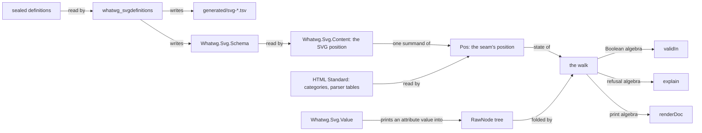

# Plan: `Whatwg.Svg`, inline SVG beside `Whatwg.Html`

Status: **S0, S1 and S2 executed, 2026-10-11** (the ledger is §8). Slices S3 and S4 are designed
here and not built. The owner adopted the seat's review on 2026-10-11. §3.1 holds its model, §4
its rulings, and §7 the owner's decisions.

This is the plan for inline SVG in the `whatwg` package. An HTML tree holds an SVG figure as
checked, first-order data. The assignment is `docs/research/2026-10-11-svg-seat-brief.md`. The
plan has the shape of `docs/HTML-PACKAGE-PLAN.md`. Its order is ruling R-S1 of `COORDINATION.md`:
design first, then land in slices. Facts were read at `html/svg` `e74dc0d`.

Three words are used in one meaning each:

- The **seam** is the set of rules by which an HTML tree holds SVG content.
- An **integration point** is an SVG element whose children are HTML content again.
- A **dangling name** is a name that a definition cites and no sealed definition declares.

## 0. What the consumer needs

lean4-effect4 builds a document as a `Whatwg.Html.RawNode` tree. `Whatwg.Html.Content.validIn`
checks the tree, and `Whatwg.Html.Print.renderDoc` writes it. Its module is
`tools/Tools/Document/Html.lean`, read at its commit `707b9a01`. Its pictures are SVG, written as
strings by `tools/Tools/View/Output.lean`. No content model checks those strings, and no reader
reads them.

| Need | What answers it | Slice |
| --- | --- | --- |
| `svg` inside a paragraph, a figure or a table cell | `svg` is a foreign tag of the HTML schema, admitted where its categories stand | S3 |
| `svg`, `g`, `defs`, `rect`, `path`, `text`, `clipPath` | the schema, generated from the sealed definitions | S2, S3 |
| `class`, `style` and custom properties | the core attributes; CSS stays text | S3 |
| `data-key` on every mark, `data-look` on the root | `data-*` on every SVG element | S3 |
| `@keyframes` in a `style` element | the element's text, escaped when printed | S3 |
| `title`, `desc`, `role` and `aria-*` | the descriptive elements and the `aria` category | S3 |
| `d`, `viewBox`, `transform`, `points`, numbers, lengths | typed values with a printer, a checker and a reader | S4 |
| a picture built from computed numbers, with no value to check at run time | the typed node `SvgNode`: an attribute holds a value of its type, and one law gives the values of every typed tree | S5 |
| a refusal that names its node | a located refusal in the library | S3 |

The sealed definitions declare every element and attribute that `Output.lean` writes today,
apart from `xmlns` and `data-*`. This is a reading of the two sources. The battery of S3 makes
it a test.

The consumer writes its own refusal walk, `problem?`, in `tools/Tools/Document/Html.lean`. The
library gives `validIn` as a Boolean and no refusal. S3 moves that walk into the library.

## 1. Authority order

1. **The HTML Standard** at its pin (`vendor/whatwg-html-746f2ede/source`) owns the seam. It
   says where `svg` stands, where the namespace changes and how a foreign element is written.
2. **SVG 2** at `w3c/svgwg` commit `47e645ef` owns the SVG elements. It owns their categories,
   content models, attributes and value grammars.
3. **The definitions files** of that commit are the draft's machine-readable index. The chapter
   files are the same authority in prose. Where the two disagree, the projection records a row.
   No one repairs a sealed file or a projection.
4. **CSS Transforms 1** owns the `transform` value, which SVG 2 cites. It is pinned at
   `w3c/csswg-drafts` commit `50337328` (SV-26, §2.4). No other CSS specification is an
   authority of this package.
5. **Browsers and validators** give host observations under a named profile. They repair no
   statement.

The pinned draft is the Editor's Draft. Its `master/publish.xml` names the Candidate
Recommendation of 2026-06-04 as the published version. The published document has no
machine-readable definitions, so the pin is the repository commit.

## 2. The pin

`vendor/w3c-svgwg-47e645ef/` holds fourteen files of `w3c/svgwg` at commit
`47e645ef7cb61490e6975ddbcfa1997c9e972cc3` (2026-10-07). `docs/PROVENANCE.md` records the fetch
and the cross-check. `generated/vendor-manifest.tsv` holds each digest.

| File | Bytes | What the plan reads in it |
| --- | --- | --- |
| `master/definitions.xml` | 83,931 | 30 elements, 13 element categories, 8 attribute categories, 10 attributes |
| `master/definitions-filters.xml` | 20,896 | 26 filter elements |
| `master/definitions-masking.xml` | 3,090 | `mask` and `clipPath` |
| `master/definitions-compositing.xml` | 2,303 | terms only |
| `specs/animations/master/definitions.xml` | 7,488 | 5 animation elements and the category `animation` |
| `master/publish.xml` | 3,273 | the list of the five definitions files of SVG 2 |
| `master/struct.html` | 153,803 | the `data-*` rule and the ARIA role table |
| `master/paths.html` | 52,259 | the path data grammar |
| `master/shapes.html` | 37,360 | the `points` value |
| `master/coords.html` | 149,848 | the `viewBox` value; `transform` by reference to CSS |
| `master/types.html` | 140,699 | the attribute syntax notation, and the kinds of a length |
| `master/geometry.html` | 17,517 | the values of the geometry properties (sealed at slice S5) |
| `LICENSE.md`, `README.md` | 152 and 999 | the licence pointer |

**The brief asked for `master/definitions*.xml`.** The pin holds ten more files, for four
reasons:

- `master/publish.xml` lists the definitions files of SVG 2. It names a fifth file, under
  `specs/animations/`. That file declares the category `animation`, which 20 content models cite.
- The definitions hold no value grammar. The grammars of S4 are in four chapter files.
- The `data-*` rule and the ARIA roles are in `master/struct.html` alone.
- The values of `x`, `y`, `width`, `height`, `cx`, `cy`, `r`, `rx` and `ry` are in
  `master/geometry.html` alone. The owner asked for that file at slice S5, and it is from the
  same commit as the rest.

### 2.1 What the definitions hold

`lake exe whatwg_svgdefinitions` prints these counts, and the projections under `generated/`
hold the rows. The evidence word is "reproduced": the gate recomputes them from the sealed
bytes at every run.

| Kind | Count | Note |
| --- | --- | --- |
| `element` | 63 | 32 names hold an upper-case letter |
| `elementcategory` | 17 | each lists its member elements |
| `attributecategory` | 17 | 16 categories: `presentation` is declared twice, in two files |
| `attribute`, outside an element or a category | 14 | three list elements that do not cite them |
| `property` | 117 | the presentation attributes are a list of these names |
| attribute names in the schema | 321 | a name may take different values on different elements |

Each element states its content model by one of five kinds:

| Kind | Elements | Meaning in the definitions |
| --- | --- | --- |
| `anyof` | 50 | any number of the listed elements and of the listed categories' members |
| `any` | 4 | any elements or character data: `desc`, `title`, `metadata`, `foreignObject` |
| `text` | 2 | character data: `style`, `script` |
| `textoranyof` | 3 | character data and the listed elements: `text`, `tspan`, `textPath` |
| prose | 4 | a sentence: `a`, `feDiffuseLighting`, `feSpecularLighting`, `animateMotion` |

So the definitions hold what S2 and S3 need: element names, categories, content models and
attributes.

### 2.2 What the definitions get wrong or leave out

The gate finds ten dangling names, and `generated/svg-dangling.tsv` lists each with its citers:

| Dangling name | Cited as | Cited by |
| --- | --- | --- |
| `altGlyphDef`, `color-profile`, `font`, `font-face` | element | `mask` |
| `document element event` | attribute category | 34 elements |
| `style` | attribute category | 20 elements |
| `externalResourcesRequired` | attribute | `clipPath`, `filter`, `feImage` |
| `transform` | attribute | `clipPath` |
| `color-profile`, `kerning` | property | the second `presentation` entry |

`transform` dangles only as a cited attribute. The first `presentation` entry lists it as a
presentation attribute, so `clipPath` has it through that category.

Five things are in no definitions file:

- every value grammar (§5.3);
- the `data-*` attributes, which `master/struct.html` gives to every SVG element;
- the roles an element may take, also in `master/struct.html`;
- the `transform` value, which `master/coords.html` leaves to CSS Transforms;
- the CSS number, which the attribute syntax of `master/types.html` leaves to CSS.

### 2.3 Licence

`LICENSE.md` places every document of the repository under the W3C Document License. The 2023
version permits a derived work in software and in its documentation. Such a work carries a
notice: it names W3C as the copyright holder and names the source by title and address. Each
generated file of S2 carries that notice.

### 2.4 The CSS pin

`vendor/w3c-csswg-drafts-50337328/` holds three files of `w3c/csswg-drafts` at commit
`50337328484f7fcdd9ab6fe9ded6011815b1707e` (2026-10-10), the head of `main` at pin time:
`css-transforms-1/Overview.bs` (73,009 bytes), `LICENSE.md` and `README.markdown`. Slice S4c
sealed it (SV-26). `docs/PROVENANCE.md` records the fetch, the cross-check and the licence.

The package reads one section of the source: "Syntax of the SVG transform attribute", with the
anchor `svg-syntax`. Its grammar is a list of productions, each under an id that opens with
`svg-`. Three facts of that section shape slice S4c:

- The section says that the three attributes `transform`, `patternTransform` and
  `gradientTransform` take this syntax, and not the syntax of the CSS property.
- Its `wsp` is four characters, stated in prose: U+0009, U+000A, U+000D and U+0020. The `wsp`
  of path data has a fifth, U+000C. The section's railroad diagrams are informative by its own
  statement, and the diagram of `wsp` lists another set.
- It defines no production `number`. It points at `<number-token>` of CSS Syntax 3, which is
  not sealed. SV-26 rules that a number is SVG's own production. The section's own example
  `translate(-10, 20)` carries a sign, so the production is `coordinate`, which is
  `sign? number` (SV-29).

The licence is not the one of the SVG pin: `LICENSE.md` names the W3C Software and Document
License. A derived work states what it took, so the grammar module of S4c carries that
statement.

## 3. Target shape

```text
vendor/w3c-svgwg-47e645ef/           the sealed SVG 2 sources (S1)
WhatwgGates/Xml.lean                 a total reader of the XML subset the sealed files use (S2)
WhatwgGates/SvgDefinitions.lean      the rows, the four projections, the drift check (S2)
WhatwgGates/SvgDefinitionsEmit.lean  the schema's resolution and the modules' emitter (S2, S3a)
WhatwgGates/EmitLean.lean            the Lean spelling that the HTML and SVG emitters share (S2)
whatwgbin/SvgDefinitions.lean        the entry point of `whatwg_svgdefinitions` (S2)
generated/svg-*.tsv                  the projection: elements, categories, attributes, dangling names (S2)
Whatwg/Svg.lean                      root of the library `WhatwgSvg`
Whatwg/Svg/
  Data/      Universe  Mask  NameTable                    a finite universe, a set as a mask, a name table (S3a)
  Schema/    Tags  Categories  Attributes  ContentModel   generated (S2; masks since S3a)
  Schema/    Readings                                     authored, digest-pinned (S2)
  Schema/    Universe                                     authored: the instances and the tables' laws (S3a)
  Content/   Context                                      the SVG position, its transition, one node's judgments (S3a)
  Value/     Grammar  Decimal  PathData  Points  ViewBox  Transform    (S4)
Whatwg/Html/Schema/Foreign.lean      generated: the parser's tables for foreign content (S3b)
Whatwg/Html/Node/Walk.lean           the walk and its two laws (S3b)
Whatwg/Html/Svg.lean                 the seam: `Ns`, `Pos`, the integration points (S3b)
Whatwg/Html/Content/Valid.lean       the Boolean algebra and `validIn` (S3b)
Whatwg/Html/Content/Explain.lean     the refusal algebra and `explain` (S3c)
Whatwg/Html/Print/Render.lean        the print state, the decoder, the round trip (S3d)
WhatwgTest/Svg/, WhatwgTest/Html/Svg*.lean   batteries
```

The diagram shows the data's route. It claims nothing: §6 lists each claim with its evidence.



**Dependency direction.** `Whatwg.Svg` imports no module of `Whatwg.Html`. The seam imports
`Whatwg.Svg`. A consumer imports `Whatwg.Html.Content.Valid` and `Whatwg.Html.Print.Render`, as
it does today.

### 3.1 The model

The owner adopted the review `docs/research/2026-10-11-svg-seat-review.md` on 2026-10-11
(ruling R-S6 of `COORDINATION.md`). Its points T1 to T9 are the model of this package, and its
points M1 to M8 are the rules of the meta level. The packet
`docs/research/2026-10-11-svg-theory/README.md` cites each source from its page. This section
states each point as the plan builds it. Where the review left a choice, the seat's choice is
marked **Seat**.

**T1. Validation is one top-down pass.** A `RawNode` is an unranked ordered tree. The checker
reads it once, from the root:

- a state is a position: what may stand there;
- the transition takes a position and an element's name to the position of its children;
- acceptance at a node is a local test of the position, the name, the attributes and the
  children's names.

A child's position is a function of its parent's position and its own name. So the grammar is
single-type, in the sense of Murata, Lee, Mani and Kawaguchi, and one top-down pass validates
it without backtracking. The seam of HTML and SVG is a new grammar of that kind. It is
single-type because `Pos.child` is a function, and no closure theorem gives it. The reachable
positions are finite, and the plan claims no bound on their number.

**T2. The namespace is a component of the state.** The seam's position is a sum:

```lean
inductive Pos where
  | html (c : Whatwg.Html.Content.Ctx)
  | svg (c : Whatwg.Svg.Content.Ctx) (excl : Whatwg.Html.Schema.Exclusions)
```

The HTML Standard's tree construction has its own automaton on namespaces. The seam writes it
once, from the sealed `source`:

```lean
inductive Ns where | html | svg
def Ns.step : Ns → String → Ns
theorem Pos.child_ns (p : Pos) (name : String) : (p.child name).ns = p.ns.step name
```

The checker's state is `Pos` and the printer's state holds `Ns`. Both factor through `Ns.step`,
so they cannot disagree about a node's namespace.

**Seat.** `Pos.svg` carries the HTML exclusions (SV-9). An integration point hands them back to
the HTML position below it. `Ns` has two values: `math` is refused (SV-10), so no valid tree
reaches MathML.

**T3. An SVG content model is a set of tags with a text bit.** The kinds of the definitions
spell points of that Boolean algebra:

- `anyof` is the union of the listed elements and of each listed category's members;
- `any` is every element of the schema, with the text bit;
- `text` is the text bit alone;
- `textoranyof` is `anyof` with the text bit.

The generator computes the resolution, and the library holds its value. A dangling name
resolves to the empty set (SV-3).

The SVG `a` element is transparent. Its sealed sentence reads: "Descriptive content, plus any
element or text allowed by its parent's content model, except for another a element. If the
parent is a switch element, use the content model of the nearest ancestor that isn't a switch."
So the SVG grammar is not local, and the position holds two models:

```lean
/-- What may stand at a position: the admitted elements, and whether character data may. -/
structure Content where
  tags : Mask Tag
  text : Bool

/-- A position in an SVG subtree. `model` is what the children of the position's element may
be. `outer` is the model in force at the nearest ancestor-or-self that is not a `switch`. -/
structure Ctx where
  model : Content
  outer : Content
```

**Seat.** Two components suffice. Let an `a` stand at a position. If its parent is not a
`switch`, the parent's model is `outer`. If its parent is a `switch`, the model of the nearest
ancestor that is not a `switch` is `outer` again. So `a` inherits `outer` in both cases.

**Seat.** "Except for another a element" removes `a` from the model of that `a`. It is not a
descendant exclusion: the sentence speaks of the content model, and the model of a `g` inside
the `a` lists `a`. So `<a><g><a>` is admitted and `<a><a>` is refused. The SVG position carries
no exclusion set of its own.

Two readings count. `feDiffuseLighting` and `feSpecularLighting` take exactly one light source,
and `animateMotion` takes at most one `mpath`, in any order. So a model also holds count
intervals, each over a set of tags. Its test reads only the multiset of the children's tags.

The HTML exclusions only grow along a path, and the admission of a tag is antitone in them. Both laws are
stated over `Pos`, for both namespaces.

**T4. A finite set over a generated universe is a mask over that universe.** Every finite set of the schema is a
subset of a generated enumeration. It is a `Nat` whose bit `i` is the value of index `i`:

```lean
/-- A finite universe: `all` lists every value at its index. -/
class Universe (α : Type) where
  all : List α
  index : α → Nat
  all_index : ∀ a, all[index a]? = some a

structure Mask (α : Type) where
  bits : Nat

def Mask.mem [Universe α] (m : Mask α) (a : α) : Bool := m.bits.testBit (Universe.index a)
```

Union is `|||`, intersection is `&&&`, and each law of membership is a core lemma
(`Nat.testBit_or`, `Nat.testBit_and`, `Nat.testBit_xor`). The kernel evaluates `|||`, `&&&`
and the shifts natively on literals, and `Nat.testBit` unfolds to a shift and an `&&&`. So one
definition is the specification and the fast test, and a tactic reads a mask back as one
literal. `Nat` has no complement. A difference is written with `^^^`, and the top of a universe is
`ofList all`. No law needs two masks with the same members to be equal. The index is Lean's own `ctorIdx`. The seat measured at the
toolchain `v4.33.1` that these lemmas and an instance by `cases a <;> rfl` stay under the
strict ceiling.

**T5. One walk, several algebras.** The checker, the located refusal and the printer are folds
over `RawNode` with one inherited attribute. The walk is written once. An algebra also sees the
raw children, because a sequence test reads their names:

```lean
/-- A top-down walk: a state, its transition, and what each node makes of its children. -/
structure Walk (S R : Type) where
  step : S → String → S
  element : S → String → List (String × String) → List RawNode → List R → R
  leaf : S → RawNode → R

def Walk.run (w : Walk S R) (s : S) : RawNode → R       -- mutual with `runAll`, structural
def Walk.runAll (w : Walk S R) (s : S) : List RawNode → List R
```

Two laws are proved once, by induction on `RawNode`:

- **W1, fusion.** If `h` commutes with the node maps of `A` and `B`, and their transitions are
  equal, then `h (A.run s n) = B.run s n`.
- **W2, state homomorphism.** If `f : S → S'` commutes with the transitions, and the node maps
  factor through `f`, then `A.run s n = B.run (f s) n`.

`explain_none_iff` is W1 at `Option.isNone`. The namespace agreement of T2 is the hypothesis of
W2 at `Pos.ns`.

**T6. A name table is an exact embedding.** A table is a writer `chars : α → List Char` and a
reader. The reader is built generically:

```lean
/-- A name table: each value's spelling, and a guess of the value that a spelling names. -/
structure NameTable (α : Type) where
  chars : α → List Char
  guess : List Char → Option α

/-- The value that a spelling names: the guess, kept only if it spells the input. -/
def NameTable.read (n : NameTable α) (s : List Char) : Option α
theorem NameTable.read_exact : n.read s = some a → n.chars a = s
theorem NameTable.read_chars (h : ∀ a, n.guess (n.chars a) = some a) (a : α) :
    n.read (n.chars a) = some a
```

**Seat.** The generated decision tree is the guess, and `read` checks its answer. So the
exactness holds by construction, for any guess, and it is proved once for every table. The
retraction needs one premise per table. One `decide` over the census discharges it. No proof
splits over a generated match. This is rule M1 at object level: the generated code proposes, and
a checked function decides.

Case restoration is an exact embedding modulo a normaliser. For every schema name `n`, the
parser's table sends the lower-case form of `n` back to `n`.

**T7. The printer is an exact embedding on well-formed trees.** The HTML package proves
`decode_render` and `render_injective_of_wf`. S3 keeps that strength. `wf` and the decoder take
the print state. In SVG no element is void and no text is raw. `decode_render` is proved for
trees that hold SVG.

**T8. Every value grammar of S4 is regular.** Path data, `points`, `viewBox`, the number and
the `transform` list nest no production. So S4 is one library and a transcription per grammar
(§5.3).

**T9. The schema projection is a function of sealed bytes.** The drift gate is its evidence.
A list attribute is split on commas and trimmed, because a category name holds a space. The
reader normalises an attribute value as XML 1.0 section 3.3.3 says.

### 3.2 What the theory packet corrects

The research partner read each source that the review cites. Its packet is
`docs/research/2026-10-11-svg-theory/README.md`. It contradicts or weakens the review at these
points, and the plan reads each one as the sources state it:

| Point | What the sources say | What the plan does |
| --- | --- | --- |
| T1, the name | The checker is no "top-down deterministic hedge automaton" of the cited texts. It is a single-type grammar, validated in one top-down pass. | §3.1 uses that name. |
| T1, composition | The cited closure is under intersection. A sum of states is no closure result. | The seam is built by hand, and its law T2 is proved here. |
| T1, enumeration | The states are finite, with an exponential bound once exclusions are in the state. | No proof enumerates the reachable positions. |
| T3 | Only the test at one node is the paper's count expression. The paper's schema is local, and this model is not. | The plan says "count intervals" and cites the paper for the node's test alone. |
| T4 | `Nat.testBit` is no kernel primitive, and `Nat` has no complement. | §3.1, T4, says what unfolds and what is native. |
| T5 | The cited theorem is for ranked parse trees. "Paramorphism" carries no law. | W1 and W2 are the seat's proofs, in `Whatwg/Html/Node/Walk.lean`. W1 has the premise of equal transitions. |
| T8 | No cited paper proves the retraction for free. Each proved round trip has an unambiguity premise. The retraction needs the reader to be complete on the printer's image. | `Syn.ok` is that premise (§5.3). A description is an inductive value, so it erases to its expression. |
| T8, the lexer | Verbatim's lexer recurses on an accessibility proof. | The reader recurses on the description and on fuel. |
| M4 | The kernel does unfold a definition by well-founded recursion. | The rule stands: recurse structurally. Its reason is the cost of the accessibility proof, which nobody here measured. |

The packet's two facts about the toolchain agree with what the seat measured. The index
function is `ctorIdx`, and Lean generates it for every inductive type.

## 4. Rulings

The owner ruled on 2026-10-11 (ruling R-S6 of `COORDINATION.md`). SV-8, SV-20 and SV-26 are the
owner's rulings. SV-22 to SV-25 are the review's, which the owner adopted. The rest are the
seat's proposals of S1, changed where §3.1 changes them.

| Id | Question | Ruling |
| --- | --- | --- |
| SV-1 | authority | The order of §1. The HTML Standard owns the seam, and SVG 2 at `47e645ef` owns the elements. |
| SV-2 | schema source | The schema is generated from the five definitions files that the sealed `master/publish.xml` lists. No row is typed by hand. |
| SV-3 | dangling names | A dangling name is a row of `generated/svg-dangling.tsv`. A dangling element is admitted nowhere, and a dangling category is empty. The gate fails when the set of rows changes. |
| SV-4 | prose content models | Each of the four is an authored reading in `Whatwg/Svg/Schema/Readings.lean`, pinned to the digest of the entry it reads. The reading of `a` is transparency with `switch` skipped (T3). It is not a fixed set. |
| SV-5 | the tree | `RawNode` is unchanged. A node's namespace is an inherited attribute of its path. The walk carries it down. |
| SV-6 | layering | The library `WhatwgSvg` owns `Whatwg/Svg/` and imports nothing of `Whatwg.Html`. The walk and the seam are in `Whatwg.Html`. |
| SV-7 | where `svg` stands | The HTML Standard's category lists name `SVG svg` and `MathML math` under flow, phrasing, embedded and palpable content. The HTML gate reads those items. The HTML `Tag` gains two foreign tags, which have no markup name, as `pcdata` has none. Admission of `svg` is the existing `admitsWith`, exclusions included. No hand table says where `svg` stands. |
| SV-8 | integration points | The children of `foreignObject` are checked as flow content, and those of `title` as phrasing content. The HTML Standard says both. The children of `desc` are checked as phrasing content too (owner ruling). A later ruling may widen this, and none narrows it. |
| SV-9 | exclusions | The exclusions of the HTML context pass through an SVG subtree. `<a><svg><foreignObject><a>` is refused. |
| SV-10 | MathML | `math` is refused with the reason "MathML is not modelled". No library is planned. |
| SV-11 | names | A tree holds each name as the serializer writes it. The checker compares names exactly, so `viewbox` is not `viewBox`. |
| SV-12 | `xmlns` | `xmlns` is admitted on an SVG element only with the SVG namespace as its value. `xmlns:xlink` is admitted only with the XLink namespace. The rule is the HTML Standard's, so it is in the seam. |
| SV-13 | values before S4 | S3 admits an attribute by its name. Its value is unchecked text until S4 gives its grammar. Since S4 the table of SV-32 gives a kind to ten names, and SV-30 says where a value is judged. |
| SV-14 | CSS | The `style` attribute, the `style` element's text and each presentation attribute's value are text. CSS is a foreign boundary. |
| SV-15 | roles | `role` takes any text in S3. The graphics roles belong to a specification that is not pinned. |
| SV-16 | located refusal | The library gives one refusal with a path and a reason. It is complete against `validIn`: the refusal is absent exactly when `validIn` is true. |
| SV-17 | the printer | In an SVG subtree no element is void and no text is raw. The printer returns to the HTML rules below an integration point. |
| SV-18 | numbers | A number is an exact decimal. No value of the library is a float. |
| SV-19 | reader and checker | For each value grammar, the checker is the domain of the reader. The reader accepts every spelling the grammar admits, and the printer writes one. |
| SV-20 | ceiling | `Whatwg.Svg` is a strict prefix from its first module (owner ruling). A function that must traverse a `String` is an exact exception with its reason. None exists: a lookup reads a `List Char`, and the seam converts. |
| SV-21 | licence notice | Each generated file names its source and W3C's copyright (§2.3). |
| SV-22 | finite sets | Every finite set of the schema is a mask over its universe (T4). |
| SV-23 | traversals | The checker, the refusal and the printer are algebras of one walk (T5). |
| SV-24 | name tables | A name table is an exact embedding built generically (T6). |
| SV-25 | value grammars | A value grammar is a regular expression as data. One invertible description reads and prints it (T8). |
| SV-26 | the CSS pin | `w3c/csswg-drafts` is pinned at one commit, and only the CSS Transforms 1 source is sealed. A number is SVG's own `number` production. No CSS Values file is pinned. A length takes only what the sealed SVG text states (owner ruling). |
| SV-27 | unknown names | An element whose name is in neither schema is refused at every position. This holds under `metadata` too, whose model is `any`: the checker knows no rule for the subtree. |
| SV-28 | the arc's rotation | The three leading arguments of `elliptical_arc_argument` are the production `number`, which has no sign. So the rotation of an arc is unsigned, like its radii, and `a25,25 -30 0,1 50,-25` is refused. The grammar of SVG 1.1 gave the rotation a sign; the sealed grammar does not, and no one repairs it (seat, S4b). |
| SV-29 | the number and the white space of `transform` | A number of the `transform` grammar is the production `coordinate` of path data, `sign? number`: SV-26 makes it SVG's own, and the sealed section's example carries a sign. Its white space is the four characters the section states, without U+000C (seat, S4c). |
| SV-30 | where a value is judged | `validIn` reads no SVG value. The judgment of values is `valuesOk`, a second algebra of the walk, with its own located refusal. The kernel cannot open a long `String` at a bearable cost (§5.3, as built), and every proof of `validIn` is an evaluation by the kernel. A typed value's text is admitted by a theorem, and `html!` runs a literal's grammar when it builds the tree (seat, S4b). Since S5 the route is the typed tree of SV-34: `html!` reads the literal into a typed value, and the judgment of every typed tree is one law. |
| SV-31 | the length | A length is a number of SVG's own production with one of the ten kinds that the unit table of `SVGLength` names in the sealed `master/types.html`: no unit, a percentage, and `em`, `ex`, `px`, `cm`, `mm`, `in`, `pt` and `pc`. A unit is read in either case, as the sealed annotation on property values says, and white space is read at both ends. Another unit of CSS, a `calc()` expression, a CSS comment and a CSS escape are refused. SVG admits them by reference to CSS Values and CSS Syntax, which are not sealed (SV-26). So the check of a length refuses some values that SVG admits, and it admits none that SVG refuses by its grammar (seat, S4d). |
| SV-32 | which attribute has which kind | One table gives the kind of a value from the element and the attribute. A name that has one grammar wherever it stands has its kind on any element: `d`, `points`, `viewBox` and the three transform attributes. `x1`, `y1`, `x2` and `y2` are lengths on `line` alone: the sealed table of `line` states their value, and their definition on `linearGradient` is in a chapter that is not sealed. At S4d the geometry properties had no kind, because `geometry.html` was not sealed; SV-35 gives them theirs (seat, S4d). |
| SV-33 | the completeness of the reader | The chapter's rule is that a production consumes as much as it can. `Greedy` states it as a relation: the meaning of a description as a parsing expression, with an ordered choice and a greedy repetition. V3b is `Greedy g s o ↔ g.read s = o`, so the reader is the rule's decision procedure and `check` decides the rule's language. The language of the bare expression is larger, and V3a is the link to it. The two agree for a description that passes `Syn.deterministic`, which is `Syn.ok` over the sets the reader reads: node V3c. A description that reads `comma_wsp?` between two numbers fails that test by design (seat, S4d, on the coordinator's notes: G2 of the second and section 4 of the third). |
| SV-34 | the typed node | An SVG subtree has a typed tree beside `RawNode`: `SvgNode`. Its element is a tag of the schema. Its attribute is an attribute of the schema with a value of `AttrValue t a`, which is the carrier of its kind where the table gives one and text otherwise; or a custom data attribute; or one of the two namespace declarations, whose values are fixed. `toRaw` writes the raw tree, and the raw tree of every typed tree passes `valuesOk` by one law that evaluates nothing (V7). So a value is right by its type, and `validIn` still judges the structure on the raw tree, where it reads names alone. The type of a value and the table are in `Whatwg.Svg`. The node is in the seam, because it holds the raw HTML content below an integration point and its law is about the seam's judgment. `RawNode` is unchanged. `html!` builds an SVG subtree as a typed tree: it reads a literal value once, at elaboration, and a spliced value has its carrier's type (seat, S5, on G4 of the coordinator's third note). |
| SV-35 | the geometry properties | The sealed `master/geometry.html` gives nine names a value on the elements it names. `cx` and `cy` on `circle` and `ellipse`, and `x` and `y` on `svg`, `rect`, `image` and `foreignObject`, are lengths. `r` on `circle` is a length that is not negative. `rx` and `ry` on `ellipse` and `rect`, and `width` and `height` on `svg`, `rect`, `image` and `foreignObject`, are `auto` or a length that is not negative. The chapter says that a negative value there is invalid and is treated as the initial value, with no error state. The check refuses it, as it refuses any value that is not of its grammar: a caller that wants the fallback reads the refusal. On any other element those names have no kind, and `x`, `y`, `dx` and `dy` of `text` are lists that `master/text.html` states, which is not sealed (seat, S5). |

## 5. Slices

| Slice | Work | Exit |
| --- | --- | --- |
| S0 | merge `origin/html-h7` into `html/svg` | done: ruling R-S2 of `COORDINATION.md` |
| S1 | this plan; the pin, sealed and cross-checked | done: ruling R-S3 |
| S2 | the projection gate and the generated schema | done: ruling R-S4 |
| S3a | the universe, the mask and the name table; the schema as masks; the SVG position | the laws U1, B1, N1 and K1 of §6 are proved; the gate passes in both modes |
| S3b | the walk and its two laws; the foreign tags and the parser's tables; `Pos`; the Boolean algebra | W1, W2, T2, X1, X2, N2, N3, C1 and C2 are proved; every HTML battery passes unchanged |
| S3c | the refusal algebra | C3 and C4 are proved; a refused tree's path is the bad node's |
| S3d | the print state, the decoder, the round trip | P1, P2 and P3 are proved for trees that hold SVG |
| S3e | the `admits` tactic and `html!` | the tactic renders the refusal of `explain`; `html!` builds an SVG figure |
| S4a | the grammar library and its generic laws | V1 and V3a are proved over the description |
| S4b | the number, path data, `points` and `viewBox` | done: ruling R-S16. Each grammar's premise holds; the battery replays the chapter's own examples |
| S4c | `transform`, after the CSS pin | done: rulings R-S15 and R-S16. The pin is sealed; the grammar's premise holds |
| S4d | the length; one table of kinds; the located refusal of a value; the reader's rule as a relation, and its bridge to the expression's language | done: ruling R-S17. V3b, V3c and V6 are proved; the table of kinds is keyed by element and attribute |
| S5 | typed values in the tree (G4 of the coordinator's third note; debt D92): a typed node beside `RawNode` whose SVG attribute holds a value of its kind; `toRaw` prints each value; one connector theorem gives `valuesOk` of every typed tree; `html!` emits typed nodes; the text route for typed attributes goes; the geometry properties get their kinds (debt D93) | done: rulings R-S18 and R-S19. An `html!` literal with a long `d` carries a proof of its values, and no kernel evaluation opens a value's text |

Each part lands as commits by explicit paths, with its narrow build, `lake build`, the axiom
receipt and the gates it reaches. No part runs the trust self-test (ruling R-S5).

### 5.1 S2: the schema as data

The gate is `lake exe whatwg_svgdefinitions`, in the shape of `whatwg_htmlstandard`. It does five
things:

1. It refuses a sealed file whose digest is not the pinned one.
2. It reads `master/publish.xml` and takes the definitions files from it.
3. It reads each file with a total XML reader. The reader refuses a construct it does not know,
   with the byte offset.
4. It writes or checks four projections and the schema modules.
5. It fails on one byte of drift, and it names the first differing line.

The XML reader covers what the five files use: elements, attributes in either quote, comments,
character data and the five named character references. It has no `partial` function. Fuel
bounds each loop.

| Output | One row per | Columns |
| --- | --- | --- |
| `generated/svg-elements.tsv` | element | file, name, anchor, kind, categories, elements, attribute categories, geometry properties, attributes, own attributes, span digest |
| `generated/svg-categories.tsv` | element or attribute category | kind, file, name, members |
| `generated/svg-attributes.tsv` | attribute declaration | owner kind, owner, name, animatable, anchor |
| `generated/svg-dangling.tsv` | dangling name | name, cited as, cited by |

| Module | Holds |
| --- | --- |
| `Whatwg.Svg.Schema.Tags` | `Tag`, `Tag.all`, `Tag.name`, `Tag.chars`, and `Tag.guess` as a character decision tree |
| `Whatwg.Svg.Schema.Categories` | `Category` and each one's members, as a mask |
| `Whatwg.Svg.Schema.Attributes` | `Attr` with its names and its guess, `AttrCategory` with its members, and each tag's attributes as a mask |
| `Whatwg.Svg.Schema.ContentModel` | `Tag.model`: the categories and elements as stated, the resolved set and the text bit, and what a read sentence adds |

As built, S2 differs from its design in three ways:

- No module repeats the raw rows in Lean. The four projections are the raw rows, and nothing in
  Lean reads them a second time.
- An attribute reaches an element in two directions. An element cites an attribute, or an
  attribute outside every element lists the element. Three attributes list elements that do not
  cite them, so a tag's own attributes are the union.
- The ledger carries `Whatwg.Svg` as an unrouted prefix (debt D78), not as a leaf record. A leaf
  record holds receipts, and S2 states no law. The graph of S3 fences these modules.

S2 emitted each set as a list. S3a emits it as a mask (SV-22), and the projections keep every
byte.

### 5.2 S3: the seam

**S3a. The data of `Whatwg.Svg`.** Three modules of `Whatwg/Svg/Data/` hold the declarations
of T4 and T6 with their laws. They name no schema. The debt H-C2 of §6.1 moves them to a home
that the HTML schema can import.

The generator emits masks, a writer `chars` and a guess per name table. One authored module,
`Whatwg/Svg/Schema/Universe.lean`, holds the four `Universe` instances, the two name tables and
their retractions. `Whatwg/Svg/Content/Context.lean` holds the position of T3:

```lean
def Ctx.outside : Ctx                              -- where an outermost `svg` stands
def Ctx.child (c : Ctx) (t : Tag) : Ctx            -- the model of `t`; `outer` kept under `switch`
def Ctx.admits (c : Ctx) (t : Tag) : Bool := c.model.tags.mem t
def boundsOk (t : Tag) (children : List Tag) : Bool   -- each interval of `t` holds its count
def attrOk (t : Tag) (name : List Char) : Bool        -- the tag's attributes, or `data-*`
```

`Ctx.child` reads three generated facts of `t`: its own content, whether it inherits, and what
it removes. One generated set, `handsOn`, names the elements under which `outer` is kept. At
this pin it holds `switch` alone. The gate refuses two readings that name different sets.

**S3b. The walk and the seam.** `Whatwg/Html/Node/Walk.lean` holds `Walk`, `run`, `runAll`, W1
and W2. It imports `Whatwg.Html.Node.Raw` alone.

The HTML gate reads two more things from the sealed `source`:

- the foreign items of the four category lists, which become the tags `svg` and `math`;
- the parser's tables for foreign content, which become `Whatwg/Html/Schema/Foreign.lean`. They
  are the start tags that end foreign content, the SVG names that the parser restores, and the
  SVG integration points.

The seam, `Whatwg/Html/Svg.lean`, holds `Ns`, `Ns.step`, `Pos`, `Pos.child`, `Pos.ns` and the
law `Pos.child_ns`. `Pos.child` is total:

| Position | Name | Position of the children |
| --- | --- | --- |
| `html c` | an HTML element `t` | `html (c.child t)` |
| `html c` | `svg` | `svg (Ctx.outside.child .svg) c.excl` |
| `html c` | any other | `html` at the base `nothing`: nothing is admitted |
| `svg c x` | `foreignObject` | `html` at flow content, with the exclusions `x` |
| `svg c x` | `desc`, `title` | `html` at phrasing content, with the exclusions `x` |
| `svg c x` | another SVG element `t` | `svg (c.child t) x` |
| `svg c x` | any other | `svg` at the empty model |

The Boolean algebra is `check : Walk Pos Bool` in `Whatwg/Html/Content/Valid.lean`. Its test at
an HTML element is the conjunction that `validIn` holds today. Its test at an SVG element is
the admission of the tag, the attributes and the bounds. A child's tag in a sequence is its HTML tag, or
its foreign tag: `<figure><svg/><figcaption/><svg/></figure>` is refused by the sequence of
`figure`.

`validIn c n` becomes `check.run (.html c) n`. The seat measures
`WhatwgTest/Html/DecideBenchmark.lean` and `WhatwgTest/Html/MarkupBenchmark.lean` before and
after. If either build slows by more than a tenth, `validIn` stays a mutual function with the
SVG cases, and one connector, `validIn_eq_run`, ties the two. Either way two equations bound
the change:

- At a name the HTML schema knows, `validIn` equals the conjunction it equals today. The
  existing `validIn_element` keeps its statement.
- At a name that is neither an HTML element nor `svg`, `validIn` is false.

**S3c. The located refusal.** `Whatwg/Html/Content/Explain.lean` holds the second algebra:

```lean
inductive Reason where            -- no element of the position's namespace; not modelled; not
  | …                             -- admitted here; an attribute; a repeated attribute; the
                                  -- sequence; a count; character data; a comment
structure Refusal where
  path : List Nat                 -- child indices from the root
  reason : Reason

def explainWalk : Walk Pos (Option Refusal)
def explain (c : Ctx) (n : RawNode) : Option Refusal := explainWalk.run (.html c) n
theorem explain_none_iff (c : Ctx) (n : RawNode) : explain c n = none ↔ validIn c n = true
```

One lemma per namespace says that a node's reason is absent exactly when its Boolean test
holds. `explain_none_iff` is then W1. It needs no second induction. The three prose functions
of today retire: `attrProblem?`, `valueProblem?` and the consumer's own `problem?` (M2).

**S3d. The printer.** The print state is the namespace and one bit:

```lean
structure PrintState where
  ns : Ns
  raw : Bool                       -- the parent is an HTML raw-text element

def printWalk : Walk PrintState (List Char)
def renderIn (s : PrintState) (n : RawNode) : List Char := printWalk.run s n
def renderChars (n : RawNode) : List Char := renderIn ⟨.html, false⟩ n
```

In the SVG namespace every element prints a start tag, its children and an end tag. Text is
escaped, under a `style` or a `script` too. `wf` and the decoder take the state. `decode_render`
and the two injectivity laws are proved again, for every tree that `wf` accepts at the root
state. The existing battery `WhatwgTest/Html/Print.lean` passes unchanged.

**S3e. The meta level.** The `admits` tactic renders the refusal of `explain`, so its message
is complete by C3. It reads a mask as one literal and writes no second reader of a context (M3).
`html!` keeps each SVG name exactly, and takes a string literal for a name that is no identifier
(`xml:space`). It declares no token that the trust gate refuses.

**The battery.** Each line is a reader, a control or a finite evaluation:

| Case | Kind | Expected |
| --- | --- | --- |
| `<p><svg>` | finite evaluation | admitted |
| `<svg><div>` | control | refused: `div` is not an SVG element |
| `<svg><foreignObject><div>` | finite evaluation | admitted |
| `<a><svg><foreignObject><a>` | control | refused by the inherited exclusion |
| `<svg><title><div>` | control | refused: `title` holds phrasing content |
| `<svg><a><a>` | control | refused: `a` removes `a` |
| `<svg><a><g><a>` | finite evaluation | admitted: the removal is not a descendant exclusion |
| `<svg><switch><a><rect>` | finite evaluation | admitted: `a` inherits the model of `svg` through `switch` |
| `<feDiffuseLighting>` with two light sources | control | refused by the count |
| `<figure><svg/><figcaption/><svg/>` | control | refused by the sequence of `figure` |
| `<math>` | control | refused: MathML is not modelled |
| `<svg><metadata><x>` | control | refused: `x` is in no schema |
| `<svg><style>a<b</style>` | finite evaluation | printed with `&lt;` |
| `<svg><rect>` with no child | finite evaluation | printed `<rect></rect>`, never void |
| `viewBox` and `xml:space` | finite evaluation | printed as written |
| the consumer's picture, built as a tree | finite evaluation | `validIn` is true, and the tree prints |
| `explain_none_iff` at a refused tree | reader | the refusal's path is the bad node's |
| `decode_render` at a tree with SVG | reader | the decoder returns the tree |

### 5.3 S4: the values

**S4a. The library.** One module, `Whatwg/Svg/Value/Grammar.lean`, holds three layers:

```lean
/-- A set of ASCII characters, as a mask over the code point. -/
structure CharSet where
  bits : Nat

/-- A regular expression over character sets: what a description erases to. -/
inductive Regex where
  | empty | eps | set (s : CharSet) | seq (a b : Regex) | alt (a b : Regex) | star (a : Regex)

inductive Regex.Matches : Regex → List Char → Prop        -- the language
def Regex.accepts : Regex → List Char → Bool              -- by derivatives
theorem Regex.accepts_iff : r.accepts s = true ↔ r.Matches s

/-- A typed description of a regular grammar. It reads a value and prints one. -/
inductive Syn : Type → Type 1
def Syn.erase : Syn α → Regex
def Syn.print : Syn α → α → Option (List Char)            -- one spelling, or none outside the image
def Syn.read : Syn α → List Char → Option (α × List Char) -- the longest match; no backtracking
def Syn.ok : Syn α → Bool                                 -- one character decides each choice
```

Two laws are proved once, over the description:

- **V1, the retraction.** If `g.ok` holds and `g.print v = some s`, then `g.read` on `s`,
  followed by a text that cannot continue the match, returns `v` and that text.
- **V3a, the soundness of the reader against the expression.** If `g.read s = some (v, rest)`, then `s` is `pre ++
  rest`, and `g.erase` matches `pre`.

`g.ok` is the premise of V1. It is a decidable test of the description: at each sequence, each
choice and each repetition, the next character decides. One `decide` discharges it per grammar.

**Seat.** The size of this layer is a risk. V1 over `Syn` may not be proved within S4a. The seat
then lands the regular expression, its matcher and V3a, and proves V1 per grammar in S4b. The
claims of §6 then say so.

**As built (S4a).** The risk did not come about: V1 is proved over `Syn`. The library is
`Whatwg/Svg/Value/Grammar.lean`, and its leaf record in the ledger is `SVG-LF-GRAMMAR`. It
differs from the design above in four ways:

- A description has seven forms: `eps`, `one`, `seq`, `alt`, `many`, `map` and `skip`. `map`
  carries the proof that its reading undoes its writing. `skip` reads a part in every spelling
  and prints its canonical one, which is how a reader takes more spellings than a printer
  writes.
- The printer is total. `Syn.valid g v` says that the value is one the description can print,
  and it is the second premise of V1.
- `Syn.ok` is computed from five facts of a description: whether a print or a read may be
  empty, what a print and a read may open with, and what may continue the reader past a print.
- No matcher decides `Regex.Matches`. The language is a relation, and the reader is the only
  decision procedure. `Syn.print_matches` is added: a printed value is a text of the language.

**S4b and S4c. The grammars.** Each grammar is one small module: the typed value, the
description, the proof of `ok`, and three corollaries.

```lean
def print : α → List Char
def read : List Char → Option α
def check (s : List Char) : Bool := (read s).isSome
theorem read_print (v : α) : read (print v) = some v
theorem check_print (v : α) : check (print v) = true
```

| Grammar | Source at the pin | Typed value |
| --- | --- | --- |
| number | the `number` production of the path data grammar | `Decimal` |
| path data, `d` | the grammar under `PathDataBNF` in `master/paths.html` | a list of commands, each with its arguments |
| `points` | `DataTypePoints` in `master/shapes.html` | a list of pairs |
| `viewBox` | `ViewBoxAttribute` in `master/coords.html` | four numbers |
| `transform` | CSS Transforms 1, pinned at S4c (SV-26) | a list of transform functions |
| length | what the sealed SVG text states (SV-26) | a number and a unit |

**The number** is an exact decimal: an integer mantissa and a power of ten. Its normal form has
no trailing zero in the mantissa. The invariant is a predicate, and one function normalises. A
conversion from a rational with rounding is a widening, not an embedding. The consumer's layout
numbers cross it, so the module states its bound.

**What the reader is.** The path data grammar admits many spellings of one value: `M 100-200`
and `M100,-200`. So `read` is not exact. It is exact modulo the normaliser `print ∘ read`, which
holds by `read_print`. The plan claims the retraction and V3a, and no more.

The module's `String` face is one function per grammar, in the seam. Every law is stated over
`List Char`.

**As built (S4b and S4c).** Ruling R-S16 of `COORDINATION.md` is the record. The design above
changed in six ways:

- **A grammar is one value.** `Grammar α` holds a description and its two premises: `ok`, by one
  evaluation, and `Syn.Total`, which says that every value prints. `Grammar.read_print`,
  `check_print`, `print_injective` and `matches_of_check` are proved once, so a grammar module
  states no law of its own. The bank `Whatwg.Syn` holds one totality rule for each form of a
  description, and a search closes the totality of each grammar.
- **The modules.** `Value/Number.lean` holds the number and the separators: `Magnitude` is the
  production `number`, `Decimal` is `coordinate`, and `Point` is `coordinate_pair`.
  `Value/Path.lean`, `Points.lean`, `ViewBox.lean` and `Transform.lean` hold one grammar each.
  `Value/Attribute.lean` says which grammar judges which attribute. `Value/Cohort.lean` holds
  the law of the canonical number.
- **The number has two layers.** A value is a spelling: `150` and `15e1` are two values. The
  reader keeps the digits it is given, and the printer writes no power of ten that the spelling
  does not show, so each costs the length of its text. `Decimal.Same` says that two values
  denote one number. `Decimal.reduce` gives the canonical value of that number, with no zero at
  the end of the mantissa, at the cost of the mantissa's digits. `Decimal.tidy` is the canonical
  value written plain where that is no longer. The first build of this slice expanded a positive
  exponent; the coordinator's second note (`docs/research/2026-10-11-svg-seat-guidance-2.md`,
  G1) showed that its cost was the exponent's size, and this form replaced it.
- **A value is judged beside the checker (SV-30).** The seat measured the kernel on this
  toolchain. `String.toList` on a literal of 433 characters takes 14 seconds, and on one of
  1,855 characters it fails with "deep recursion". The grammar's reader takes under a second
  and about three seconds on the same texts as lists of characters. So `validIn` reads no SVG
  value. `Whatwg/Html/Content/Values.lean` holds the judgment `valuesOk`, its refusal
  `explainValues`, and `valueText`, the `String` face of every grammar. `check_valueText` says
  that the text of a typed value passes its grammar's check: it is a theorem and opens no text.
  `html!` runs the grammar on a literal value and refuses a bad one at its token.
- **The length is not here.** No slice of §5 names it, and it needs the units that the sealed
  SVG text states. It is debt D89. Slice S4d pays it.
- **V3b stays open, and it is narrower than the plan said.** Each grammar passes `ok` and still
  has a text of its expression that the reader refuses: `12` is two numbers to the expression
  and one to the reader. The sealed path grammar asks for that reading: a production consumes
  as much as it can. So the reader is the grammar's rule, and no theorem yet states the rule as
  a relation. The second note's G2 asks for `ok → (check ↔ Matches)`. The batteries refute it
  for this `ok`. Slice S4d states the rule as a relation and proves the reader against it. It
  also proves the note's claim under the premise that the note's own caution names.

**As built (S4d).** Ruling R-S17 of `COORDINATION.md` is the record. The owner asked for the
length and for a tighter implementation, and said that the coordinator's notes are the owner's.
So the slice also does the two open points of the second note, G2 and G3, as the third note
(`docs/research/2026-10-11-svg-seat-guidance-3.md`) restates them, and its G5. The third
note's G4, a typed value in the tree, is slice S5.

- **The length (SV-31).** `Value/Length.lean` holds `LengthUnit`, the ten kinds of the sealed
  unit table, and `Length`, a `Decimal` with its kind. After a number, `e` opens an exponent or
  the unit `em` or `ex`. The reader of a choice starts again where the choice began, so it reads
  both, but `ok` is a test of one character. The description is therefore left-factored at that
  `e`, and at the `p` of `px`, `pt` and `pc`.
- **One table of kinds (SV-32, G5).** `Value/Attribute.lean` holds `ValueKind`, its typed
  value `carrier`, its grammar, and `kindOf`, which gives the kind of an attribute's value on
  an element. `valueOk` and `explainValue` read it. One law, `valueOk_print`, replaces the six
  laws of S4b, and one law by name replaces the six of the seam: the text of a typed value is
  admitted wherever the table gives its kind. The note's table is keyed by the attribute
  alone. This one is keyed by the element too, because the sealed text states the length of
  `x1` for `line` and not for `linearGradient`.
- **The located refusal of a value (G3, node V6).** `Value/Refusal.lean` holds `Syn.run`, the
  reader with its reach: the length of the shortest text the reading stood on. A part that the
  reader tries and gives up keeps its reach. So the offset of a refusal is the furthest
  character a reading got to, and it is found in the one reading. `Syn.explain` is absent
  exactly when `check` holds. The seam's refusal carries the offset (`AttrFault.valueAt`), and
  `html!` writes it in its message.
- **The reader's rule as a relation (G2 restated, node V3b, SV-33).** `Value/Greedy.lean` holds
  `Greedy`, the outcome of reading a text with a description as a parsing expression: an
  ordered choice, and a repetition that goes on while its part succeeds and consumes a
  character. An outcome is a refusal or a value with the text left, because a choice takes its
  second alternative only when the first fails. `Greedy g s o ↔ g.read s = o`: the reader is
  the rule's decision procedure, and `check` decides the rule's language.
- **The bridge to the expression's language (node V3c).** `Value/Deterministic.lean` holds
  `Syn.deterministic`, which is `ok` over the sets the reader reads, and proves that the reader
  of a deterministic description reads every text of its expression's language. The number,
  the coordinate and the length are deterministic. Path data, `points`, `viewBox` and
  `transform` are not: each reads `comma_wsp?` between two numbers, by design.
- **A part is an `abbrev`.** The search that proves a grammar total reads through a reducible
  part. So a part of a description states no totality lemma of its own, and the modules lose
  the lemmas that only fed the search.

### 5.4 S5: a value is right by its type

**As built (S5).** Rulings R-S18 and R-S19 of `COORDINATION.md` are the record. The slice does
G4 of the coordinator's third note in the order the note gives, and pays debts D92 and D93.

- **The type of a value.** `Whatwg/Svg/Value/Attribute.lean` gives `AttrValue t a`: the carrier
  of the kind of `a` on `t`, and `String` where the table gives none. `kindOf` is reducible, so
  the type of `d` on `path` is `PathData` on sight.
- **The typed node (SV-34).** `Whatwg/Html/Node/Svg.lean` holds `SvgAttr t` and `SvgNode`. An
  attribute is `attr a value` with `value : AttrValue t a`, a custom data attribute, or one of
  the two namespace declarations. A node is an element with a tag of the schema, character
  data, an entity, a comment, or a raw subtree for the HTML content below an integration point.
  `SvgNode.toRaw` writes the raw tree. `SvgNode.valuesOk_toRaw` is the connector (node V7):
  the raw tree of every typed tree passes `valuesOk`. Its proof is `check_print` at each
  attribute and the judgment's unfolding at each node. A program that computes its numbers has
  the law for nothing.
- **The structure stays the checker's.** `validIn` of `toRaw` judges a typed tree. It reads
  names, so the kernel evaluates it without opening a value. The battery
  `WhatwgTest/Html/SvgNode.lean` builds the consumer's picture from variables, proves its
  values for every number, and checks the structure of one closed instance by one evaluation.
- **The reader (node P4).** `Whatwg/Html/Node/SvgRead.lean` holds `SvgNode.ofRaw?`, which reads
  a raw tree as a typed one with each attribute's grammar. `SvgNode.ofRaw?_toRaw` is its
  retraction on the trees the reader produces (`SvgNode.placed`), by V1 at each value. A raw
  tree that reads has values of their grammars. The reader keeps a value and not its spelling:
  `M 10 20` reads and prints as `M10,20`.
- **`html!` emits a typed tree.** An SVG subtree in markup is `SvgNode.toRaw` of a typed term.
  The elaborator reads each literal value with its grammar and emits the value's term, so the
  kernel sees constructors and numbers where the markup held a literal. A bad literal is
  refused at its token with the offset, and a spliced value has its carrier's type. The run of
  a literal with no proof is gone.
- **The geometry properties (SV-35).** `master/geometry.html` joined the pin on the owner's
  word. `Value/Extent.lean` holds `Extent`, a length that is not negative, and `AutoExtent`,
  `auto` or one. The table gives the nine names their kinds on the elements the chapter names.
- **Numerals.** `10 : Decimal`, `320 : Magnitude` and `10 : Length` are instances, and
  `-10 : Decimal` is the opposite number.
## 6. Anticipated proof graph

S2 is passive data and states no law. S3 is an admission, so it opens a proof graph,
`SVG-PG-SEAM`, with its ten edges in the ledger, and that graph fences the schema modules. Each
grammar of S4 is an exact representation and closes with a leaf record of its laws.

Two consumers read these nodes. **D** is lean4-effect4's document builder,
`tools/Tools/Document/Html.lean`. **P** is its picture writer, `tools/Tools/View/Output.lean`.

| Node | Statement | Kind | Planned evidence | Slice | Consumer |
| --- | --- | --- | --- | --- | --- |
| G1 | the projections and the schema modules equal a regeneration from the sealed bytes | drift gate | reproduced | S2 | P |
| U1 | a Boolean predicate that holds on `Universe.all` holds at every value | reflection, once per class | proved | S3a | D, P |
| B1 | `mem` sends union, intersection, difference and `ofList` to the Boolean operations | homomorphism | proved | S3a | P |
| N1 | `read s = some a → chars a = s`, and `read (chars a) = some a`, for every name table | exact embedding | proved: generic, with one `decide` per table | S3a | P |
| K1 | the resolved set of each model is the join of its stated categories and elements | finite check | proved by `decide` | S3a | P |
| N2 | the parser's tables restore every schema name from its lower-case form | exact embedding modulo a normaliser | proved by `decide` | S3b | P |
| N3 | no SVG element name is a start tag that ends foreign content | finite check | proved by `decide` | S3b | P |
| W1 | fusion of two algebras of the walk | law of the walk | proved | S3b | D |
| W2 | a state homomorphism carries one algebra's run to another's | law of the walk | proved | S3b | D |
| T2 | `(p.child name).ns = p.ns.step name` | homomorphism of automata | proved | S3b | D, P |
| X1 | the HTML exclusions only grow along `Pos.child` | monotonicity, both namespaces | proved | S3b | D |
| X2 | the admission of a tag at a position is antitone in its exclusions | antitonicity, both namespaces | proved | S3b | D |
| C1 | `validIn` at an HTML element name unfolds as before | equation | proved | S3b | D |
| C2 | `validIn` at a name that is no HTML element and not `svg` is false | equation | proved | S3b | D |
| C3 | `explain c n = none ↔ validIn c n = true` | located refusal | proved, as W1 | S3c | D |
| C4 | a refusal's path names a node of the tree | located refusal | proved | S3c | D |
| P1 | the decoder inverts the printer on every well-formed tree, SVG included | exact embedding | proved | S3d | D, P |
| P2 | no delimiter character of a text node survives in the SVG namespace | escaping | proved, from `escape_no_delim` | S3d | P |
| P3 | the printer is injective on well-formed trees, SVG included | corollary of P1 | proved | S3d | D, P |
| V1 | `read (print v) = some v`, for each grammar | retraction | proved: generic, with one `decide` per grammar | S4a, S4b | P |
| V2 | `check (print v) = true`, for each grammar | corollary of V1 | proved | S4b | P |
| V3a | a string that `read` accepts is in the language of the description's expression | soundness of the reader | proved, generic | S4a | P |
| V3b | `Greedy g s o ↔ g.read s = o`: the reader decides the rule that a production consumes as much as it can, stated as a relation | completeness of the reader against the chapter's rule | proved, generic | S4d | P |
| V3c | for a deterministic description, `check s = true ↔ Matches s`: the rule's language is the expression's | bridge to the expression's language | proved, generic, with one evaluation of `deterministic` per grammar. The number, the coordinate and the length are deterministic. Path data, `points`, `viewBox` and `transform` are not, and each battery holds a text of the bare expression that the reader refuses | S4d | P |
| V4 | `explainValues n = none ↔ valuesOk n = true` | located refusal of a value | proved, as W1 | S4b | D, P |
| V5 | the text of a typed value passes its attribute's check | corollary of V2 and of `String.toList_ofList` | proved: it evaluates no text | S4b | P |
| V6 | `explainValue t a s = none ↔ valueOk t a s = true`, and the offset is a position of the text, no earlier than where the reader stopped | located refusal of one value | proved, generic, by the reader that carries its reach | S4d | D, P |
| V7 | `valuesOk node.toRaw = true` for every typed tree `node` | connector from the typed tree to the value judgment | proved: V2 at each attribute and the judgment's unfolding at each node; it evaluates no text | S5 | D, P |
| P4 | `ofRaw? ns node.toRaw = some node` for a typed tree in the reader's placement, and a raw tree that reads has values of their grammars | retraction of the typed reader | proved: V1 at each value, and the name tables' own retraction | S5 | P |
| D1 | `a.Same b ↔ a.reduce = b.reduce` | the canonical value decides the cohort | proved, with `Same` an equivalence | S4b | P |

**What the graph does not establish.**

- No parser exists in this package (ruling HP-8). N2, N3 and T2 are facts about names and about
  the seam's own automaton. They do not say that a browser parses a printed tree back to the
  same tree. P1 is about the package's decoder, which reads the printer's output alone.
- C1 and C2 bound the change to `validIn`. They do not say that the HTML checker is the
  standard's content model: that edge is the HTML package's, and it is open (debt D57).
- The content model of SVG is the definitions' index. A sentence of a chapter that narrows a
  model is not read, apart from the four of SV-4.
- The expression of a grammar is the seat's transcription of the chapter's BNF. No gate
  compares the two languages. V3a ties the reader to the transcription, not to the chapter.
- V1 says that a printed value reads back. It does not say that a browser draws it as intended.
- V3b ties the reader to the rule over the seat's transcription. V3c ties the rule's language
  to the expression's for a deterministic description alone. Neither says that the
  transcription is the chapter's grammar: that rests on each battery's replay of the chapter's
  examples (debt D95).
- V6 gives an offset. It does not say that every text with that prefix is refused: that law is
  not proved.
- `validIn` says nothing of an SVG value (SV-30). A typed tree's values are right by its type
  (V7), and `valuesOk` judges a raw tree that no one typed, on the names of the table of SV-32
  and SV-35. An attribute with no kind takes any text.
- The check of a length refuses some values that SVG admits (SV-31), and a negative size that
  SVG treats as its initial value (SV-35).
- A typed tree is not a valid tree. `validIn` of its raw tree judges the structure, and for a
  tree that `html!` builds that is one evaluation by the kernel (debt D83).
- P4 is a retraction on typed trees. Reading a raw tree and writing it gives another spelling
  of each value, not the same text.
- CSS in a `style` element or attribute is never checked.

### 6.1 Debts of the HTML package

The review holds the HTML package to the same standard. None of these blocks S3 or S4. Each is
a debt of `COORDINATION.md` (ruling R-S6):

| Debt | What is owed |
| --- | --- |
| H-C1 | Exclusions as a mask. Today they are fifteen `Bool` fields, and four functions repeat the list of rules. |
| H-C2 | The class `Universe` and its reflection lemma for the HTML universes, in a home both schemas import. |
| H-C3 | Proof style: every `simp` names its lemmas, and no `simp_all`. |
| H-C4 | The tactic's hand reader of a context, after H-C1. |
| H-C5 | One set of character helpers in place of `spanChars`, `spanWhile` and two `isNameChar`. |
| H-C6 | The HTML name tables through `NameTable` (T6). |

## 7. Decisions

The owner ruled on 2026-10-11, as `docs/research/2026-10-11-svg-owner-rulings.md` relays. Ruling
R-S6 of `COORDINATION.md` records it.

1. **The nine extra files of the pin** (§2) are accepted. The pin stayed thirteen files until slice S5, when the owner added `master/geometry.html` from the same commit.
2. **SV-8, `desc`.** Its children are checked as phrasing content, as those of `title` are.
3. **SV-20, the strict ceiling.** `Whatwg.Svg` is strict from its first module.
4. **SV-26, the CSS pin.** One commit of `w3c/csswg-drafts`, and only the CSS Transforms 1
   source. S4c seals it.
5. **The model** is the review's sections 2 to 4, and SV-22 to SV-25 are rulings.
6. **The order** is the review's section 8: S3 in five parts, then S4 in three.

The seat decided what the review left open. §3.1 marks each as **Seat**:

- the SVG position holds two models and no exclusion set;
- `a` removes `a` from its own model, and excludes no descendant;
- a foreign tag has no markup name;
- a name table's reader checks a generated guess;
- an element of no schema is refused everywhere (SV-27);
- `validIn` becomes the walk's run, unless the benchmark refuses it.

**The slice after S4** is in lean4-effect4's repository: it moves its pin to this branch and
builds its pictures as trees.

## 8. Ledger

| Slice | Commit | Result |
| --- | --- | --- |
| S0 | `e74dc0d` on `html/svg`, 2026-10-11 | `origin/html-h7` merged; the record is ruling R-S2 of `COORDINATION.md` and the last ledger row of `docs/HTML-PACKAGE-PLAN.md` |
| S1 | `9266dac`, 2026-10-11 | the pin `vendor/w3c-svgwg-47e645ef/`, thirteen files; every file matches its upstream blob hash; `lake exe whatwg_vendorseal` passes; the seal's digests equal those of `Get-FileHash`; this plan |
| S2 | `10c81a3`, 2026-10-11 | `lake exe whatwg_svgdefinitions`: four projections and four generated modules, byte-identical to a regeneration; 63 tags, 17 element categories, 321 attribute names, 16 attribute categories, four read sentences, ten dangling names; `Whatwg.Svg` strict with no exception; two batteries; the record is ruling R-S4 of `COORDINATION.md` |
| revision | `f5201b8`, 2026-10-11 | the owner adopted the seat's review: sections 3.1, 4, 5.2, 5.3 and 6 rewritten on its model; SV-22 to SV-27; the record is ruling R-S6 of `COORDINATION.md` |
| S3a | `ab1ed31`, 2026-10-11 | `Whatwg/Svg/Data/`: `Universe`, `Mask` and `NameTable` with U1, B1 and the generic half of N1; the schema regenerated with every set a mask; `Whatwg/Svg/Schema/Universe.lean`: four instances, two exact name tables (N1), three resolution laws (K1); `Whatwg/Svg/Content/Context.lean`: the position of T3, its transition and one node's judgments; two batteries; `Whatwg.Svg` strict with no exception; the record is ruling R-S7 of `COORDINATION.md` |
| packet | `7166a6f`, 2026-10-11 | the theory packet's README; section 3.2 and the corrections to T1 and T4; the record is ruling R-S8 |
| S3b | `81fe54a`, 2026-10-11 | `Whatwg/Html/Node/Walk.lean` with W1 and W2; the HTML gate reads the foreign tags and the parser's tables; the seam `Whatwg/Html/Svg.lean` with T2, X1, N2 and N3; `validIn` as the run of `check` with C1, C2 and X2; the graph `SVG-PG-SEAM` opens and debt D78 is paid; the record is ruling R-S9 |
| proof search | `a5b9e50`, 2026-10-11 | Aesop at lean4-effect4's pin; the library `WhatwgAuto` with the bank `Whatwg.Mask`, its theorem and its control; the instruments `#whatwg_auto_census` and `#whatwg_bank_census`; the rules in the root `AGENTS.md`; the record is ruling R-S10. The proofs of S3c onward ask for a bank where one fits |
| S3c | `8ad963d`, 2026-10-11 | `Whatwg/Html/Content/Explain.lean`: `Reason`, `Refusal`, the refusal algebra, `explain`; C3 by the walk's fusion law and C4 by its new induction law W3; the battery `WhatwgTest/Html/Explain.lean`; the record is ruling R-S11 |
| S3d | `f987a6c`, 2026-10-11 | `Whatwg/Html/Print/Render.lean` rewritten around the walk: the print state, `wfIn`, the decoder in a namespace; P1, P2 and P3 for trees that hold SVG; the existing print battery unchanged and `WhatwgTest/Html/SvgPrint.lean` new; the record is ruling R-S12 |
| S3e | `d9bb3af`, 2026-10-11 | `html!` builds an `svg` subtree as one raw literal with one obligation and reports the located refusal at the refused token; `admits` closes or explains a whole tree; `WhatwgTest/Html/SvgMarkup.lean`; debt D83 stays for the node obligations; the record is ruling R-S13 |
| S4a | `2c9ac8b`, 2026-10-11 | `Whatwg/Svg/Value/Grammar.lean`: `CharSet`, `Syn`, the reader and the printer; V1, V2 and V3a proved once over the description, under the strict ceiling; the leaf record `SVG-LF-GRAMMAR`; the battery `WhatwgTest/Svg/Grammar.lean`; the record is ruling R-S14 |
| the CSS pin | `16942b1`, 2026-10-11 | `vendor/w3c-csswg-drafts-50337328/`, three files of `w3c/csswg-drafts` at `50337328`; every file matches its upstream blob hash; `lake exe whatwg_vendorseal` passes, and its digests equal those of `Get-FileHash`; section 2.4; rulings SV-28 and SV-29 are recorded for the grammars; the record is ruling R-S15 |
| S4b and S4c | `8d79c21`, 2026-10-11 | `Grammar` and the bank `Whatwg.Syn`; `Value/Number.lean`, `Path.lean`, `Points.lean`, `ViewBox.lean`, `Transform.lean` and `Cohort.lean`, each a value of `Grammar` or its law; `Value/Attribute.lean` with six attributes; the seam's `Whatwg/Html/Content/Values.lean` with `valuesOk`, V4 and V5; `html!` runs a literal value; six batteries; `Whatwg.Svg` strict with no exception; rulings SV-28 to SV-30; debts D89 to D92; the record is ruling R-S16 |
| S4d | 2026-10-11 | `Value/Length.lean` with `Length.grammar`; `Value/Attribute.lean` as one table of kinds keyed by element and attribute; `Value/Refusal.lean` with V6, and the offset in the seam's refusal and in the message of `html!`; `Value/Greedy.lean` with V3b and `Value/Deterministic.lean` with V3c; a part of a description is an `abbrev`; four batteries new and the seam's extended; `Whatwg.Svg` strict with no exception; rulings SV-31 to SV-33; debts D89, D90 and D91 paid, D93 to D95 opened; slice S5 named for the third note's G4; the record is ruling R-S17 |
| S5 | 2026-10-12 | `master/geometry.html` sealed (`e3144bb`, ruling R-S18); `AttrValue`, the typed node `Whatwg/Html/Node/Svg.lean` with the connector V7, the reader `Whatwg/Html/Node/SvgRead.lean` with P4, `html!` emitting typed trees, `Value/Extent.lean` and the geometry rows of the table; batteries `WhatwgTest/Html/SvgNode.lean`, `SvgRead.lean` and `WhatwgTest/Svg/Extent.lean`; rulings SV-34 and SV-35; debts D92 and D93 paid, D96 opened for the lists of `text`; the record is ruling R-S19 |
